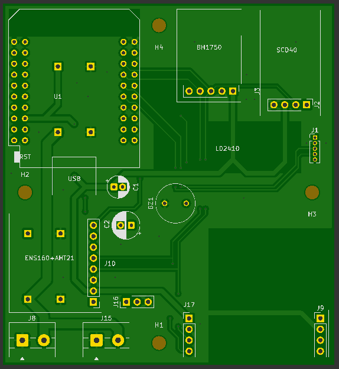
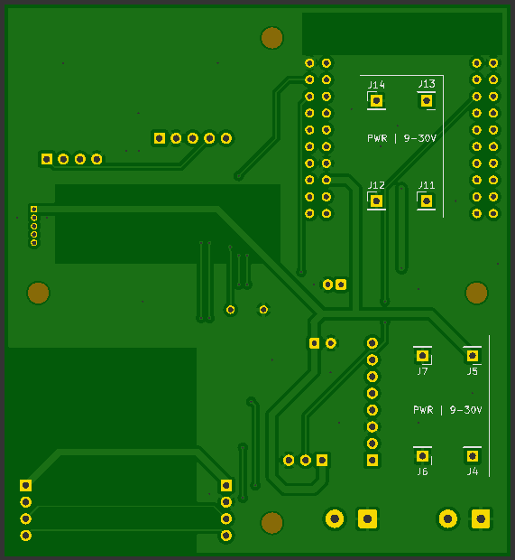
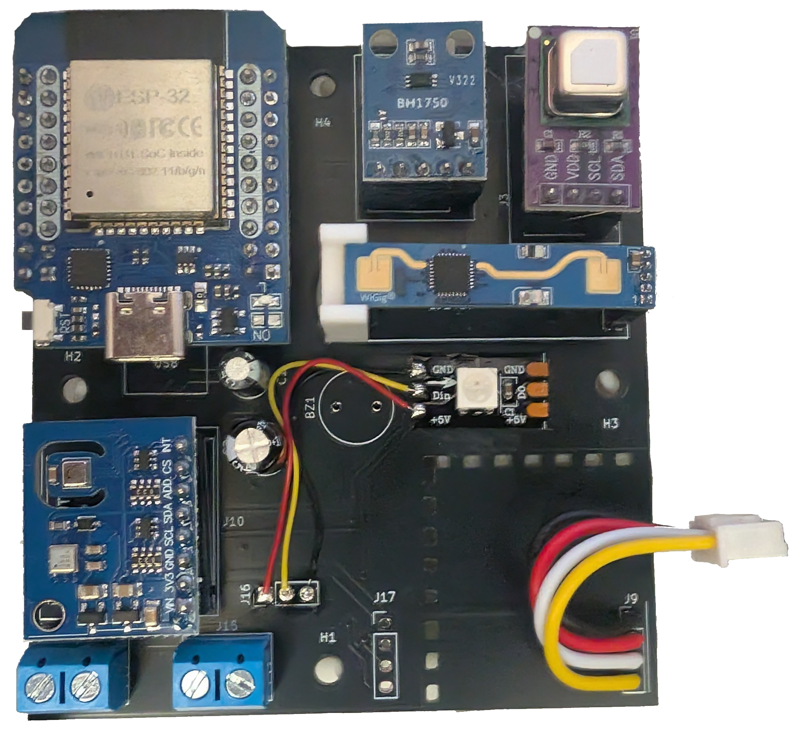

# Die Platine

Auf dieser Seite steht, wie die erste Platine für **Hypha Home - Sens** aufgebaut ist, welche Überlegungen dahinterstecken und welche Mängel sie hat.

> [!WARNING]
> **Diese Platinenversion wird nicht zum Nachbau empfohlen.**
> Sie hat einige Mängel (siehe [Warum kein Nachbau?](#warum-kein-nachbau)). Eine überarbeitete Version ist in Arbeit.
> Wenn du das Gerät nachbauen möchtest, warte bitte auf die neue Version.

| Oberseite | Unterseite |
|:---:|:---:|
|  |  |

| Platine Bestückt |
|:---:|
|  |

## Auf einen Blick

| | |
|---|---|
| **Abmessungen** | ca. 77 × 84 mm, zwei Lagen, 1,6 mm dick |
| **Controller** | ESP32 im Wemos-D1-Mini-Format (Steckplatz mit Stiftleisten) |
| **Spannungsversorgung** | 9 bis 30 V DC über Schraubklemmen, Regelung auf 5 V und 3,3 V |
| **Sensoren** | BH1750, SCD40, ENS160 + AHT21, LD2410 (alle auf der Platine), SHT41 (außerhalb des Gehäuses) |
| **Aufbau** | Alle Bauteile werden über Stiftleisten gesteckt, kein SMD-Löten nötig |
| **Befestigung** | 4 Montagelöcher für M3-Schrauben |
| **Entwurf** | KiCad, Dateien unter [`hardware/Hypha Home - Sens - Rev.1`](../../hardware/Hypha%20Home%20-%20Sens%20-%20Rev.1) |

## Warum kein Nachbau?

Die Platine ist als Prototyp gedacht und hat Schwächen, die sich nicht sauber durch Umlöten beheben lassen. Wer sie nachbaut, muss mit Einschränkungen und Notlösungen leben. Das ist die Übersicht:

| Bereich | Zustand | Was ist das Problem? |
|---|---|---|
| **Summer** | nicht nutzbar | Der eingeplante Summer ist ein *aktiver* Summer. Der ESP32 kann ihn nicht sauber betreiben, dafür ist eine andere Schaltung nötig. Der Summer wird **nicht bestückt**, der Alarmton entfällt. |
| **Adressierbare LED** | nur mit Drähten | Die LED sollte ursprünglich außerhalb des Geräts sitzen. Inzwischen sitzt sie auf der Platine, aber dafür war kein Platz vorgesehen. Sie muss deshalb **mit Drähten angeschlossen** werden. |
| **Kupferfreie Fläche rechts** | Experiment | Ein Prototypversuch. Ob er die Wärmestrahlung wirklich von den Sensoren fernhält, ist noch nicht belegt. |

Wer diese Version nachbaut, bekommt also ein Board mit einer Funktion weniger und einer Notlösung für die LED. Die neue Version soll beides beheben.

## Wie die Platine aufgeteilt ist

Die Leitfrage beim Layout war: **Wie halte ich die Wärme der Elektronik von den Sensoren fern?** Besonders empfindlich ist der Temperatursensor. Wenn sich das Gerät im Gehäuse selbst aufheizt, zeigt der Sensor zu viel an.

Deshalb gilt:

- **Wärmequellen liegen oben und links.** Dort sitzen der ESP32, die Spannungswandler, die Netzteilklemmen und die Kondensatoren. Auch der ENS160 liegt links, weil seine Messzelle beheizt wird.
- **Empfindliche Sensoren liegen rechts**, möglichst weit weg von diesen Wärmequellen: BH1750 (Licht), SCD40 (CO₂) und der Radarsensor LD2410.
- **Der SHT41 sitzt absichtlich nicht auf der Platine.** Er wird über ein kurzes Kabel *außerhalb des Gehäuses* angebracht. So kann ihn die Eigenerwärmung des Geräts nicht verfälschen. Die Platine hat dafür zwei Anschlüsse (`J9`, `J17`).

### Die kupferfreie Fläche

Rechts auf der Platine ist eine Fläche bewusst **ohne Kupfer** geblieben. Das ist ein Prototypversuch: Kupfer leitet Wärme sehr gut. Ohne Kupfer soll weniger Wärme in Richtung der Sensoren wandern. Ob das etwas bringt, wird sich im Betrieb zeigen. Die neue Version soll auf diesen Erfahrungen aufbauen.

## Alles auf Stiftleisten

Alle Bauteile sind für **Stiftleisten** geplant, also gesteckt statt aufgelötet.

| Vorteile | Nachteile |
|---|---|
| Einfach zu löten, auch ohne SMD-Erfahrung | Die Platine wird größer |
| Defekte oder falsche Module lassen sich tauschen | Mehr Steckverbindungen, die sich lösen können |
| Sensoren können später gegen bessere ausgetauscht werden | Höhere Aufbauhöhe |

## Anschlüsse

| Bezeichnung | Funktion |
|---|---|
| `J8`, `J15` | Versorgung 9 bis 30 V DC (Schraubklemmen, GND und +VDC) |
| `J4` bis `J7` | Anschlusspunkte (Einzelpins) für das Wandlermodul 9–30 V → 5 V |
| `J11` bis `J14` | Anschlusspunkte (Einzelpins) für das Wandlermodul 9–30 V → 3,3 V |
| `J1` | LD2410 (5 Pins, Raster 1,27 mm): 5 V, GND, RX, TX |
| `J2` | SCD40: SDA, SCL, 3,3 V, GND |
| `J3` | BH1750: 3,3 V, GND, SCL, SDA |
| `J10` | ENS160 + AHT21 (8 Pins): 3,3 V, GND, SCL, SDA, Interrupt des ENS160 |
| `J9`, `J17` | SHT41 (4 Pins): 3,3 V, GND, SCL, SDA |
| `J16` | Adressierbare LED: 5 V, Datenleitung, GND |
| `BZ1` | Summer (**nicht bestücken**) |

Der I²C-Bus (SDA, SCL) wird von allen Sensoren außer dem LD2410 gemeinsam genutzt. Der LD2410 hängt an einer seriellen Schnittstelle (RX, TX). Die zugehörigen Pins am ESP32 stehen in [`pinmapping.h`](../../firmware/src/pinmapping.h).

## Wie geht es weiter?

Eine **neue Platinenversion ist in Arbeit.** Sie soll die genannten Mängel beheben. Sobald sie fertig und getestet ist, kommt sie hier als empfohlene Version dazu.

Wenn du die Entwicklung verfolgen willst, schau gelegentlich in dieses Repository.

Zurück zur [Startseite](../../README.md) · [Firmware-Dokumentation](../firmware/README.md)
