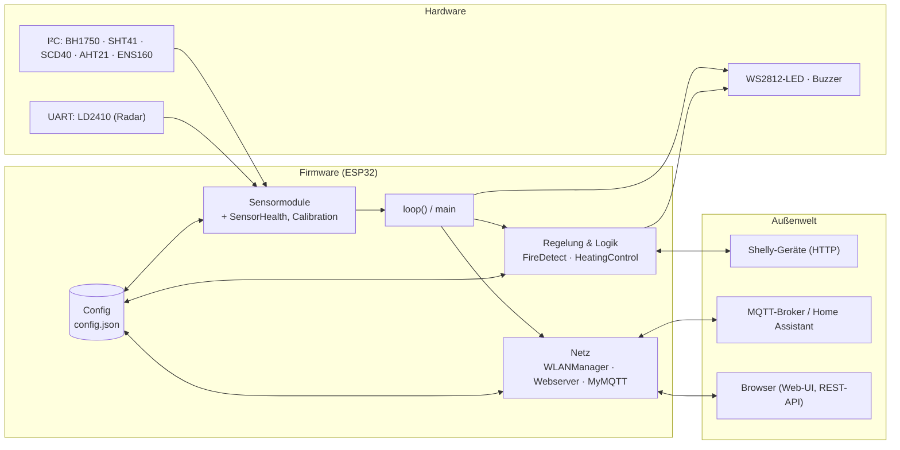

# Firmware-Dokumentation – Hypha Home - Sens (ESP32)

Dokumentation des Quelltextes in `firmware/`. Stand: Firmware **1.0.0**, Quelltext vom 25.10.2026.

## Wo anfangen?

| Ich möchte … | Dann lesen |
|---|---|
| verstehen, **wie alles zusammenhängt** | [Architektur](architektur.md): Systemkontext, Modulabhängigkeiten, Start, Hauptschleife, Datenfluss, Flash-Layout |
| ein **bestimmtes Modul** nachschlagen | [Modulübersicht](module/README.md) |
| wissen, wie **gebaut und geflasht** wird | [Build-System](module/build-system.md) |
| die **REST-Schnittstelle** nutzen | [Webinterface](module/webinterface.md) |
| **Home Assistant / MQTT** anbinden | [MyMQTT](module/mqtt.md) |
| sehen, **was im Code noch zu prüfen ist** | [Auffälligkeiten](auffaelligkeiten.md) |

## Das Ganze in einem Bild

Die Pfeile stehen für den Datenfluss; Details und die Unterteilung nach Tasks stehen in der [Architektur](architektur.md).

## Inhalt

### Übergreifend

- [Architektur](architektur.md)
- [Auffälligkeiten](auffaelligkeiten.md)
- [Modulübersicht](module/README.md)

### Module (kurz)

| Bereich | Seiten |
|---|---|
| Programmablauf | [main](module/main.md), [Config](module/config.md), [Runtime](module/runtime.md), [BuildInfo](module/build-info.md) |
| Sensoren | [BH1750](module/bh1750.md) · [SHT41](module/sht41.md) · [SCD40](module/scd40.md) · [AHT21](module/aht21.md) · [ENS160](module/ens160.md) · [LD2410](module/ld2410.md) |
| Sensor-Hilfen | [SensorHealth](module/sensor-health.md), [Calibration](module/calibration.md) |
| Logik und Ausgabe | [FireDetect](module/fire-detect.md), [HeatingControl](module/heating-control.md), [Shelly](module/shelly.md), [LED](module/led.md), [Beeper](module/beeper.md) |
| Netzwerk | [WLANManager + FastWebServer](module/wlan-manager.md), [Webinterface (API)](module/webinterface.md), [Webfiles](module/webfiles.md), [MyMQTT](module/mqtt.md) |
| Sicherheit und Updates | [Session](module/session.md), [PasswordReset](module/password-reset.md), [UiUpdate](module/ui-update.md), [FirmwareUpdate](module/firmware-update.md) |
| Bauen | [Build-System](module/build-system.md) |

## Schreibweisen in dieser Dokumentation

- Diagramme sind **Mermaid** und werden von GitHub, GitLab und den meisten Markdown-Editoren direkt dargestellt.
- `Namespace::funktion()` bezeichnet eine Funktion eines Moduls (fast alle Module sind Namespaces, keine Klassen).
- „Task“ meint einen FreeRTOS-Task. `loop()` läuft im Task `loopTask` (Arduino).
- Die Oberfläche (HTML/JS in `data/`) ist **nicht** Gegenstand dieser Dokumentation, nur der Weg, wie die Firmware sie ausliefert.
