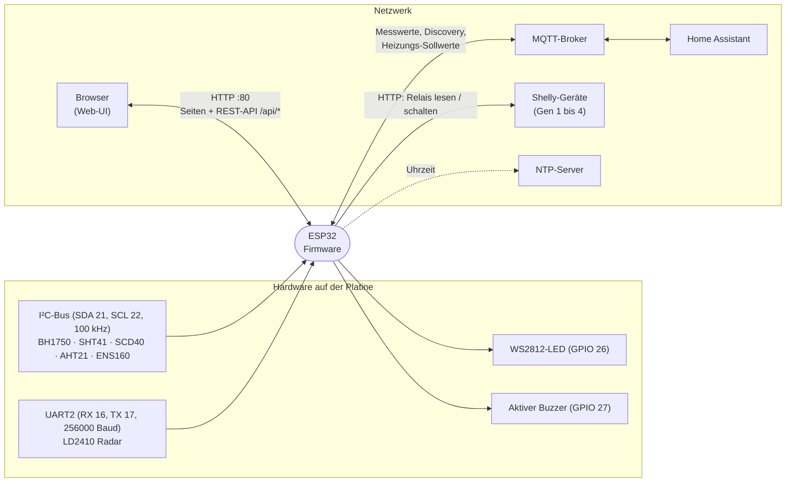
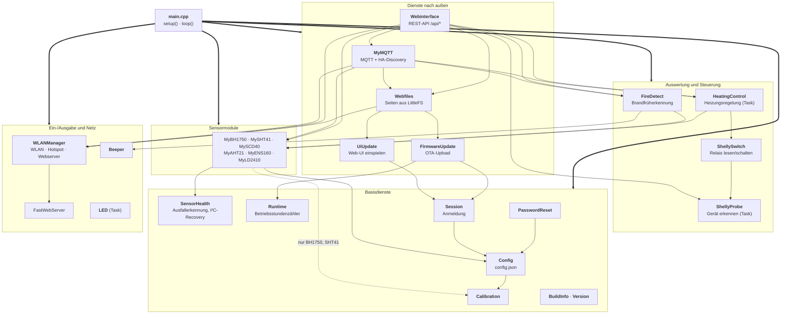
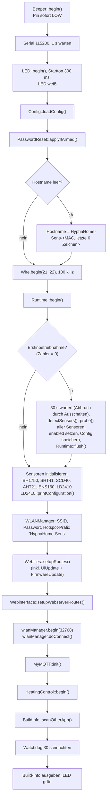
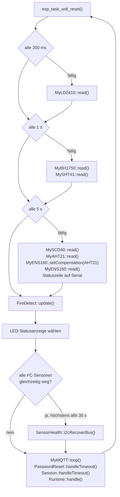
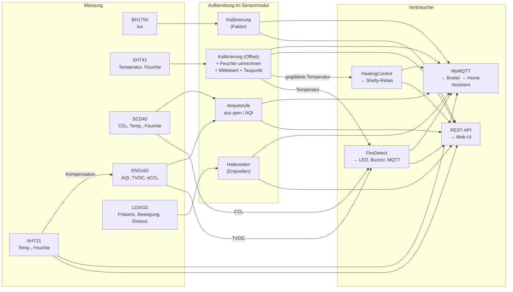
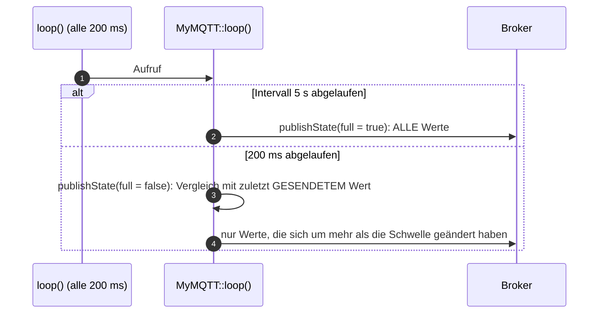
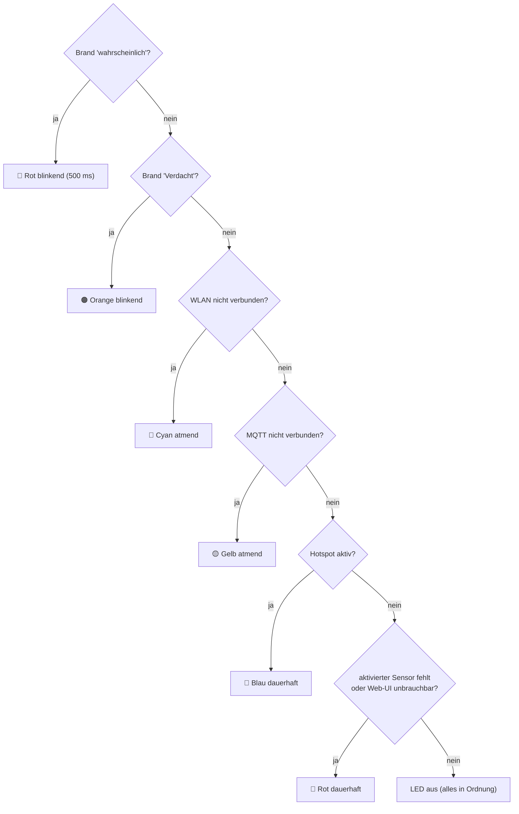
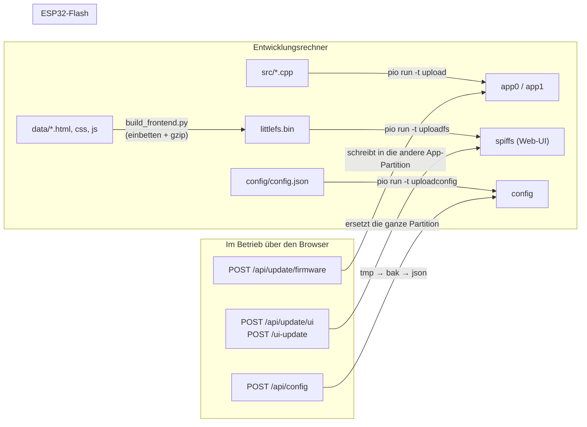

# Architektur der Firmware

Diese Seite zeigt, wie die Module der Firmware zusammenhängen. Die Details zu jedem Modul stehen in
[`module/`](module/README.md). Alle Diagramme sind [Mermaid](https://mermaid.js.org/) und werden von
GitHub direkt dargestellt.

**Inhalt**

1. [Systemkontext](#1-systemkontext)
2. [Modulübersicht und Abhängigkeiten](#2-modulübersicht-und-abhängigkeiten)
3. [Start des Geräts (`setup()`)](#3-start-des-geräts-setup)
4. [Laufzeit: `loop()` und Tasks](#4-laufzeit-loop-und-tasks)
5. [Datenfluss der Messwerte](#5-datenfluss-der-messwerte)
6. [Statusanzeige (LED)](#6-statusanzeige-led)
7. [Flash-Aufteilung und Updates](#7-flash-aufteilung-und-updates)
8. [Gemeinsame Konventionen im Code](#8-gemeinsame-konventionen-im-code)

---

## 1. Systemkontext

Das Gerät misst Licht, Temperatur, Luftfeuchte, CO₂, Luftqualität und Präsenz. Die Werte gehen per MQTT an
Home Assistant und stehen in einer eigenen Weboberfläche. Optional schaltet das Gerät über Shelly-Aktoren eine
Heizung.

Ist kein WLAN erreichbar, öffnet das Gerät selbst ein Netz („Hotspot“, `192.168.4.1`), damit die Konfiguration
immer möglich bleibt (siehe [WLANManager](module/wlan-manager.md)).

---

## 2. Modulübersicht und Abhängigkeiten

Die Pfeile bedeuten „ruft auf bzw. liest Werte von“. Gezeichnet sind die tatsächlichen `#include`-Beziehungen und
Aufrufe aus dem Quellcode; mehrere gleichartige Module sind zusammengefasst.

> **Lesehilfe:** Dicke Pfeile von `main.cpp` stehen für „ruft alle Module der Gruppe auf“ (`setup()` initialisiert, `loop()` ruft sie im Takt auf).
> Zur besseren Lesbarkeit fehlen bewusst die Pfeile **zu `Config`**, die fast jedes Modul hat, sowie die von `Webinterface` zu `Session`,
> `PasswordReset`, `Runtime` und `BuildInfo` (die API liest deren Werte bzw. löst sie aus).

Wichtige Regeln, die man an der Grafik ablesen kann:

- **Sensormodule kennen weder MQTT noch das Web.** Sie sind reine Datenquellen: Sie halten ihre Messwerte als
  öffentliche Variablen (`MyBH1750::lux`, `MySHT41::temperature`, …) und ein `isConnected`-Flag. Wer die Werte
  braucht, liest sie dort (Pull). Es gibt keine Callbacks.
- **`Config` ist die einzige Quelle für Einstellungen.** Alle Module lesen `Config::sensors`, `Config::mqtt`
  usw. direkt. Die Datei `config.json` wird nur beim Start gelesen und beim Speichern geschrieben.
- **Es gibt drei Konsumenten der Messwerte:** MQTT, die REST-API und die beiden Auswertungen
  (FireDetect, HeatingControl).

---

## 3. Start des Geräts (`setup()`)

Die Reihenfolge ist an mehreren Stellen bewusst gewählt:

| Schritt | Grund |
|---|---|
| `Beeper::begin()` zuerst | Der Buzzer-Pin muss sofort auf LOW, sonst piept es beim Start. |
| `PasswordReset::applyIfArmed()` direkt nach `loadConfig()` | `loadConfig()` würde ein gelöschtes Passwort sonst wieder einlesen. Es muss vor dem automatischen Hostnamen laufen, weil es `saveConfig()` aufruft und der Auto-Name sonst mitgespeichert würde. |
| `Runtime::begin()` vor den Sensor-`init()` | Nur so weiß `setup()`, ob es die Erstinbetriebnahme ist und erst die Sensoren gesucht werden müssen. |
| Routen werden vor `wlanManager.begin()` angelegt | Der Webserver startet erst, wenn die Verbindung (oder der Hotspot) steht; die Routen müssen dann schon da sein. |
| Watchdog am Ende | `setup()` kann durch Sensor-Init (SCD40: 500 ms Pause) und die Erstinbetriebnahme (30 s) lange dauern. |

---

## 4. Laufzeit: `loop()` und Tasks

### Die Hauptschleife

`loop()` läuft ohne Pause und teilt die Arbeit nach Zeitintervallen auf. Die Sensoren sind nach Messrate
in drei Gruppen eingeteilt:

Warum drei Gruppen? Der LD2410 liefert schnelle Ereignisse (Präsenz), Licht und Temperatur sollen
sekundengenau sein, und CO₂/AQI ändern sich langsam (der SCD40 misst ohnehin nur alle 5 s). Der ENS160 bekommt vor
jedem Lesen Temperatur und Feuchte des AHT21 zur Kompensation.

### Tasks (FreeRTOS)

Neben der Arduino-`loop()` laufen weitere Tasks. Das ist wichtig, weil sie auf gemeinsame Variablen zugreifen.

| Task | Gestartet von | Priorität | Stack | Aufgabe |
|---|---|---|---|---|
| Arduino `loopTask` | Arduino-Core | 1 | Standard | `setup()` und `loop()` (siehe oben), **inklusive MQTT** |
| `WLANMGT_loop` | `wlanManager.begin(32768)` | 2 | 32 KB, Core 1 | WLAN-Verbindung, Hotspot, DNS, **Webserver mit allen Seiten und der REST-API** |
| `LED` | `LED::begin()` | 1 | 3 KB, Core 1 | Effekte der WS2812 (Blinken, Atmen), Takt 20 ms |
| `heating` | `HeatingControl::begin()` | 1 | 8 KB | Regelung und Abgleich der Shelly-Kanäle (Takt 1 s) |
| `shellyProbe` | `ShellyProbe::request()` | 1 | 8 KB | Einmalige Geräteerkennung; beendet sich danach selbst |
| LD2410-Lesetask | Bibliothek (`radar.autoReadTask()`) | – | – | Liest den UART-Puffer des Radars dauernd leer |
| `esp_timer` „beep“ | `Beeper::beepAsync()` | – | – | Schaltet den Buzzer nach Ablauf wieder aus |

Folgen für den Code:

- Die **REST-API läuft im Task `WLANMGT_loop`**, die Sensoren und MQTT im `loopTask`. Die API liest also Sensorwerte,
  während `loop()` sie schreibt. Die Werte sind einfache Zahlen (`float`, `bool`); es gibt dafür keine Sperren.
- Wo Zustand sicher zwischen Tasks wechseln muss, wird er über **Flags oder Kopien** übergeben:
  `MyMQTT::requestReconnect()` / `requestHeatingSync()` setzen nur ein `volatile`-Flag, das MQTT-`loop()` abarbeitet
  („der MQTT-Client gehört dem Loop-Task“). `HeatingControl::status()` liefert eine Kopie unter einer Spinlock-Sperre.
- **Blockierende Aufrufe** (Shelly-HTTP, WLAN-Scan) gehören nicht in `loop()` oder in einen Webserver-Handler.
  Deshalb gibt es die Tasks `heating` und `shellyProbe`; der WLAN-Scan läuft asynchron (`scanNetworks(true)`).
- Der **Watchdog** (30 s) überwacht nur den `loopTask`. Die 30 s sind so gewählt, weil ein hängender MQTT-Connect
  (Timeout 15 s) die Schleife blockieren kann.

---

## 5. Datenfluss der Messwerte

Zwei Details, die man leicht übersieht:

- Per MQTT geht die **geglättete** SHT41-Temperatur hinaus (`temperatureSmoothed`), und die Heizung regelt
  ebenfalls auf diesem Wert. Die FireDetect-Auswertung nimmt dagegen den **kalibrierten Einzelwert**
  (`temperatureCalibrated`), weil sie selbst auf Anstiege achtet.
- Der AHT21 ist kein eigenständiger „Raumsensor“: Er sitzt auf demselben Modul wie der ENS160 und liefert dessen
  Kompensationswerte. Seine Temperatur ist wegen der ENS160-Heizung leicht erhöht (in Home Assistant standardmäßig
  deaktiviert).

### Weg eines MQTT-Wertes

Der volle Durchlauf alle 5 s sorgt dafür, dass Home Assistant auch unveränderte Werte regelmäßig sieht. Der schnelle
Durchlauf dazwischen meldet Änderungen (zum Beispiel Präsenz) fast sofort. Mehr dazu in [MyMQTT](module/mqtt.md).

---

## 6. Statusanzeige (LED)

`loop()` wählt die LED-Farbe nach dieser Rangfolge – der erste zutreffende Punkt gewinnt:

Beim Start leuchtet die LED weiß, nach dem Ende von `setup()` grün, bis `loop()` sie übernimmt.
Der LD2410 zählt bei „Sensor fehlt“ nicht mit (er hängt am UART, nicht am I²C-Bus).

> Hinweis: Im Hotspot-Betrieb ist `WiFi.status()` meist nicht `WL_CONNECTED`; dann greift schon der
> Cyan-Zweig. Siehe [Auffälligkeiten](auffaelligkeiten.md).

---

## 7. Flash-Aufteilung und Updates

Der ESP32 hat 4 MB Flash. Die Partitionstabelle (`firmware/partitions.csv`) entspricht dem Arduino-Standard,
nur ist das Dateisystem in **zwei** Teile geteilt: Konfiguration und Web-UI.

| Partition | Typ | Offset | Größe | Inhalt |
|---|---|---|---|---|
| `nvs` | data/nvs | `0x9000` | 20 KB | Zähler „Betriebszeit“ (`Runtime`), Flag „Passwort-Reset freigegeben“ |
| `otadata` | data/ota | `0xE000` | 8 KB | Merker, welche App-Partition startet |
| `app0` | app/ota_0 | `0x10000` | 1,25 MB | Firmware (Platz A) |
| `app1` | app/ota_1 | `0x150000` | 1,25 MB | Firmware (Platz B) |
| `config` | data/spiffs | `0x290000` | 200 KB | LittleFS mit **nur** `config.json` (+ `.bak`, `.tmp`) |
| `spiffs` | data/spiffs | `0x2C2000` | ≈ 1,18 MiB (0x12E000) | LittleFS mit der **Web-UI** (HTML/CSS/JS, gzip) |
| `coredump` | data/coredump | `0x3F0000` | 64 KB | Absturzprotokoll |

Beide Dateisysteme haben den Typ `spiffs`, weil die LittleFS-Bibliothek des Arduino-Cores nur diesen kennt.
`pio run -t uploadfs` nimmt die **letzte** Dateisystem-Partition der Tabelle – deshalb steht die Web-UI hinter der
Konfiguration und die Reihenfolge darf nicht vertauscht werden.

Details zu den drei Wegen: [FirmwareUpdate](module/firmware-update.md), [UiUpdate](module/ui-update.md),
[Config](module/config.md), [Build-System](module/build-system.md).

---

## 8. Gemeinsame Konventionen im Code

| Konvention | Bedeutung |
|---|---|
| **Namespaces statt Klassen** | Fast jedes Modul ist ein `namespace` mit statischem Zustand (`MyBH1750::lux`). Es gibt genau eine Instanz, keine Objekte zum Herumreichen. Ausnahme: `WLANManager` (Klasse, globales Objekt `wlanManager`) und `FastWebServer`. |
| **`init()` / `read()` / `probe()`** | Jedes Sensormodul bietet dieselben drei Funktionen: `init()` einmal in `setup()`, `read()` zyklisch aus `loop()`, `probe()` ohne Initialisierung für die Erstinbetriebnahme. |
| **`isConnected`** | Pro Sensor ein öffentliches Flag. Es wird nicht bei einem einzelnen Fehlschlag gelöscht, sondern erst nach 10 s ohne gültige Antwort ([SensorHealth](module/sensor-health.md)). |
| **`enabled` ≠ `isConnected`** | `enabled` ist die Einstellung (Config), `isConnected` der Zustand. Ein aktivierter, aber fehlender Sensor wird nur als „nicht verbunden“ gemeldet und regelmäßig neu gesucht. |
| **Selbstheilung** | Fehlt ein Sensor, versucht `read()` in Abständen (15 s, SCD40: 30 s), ihn per Ping wiederzufinden und neu zu starten. |
| **Fehlerwerte** | Bei einem Lesefehler bleibt der letzte gültige Wert stehen; wer den Wert verwendet, prüft vorher `isConnected`. |
| **Flash schonen** | Schreibzugriffe werden gesammelt: Betriebszeit höchstens alle 60 s, per MQTT geänderte Heizungswerte erst nach 3 s Ruhe, LD2410-Gates nur bei Abweichung. |
| **Texte** | Logausgaben auf `Serial` mit `[MODUL]`-Präfix, auf Deutsch. API-Fehler sind Schlüssel in Großbuchstaben (`NOT_AUTHENTICATED`), die die Web-UI selbst übersetzt. |
| **Kopfzeile jeder Datei** | `File / Author / Year / Last modified`. Doxygen-Kommentare (`/// @brief`) stehen an den Funktionen. |

Weiter: [Modulübersicht](module/README.md) · [Auffälligkeiten](auffaelligkeiten.md)
