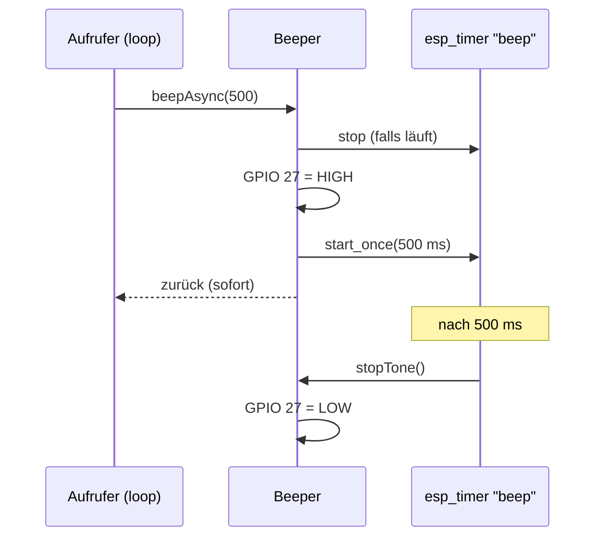

# Beeper – Summer

**Dateien:** `src/Beeper.cpp`, `src/Beeper.h` · **Namespace:** `Beeper`
**Hardware:** aktiver Buzzer an `GPIO 27` (`PIN_BEEP` in `pinmapping.h`)

## Zweck

Gibt kurze Signaltöne aus: einen Startton beim Hochfahren und das Warnsignal der [Brandfrüherkennung](fire-detect.md). Der Buzzer ist
**aktiv**, enthält also seinen eigenen Oszillator. Der Pin wird nur auf HIGH (Ton) oder LOW (still) geschaltet. Es gibt keine
Tonhöhe und keine PWM.

## Öffentliche Schnittstelle

| Funktion | Beschreibung |
|---|---|
| `begin()` | Pin als Ausgang, LOW |
| `beep(durationMs = 80)` | Ton ausgeben und **warten**, bis er zu Ende ist (blockiert den aufrufenden Task für `durationMs`) |
| `beepAsync(durationMs = 500)` | Ton starten und **sofort zurückkehren**. Ein Zeitgeber schaltet ihn aus |

## Funktionsweise

- `beep()` nutzt `delay()`. Es taugt für den Startton in `setup()` (300 ms), wo das Blockieren nichts stört.
- `beepAsync()` ist für wiederkehrende Signale aus `loop()` gedacht, die nichts aufhalten dürfen. Der `esp_timer` wird beim ersten
  Aufruf angelegt (`esp_timer_create`). Läuft noch ein Ton, wird sein Ende **verschoben** (`esp_timer_stop`, dann neu starten), er
  wird also nicht abgeschnitten und nicht verdoppelt.
- Der Ausschalt-Callback läuft im Zeitgeber-Task von ESP-IDF.

## Verwendung

| Aufrufer | Zweck |
|---|---|
| [main](main.md) | `beep()` als Startton (Dauer 300 ms) |
| [FireDetect](fire-detect.md) | `beepAsync(FIRE_BEEP_MS)` im Takt des Alarms (Verdacht/wahrscheinlich/Test) |

## Besonderheiten

- `beepAsync()` und `beep()` setzen den Pin jedes Mal erneut auf `OUTPUT`. Das ist harmlos, macht die Aufrufe aber unabhängig von
  `begin()`.
- Die Rückfallwerte `PIN_BEEP 1` in `Beeper.h` gelten nur, wenn `pinmapping.h` nicht eingebunden wäre; sie sind in der Praxis
  nicht wirksam.
- Ein Stummschalten per Konfiguration gibt es nicht. Wer den Summer nicht will, schaltet die Brandfrüherkennung ab
  (`system.fireDetection`) oder lässt den Buzzer unbestückt.

## Siehe auch

[LED](led.md) · [FireDetect](fire-detect.md)
