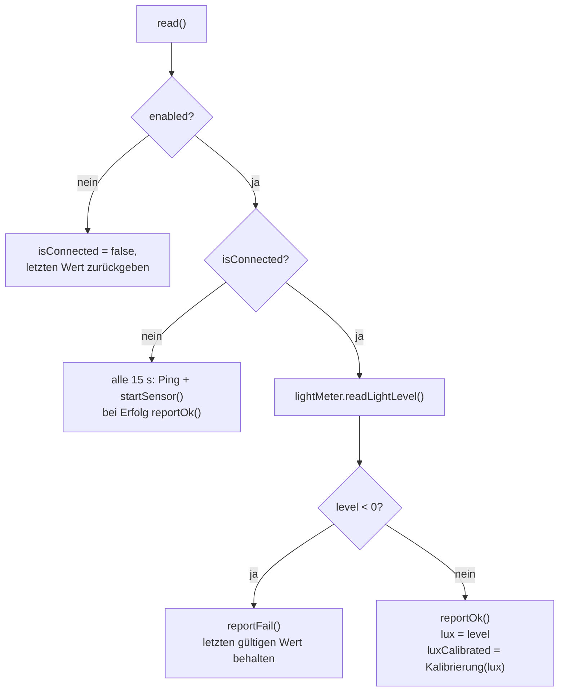

# MyBH1750 – Helligkeitssensor

**Dateien:** `src/MyBH1750.cpp`, `src/MyBH1750.h` · **Namespace:** `MyBH1750`
**Sensor:** BH1750 · **Anschluss:** I²C, Adresse `0x23` (`0x5C`, wenn der ADDR-Pin auf High liegt)
**Bibliothek:** `claws/BH1750`

## Zweck

Misst die Beleuchtungsstärke in Lux. Der Rohwert kann über eine [Kalibrierung](calibration.md) korrigiert werden, etwa
wenn eine getönte Gehäusescheibe einen festen Anteil des Lichts schluckt.

## Öffentliche Schnittstelle

| Element | Typ | Beschreibung |
|---|---|---|
| `BH1750_ADDRESS` | Makro | `0x23` |
| `lightMeter` | `BH1750` | Die Treiberinstanz |
| `isConnected` | `bool` | Sensor antwortet |
| `lux` | `float` | Rohwert in lx |
| `luxCalibrated` | `float` | Mit der Kalibrierung korrigierter Wert in lx (nie negativ) |
| `init()` | Funktion | Startet den Sensor, wenn `Config::sensors.bh1750.enabled` |
| `read(bool print = true)` | Funktion | Liest den Sensor; gibt `luxCalibrated` zurück |
| `probe()` | Funktion | Ping der Adresse, ohne Initialisierung (Erstinbetriebnahme) |

## Funktionsweise

- **Start (`startSensor`)**: Dauermessmodus `CONTINUOUS_HIGH_RES_MODE`, danach `setMTreg(254)`. 254 ist der Höchstwert des
  Messzeitregisters (Standard 69): längere Messzeit und höhere Empfindlichkeit bei wenig Licht; laut Datenblatt sinkt
  dadurch der maximal messbare Wert.
- **Fehler** meldet die Bibliothek über negative Rückgabewerte: `-1.0` = I²C-Lesefehler, `-2.0` = Sensor nicht
  konfiguriert. Beide zählen als Fehlschlag; erst nach 10 s ohne gültigen Wert gilt der Sensor als fehlend
  ([SensorHealth](sensor-health.md)).
- **Kalibrierung**: `Calibration::apply(table, raw, Fallback::Factor)`. Mit einem einzigen Punkt wird also gekippt
  (Null bleibt Null). Das Ergebnis wird auf mindestens 0 begrenzt.
- **Serielle Ausgabe** (`print = true`): `Licht: 123.4 lx`; der Rohwert steht nur dazu, wenn die Kalibrierung ihn
  verändert hat. Im normalen Betrieb ruft `loop()` mit `print = false` auf.

## Konfiguration

| Einstellung | Bedeutung |
|---|---|
| `sensors.bh1750.enabled` | Sensor ein/aus. Aus = kein Zugriff auf den Bus |
| `sensors.bh1750.luxCalibration` | Bis zu 8 Punkte `{measured, reference}` in lx |

## Verwendung der Werte

| Verbraucher | Wert |
|---|---|
| [MyMQTT](mqtt.md) | `…/bh1750/lux` (kalibriert), `…/bh1750/lux_raw`; Verfügbarkeit `…/bh1750/available` |
| [Webinterface](webinterface.md) | `GET /api/sensors` → `bh1750` |

Gelesen wird in `loop()` im **1-s-Takt**.

## Besonderheiten

- Per MQTT geht der **kalibrierte** Wert hinaus: Home Assistant soll den Wert bekommen, auf den das Gerät eingemessen
  wurde.
- Das spätere Lichtsteuerungs-Feature (`controls.light`) ist in der Konfiguration vorbereitet, hat im Code aber noch
  keine Regelung.

## Siehe auch

[SensorHealth](sensor-health.md) · [Calibration](calibration.md) · [Config](config.md)
