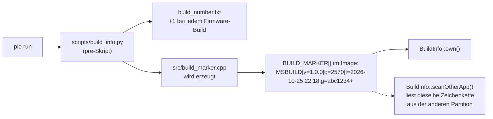
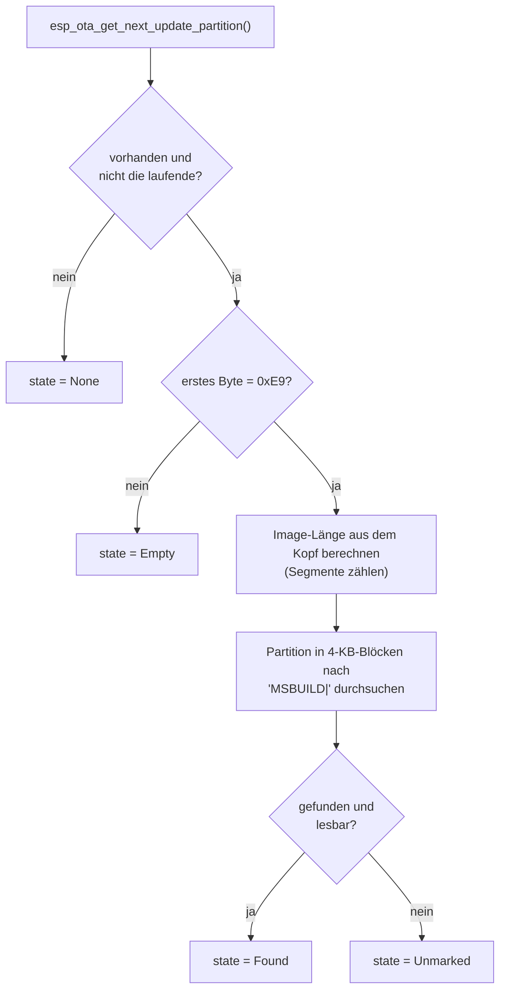

# BuildInfo und Version – Kennung der Firmware

**Dateien:** `src/BuildInfo.cpp`, `src/BuildInfo.h`, `src/version.cpp`, `src/version.h`, `src/build_marker.cpp`
(erzeugt) · **Namespace:** `BuildInfo`, Struktur `Version`

## Zweck

- **`Version`** ist eine kleine Struktur `major.minor.patch` mit Vergleichsoperatoren. Sie dient dem Vergleich der
  Firmwareversion mit den Versionsangaben der Web-UI ([Webfiles](webfiles.md)) und der Anzeige.
- **`BuildInfo`** kennt die **Kennung des laufenden Builds** (Version, Build-Nummer, Zeitpunkt, Git-Stand) und liest die
  Kennung der Firmware auf der **anderen OTA-Partition** aus. Die Web-UI zeigt damit an, was auf dem zweiten
  Firmware-Platz liegt und ob ein Zurückwechseln möglich ist.

## Version (`version.h`)

| Element | Beschreibung |
|---|---|
| `uint8_t major, minor, patch` | Die drei Zahlen |
| `static Version parse(const String&)` | Liest `"1.10.4"`. Fehlt der erste Punkt, ist das Ergebnis `0.0.0` |
| `String toString() const` | `"1.10.4"` |
| `>`, `<`, `>=`, `<=`, `==`, `!=` | Vergleich nach major, dann minor, dann patch |

Die Firmwareversion ist das Makro `VERSION` in `config.h` (von Hand hochgezählt) und als `Config::version` verfügbar.

## BuildInfo (`BuildInfo.h`)

| Element | Beschreibung |
|---|---|
| `struct Info { version[16]; build; time[20]; git[16]; }` | Kennung eines Builds |
| `const Info& own()` | Kennung der laufenden Firmware (beim ersten Aufruf aus `BUILD_MARKER` gelesen) |
| `void scanOtherApp()` | Durchsucht die andere App-Partition **einmal** nach ihrer Kennung (einige 100 ms). Ein zweiter Aufruf tut nichts |
| `const Other& other()` | Ergebnis; vor dem Scan ist `state == Pending` |
| `enum OtherState { Pending, None, Empty, Unmarked, Found }` | Zustand der anderen Partition |
| `struct Other { state; label; imageSize; partitionSize; info; }` | Ergebnis des Scans |

| `OtherState` | Bedeutung |
|---|---|
| `Pending` | Noch nicht gesucht |
| `None` | Die Partitionstabelle hat keinen zweiten App-Platz |
| `Empty` | Dort liegt keine Firmware (erstes Byte ist nicht `0xE9`) |
| `Unmarked` | Firmware ohne Kennung (gebaut vor Einführung der Kennung) |
| `Found` | Kennung gefunden, `info` ist gültig |

## Funktionsweise

### Woher kommt die Kennung?

Das Format ist `MSBUILD|v=<Version>|b=<Build>|t=<Zeit>|g=<Git>`. Die Git-Angabe ist der kurze Commit-Hash, mit
angehängtem `+`, wenn es nicht eingecheckte Änderungen gab. `unbekannt` steht dort, wenn Git nicht lesbar ist.
`build_marker.cpp` ist **erzeugt** und nicht von Hand zu ändern; `VERSION` setzt der Compiler selbst ein.

Hochgezählt wird nur beim Bauen der Firmware (`pio run`, `pio run -t upload`), nicht bei Dateisystem-Abbild, Aufräumen
oder IntelliSense-Abfragen.

### Warum nicht die App-Beschreibung des ESP-IDF?

Die Beschreibung (`esp_app_desc_t`) stammt aus der vorkompilierten Arduino-Bibliothek und ist in jedem Build gleich.
Deshalb legt `build_info.py` eine eigene Zeichenkette ins Image.

### Die andere Partition durchsuchen

Zwei Kniffe im Code:

- **Der Suchanfang `MSBUILD|` steht nur verschlüsselt im Code** (XOR mit `0x5A`, Entschlüsselung über eine
  `volatile`-Variable). Stünde er im Klartext darin, fände die Suche in jedem Image zuerst diese Stelle statt der echten
  Kennung.
- Die Blöcke überlappen um die Länge von Anfang und Datensatz, damit eine Kennung über eine Blockgrenze hinweg
  vollständig im Puffer liegt.

`imageLength()` berechnet die Größe der Firmware aus dem Image-Kopf: 24 Byte Kopf, je Segment 8 Byte Kopf plus Daten,
dann Auffüllung bis zur nächsten 16er-Grenze und optional 32 Byte SHA-256.

## Wo wird es verwendet?

| Aufrufer | Zweck |
|---|---|
| `main.cpp` | `scanOtherApp()` beim Start, Ausgabe der Build-Zeile auf `Serial` |
| [Webinterface](webinterface.md) | `GET /api/dashboard` (Blöcke `firmware` und `otherApp`), `POST /api/firmware/switch` (nur wenn `Found` oder `Unmarked`) |
| [Webfiles](webfiles.md) | Vergleich `Version::parse(VERSION)` mit den Angaben in `version.json` der UI |
| [Config](config.md) | Vergleich der Dateiversion mit der Firmware (nur Log) |

## Siehe auch

[Build-System](build-system.md) · [FirmwareUpdate](firmware-update.md)
