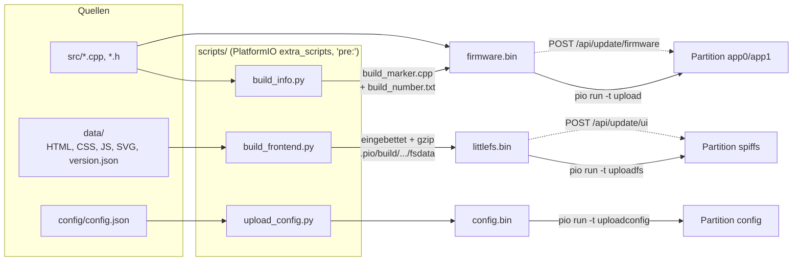

# Build-System – PlatformIO, Skripte und Partitionen

**Dateien:** `platformio.ini`, `partitions.csv`, `scripts/*.py`, `config/config.json`, `data/version.json`
**Plattform:** `espressif32`, Board `esp32dev`, Framework Arduino

Diese Seite beschreibt, wie aus dem Quelltext drei getrennte Flash-Inhalte entstehen: **Firmware**, **Web-Oberfläche** und **Konfiguration**.
Warum drei? Damit sich jede für sich aktualisieren lässt, ohne die anderen anzufassen (Aufteilung: [Architektur: Flash-Layout](../architektur.md)).

## Überblick



Durchgezogen: Weg per USB mit PlatformIO. Gestrichelt: Weg im Betrieb über das Netz ([FirmwareUpdate](firmware-update.md),
[UiUpdate](ui-update.md)).

## `platformio.ini`

| Einstellung | Wert | Bedeutung |
|---|---|---|
| `platform / board / framework` | `espressif32 / esp32dev / arduino` | 4-MB-ESP32 mit Arduino-Core |
| `board_build.filesystem` | `littlefs` | Ohne die Zeile entstünde ein SPIFFS-Abbild, die Firmware hängt aber LittleFS ein |
| `board_build.partitions` | `partitions.csv` | Eigene Tabelle mit zwei Dateisystemen und zwei App-Slots |
| `extra_scripts` | `pre:scripts/build_frontend.py`, `pre:scripts/build_info.py`, `pre:scripts/upload_config.py` | siehe unten |
| `monitor_speed` / `upload_speed` | 115200 / 921600 | Serielle Konsole / Flashgeschwindigkeit |
| `build_flags` | `-D MQTT_MAX_PACKET_SIZE=1024` | Größere MQTT-Pakete für die Discovery-Dokumente |

### Bibliotheken (`lib_deps`)

| Bibliothek | Version | Modul |
|---|---|---|
| `claws/BH1750` | ^1.3.0 | [MyBH1750](bh1750.md) |
| `adafruit/Adafruit SHT4x Library` | ^1.0.4 | [MySHT41](sht41.md) |
| `sensirion/Sensirion I2C SCD4x` | ^0.4.0 | [MySCD40](scd40.md) |
| `sciosense/ScioSense_ENS16x` | ^2.0.5 | [MyENS160](ens160.md) |
| `adafruit/Adafruit AHTX0` | ^2.0.5 | [MyAHT21](aht21.md) |
| `ncmreynolds/ld2410` | ^0.2.2 | [MyLD2410](ld2410.md) |
| `knolleary/PubSubClient` | ^2.8 | [MyMQTT](mqtt.md) |
| `bblanchon/ArduinoJson` | ^7.4.3 | [Config](config.md), [Webinterface](webinterface.md), [Shelly](shelly.md) |

Außerdem kommen Bibliotheken des Arduino-Cores zum Einsatz: `WiFi`, `WebServer`, `DNSServer`, `LittleFS`, `Preferences`, `Update`, `Wire`.

## `partitions.csv`

Wie die Standardtabelle des Arduino-Cores (`default.csv`), nur dass das Dateisystem in **zwei** Teile geteilt ist:

| Name | Typ | Offset | Größe | Inhalt |
|---|---|---|---|---|
| `nvs` | data/nvs | `0x9000` | `0x5000` (20 KiB) | Betriebszeit-Zähler, Passwort-Reset-Flag |
| `otadata` | data/ota | `0xE000` | `0x2000` (8 KiB) | Merker, welcher App-Slot startet |
| `app0` | app/ota_0 | `0x10000` | `0x140000` (1,25 MiB) | Firmware, Platz A |
| `app1` | app/ota_1 | `0x150000` | `0x140000` (1,25 MiB) | Firmware, Platz B |
| `config` | data/spiffs | `0x290000` | `0x32000` (200 KiB) | LittleFS, **nur** `config.json` (+ `.bak`, `.tmp`) |
| `spiffs` | data/spiffs | `0x2C2000` | `0x12E000` (≈ 1,18 MiB) | LittleFS, die Web-Oberfläche |
| `coredump` | data/coredump | `0x3F0000` | `0x10000` (64 KiB) | Absturzabbild |

- Beide Dateisysteme haben den Untertyp `spiffs`, weil die LittleFS-Bibliothek des Cores nur den kennt.
- **PlatformIO nimmt für `buildfs`/`uploadfs` die LETZTE Dateisystem-Partition** der Tabelle. Deshalb steht die Oberfläche hinter der
  Konfiguration. **Die Reihenfolge nicht vertauschen**, sonst überschreibt `uploadfs` die Konfiguration.

## Die Skripte

### `build_info.py` – Build-Kennung

Läuft bei jedem **Firmware**-Build (`pio run`, `pio run -t upload`; nicht bei `buildfs`, `clean` o. ä.):

1. Liest `build_number.txt` (Zähler, liegt in der Versionsverwaltung), erhöht ihn um 1 und schreibt ihn zurück.
2. Ermittelt den Git-Stand (`git rev-parse --short HEAD`, mit angehängtem `+` bei uncommitteten Änderungen; der Zähler selbst zählt nicht als Änderung).
3. Erzeugt `src/build_marker.cpp` (nicht in der Versionsverwaltung) mit der Zeichenkette

   ```
   MSBUILD|v=<VERSION>|b=<Nummer>|t=<yyyy-mm-dd hh:mm>|g=<Git>
   ```

   `VERSION` setzt der Compiler aus `config.h` ein, die Version steht also nur einmal im Quelltext.

Warum: Die `VERSION` wird von Hand hochgezählt, zwischen zwei Versionen entstehen aber viele Stände. Außerdem stammt die App-Beschreibung des
ESP-IDF aus der vorkompilierten Bibliothek und ist in jedem Build gleich. Die Firmware liest die Kennung zur Laufzeit aus dem eigenen und dem anderen
App-Slot ([BuildInfo](build-info.md)). Scheitert die Übersetzung, ist die Nummer trotzdem vergeben.

### `build_frontend.py` – Web-Oberfläche einbetten und packen

Läuft **nur**, wenn ein Dateisystem gebaut wird (`buildfs`, `uploadfs`, `uploadfsota`), nicht bei jedem Firmware-Build. Es ersetzt
`PROJECT_DATA_DIR` durch `.pio/build/<env>/fsdata`, also außerhalb der Versionsverwaltung.

**Warum es den Schritt gibt:** Der Webserver bedient eine TCP-Verbindung zugleich, und lwIP hat nur 16 Kontrollblöcke
(`CONFIG_LWIP_MAX_ACTIVE_TCP`), die nach dem Schließen noch 60 s belegt bleiben. Jede Datei einer Seite ist eine eigene Verbindung; die Startseite
mit sieben Symbolen brauchte zehn und leerte den Pool mit einem Aufruf. Danach blieben SYN-Pakete unbeantwortet, und der Browser ging in die
Rücknahme (1 s, 2 s, 4 s, 8 s). Gemessen am 10.10.2026: Seitenaufbau bis zu 1,2 Minuten. Der Schritt macht aus zehn Verbindungen eine.

Was passiert:

| Quelle in der Seite | Ergebnis |
|---|---|
| `<link rel="stylesheet" href="css/style.css">` | `<style>…</style>` |
| `<script src="js/api.js"></script>` | `<script>…</script>` |
| `` | `<svg class="x" role="img" aria-label="L">…</svg>` (leeres `alt` → `aria-hidden`) |
| `<link rel="icon" href="images/logo.svg">` | `href="data:image/svg+xml;base64,…"` |

- Pfade sind relativ zu `data/`; absolute (`/css/...`) und `./css/...` werden gleich aufgelöst.
- Was sich nicht einbetten lässt, wird einzeln ausgeliefert (und vom Skript gemeldet); dann aber nur unter dem Pfad ab Wurzel.
- Fremdsprachige Wörterbücher `js/lang-xx.js` (außer `lang-de.js`) bleiben einzelne Dateien, weil der Seitenkopf sie nachlädt.
- `css/`, `js/`, `images/` landen sonst nicht im Abbild.
- Danach wird jede `.html`, `.css`, `.js`, `.svg` mit **gzip -9** gepackt (`*.gz`). [Webfiles](webfiles.md) liefert die `.gz`-Fassung mit passendem Header aus.
- `data/config.json` wird übergangen: Die Konfiguration gehört nicht ins Oberflächenabbild.

### `upload_config.py` – Ziel `uploadconfig`

`pio run -t uploadconfig` schreibt `config/config.json` per USB in die Partition `config`:

1. Offset und Größe der Partition werden aus `partitions.csv` gelesen (nur dort definiert).
2. Aus `config/config.json` entsteht mit `mklittlefs` ein Abbild genau in Partitionsgröße (Seite 256, Block 4096 Byte).
3. `esptool.py write_flash` schreibt es an den Offset.

**Achtung:** Die **ganze Partition** wird ersetzt. Was die Web-Oberfläche seither gespeichert hat, ist danach weg. Die Datei enthält
Passwörter und steht in der `.gitignore`.

### Hilfsskripte für Übersetzungen

| Skript | Zweck |
|---|---|
| `i18n_check.py` | Prüft die Wörterbücher `data/js/lang-xx.js` gegen die Schlüssel in `data/*.html` und `data/js/*.js` (`data-t`, `data-t-attr`, `I18n.t('…')`). Meldet je Sprache, was fehlt, samt deutschem Original. Rückgabewert 1 bei Lücken. `--reference` erzeugt `i18n/de.json` als Vorlage für Übersetzer |
| `i18n_extract.py` | Versieht feste Texte der Seiten mit `data-t="schlüssel"`. Trockenlauf standardmäßig, `--apply` schreibt die Seiten um. Gleiche Texte bekommen wiederverwendete Schlüssel; neue entstehen aus dem Text. Ausgabe: `new_keys.json` |

Beide laufen von Hand (`python scripts/i18n_check.py`), nicht beim Bauen. Deutsch ist die Originalsprache: Der deutsche Text steht in den Seiten selbst.

## Typische Abläufe

| Ziel | Befehl |
|---|---|
| Firmware bauen und flashen | `pio run -t upload` |
| Oberfläche flashen | `pio run -t uploadfs` |
| Konfiguration (neu) schreiben | `pio run -t uploadconfig` |
| Serielle Konsole | `pio device monitor` |
| Oberfläche im Betrieb ersetzen | `littlefs.bin` auf `/ui-update` hochladen ([UiUpdate](ui-update.md)) |
| Firmware im Betrieb ersetzen | `firmware.bin` über die Einstellungen hochladen ([FirmwareUpdate](firmware-update.md)) |

Die Build-Ergebnisse liegen unter `.pio/build/esp32dev/` (`firmware.bin`, `littlefs.bin`).

## Besonderheiten

- Die `platformio.ini` beschreibt `upload_config.py` im Kommentar so, als **lese es die Konfiguration aus der anderen OTA-Partition**. Das Skript
  tut das nicht: Es schreibt `config/config.json` ([Auffälligkeiten](../auffaelligkeiten.md)).
- Der Ordner `data/` im vorliegenden Stand enthält nur `version.json`. Die HTML-, CSS- und JavaScript-Dateien der Oberfläche sind
  **nicht** Teil dieser Dokumentation.
- `version.h` / `version.cpp`: Die Struktur `Version` (`parse`, `toString`, Vergleiche) dient der Kompatibilitätsprüfung der Oberfläche
  ([Webfiles](webfiles.md)); die Versionsnummer `VERSION` steht in `config.h`.

## Siehe auch

[Architektur: Flash-Layout und Updatewege](../architektur.md) · [BuildInfo](build-info.md) · [Webfiles](webfiles.md) · [Config](config.md)
