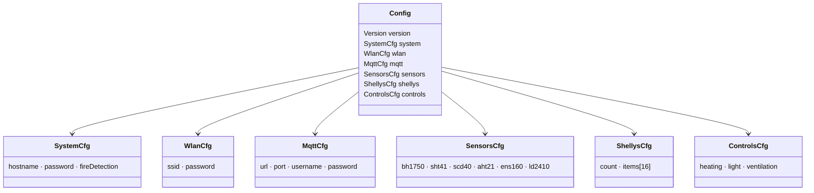
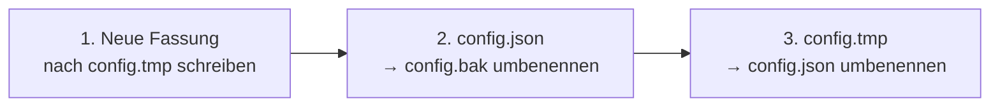
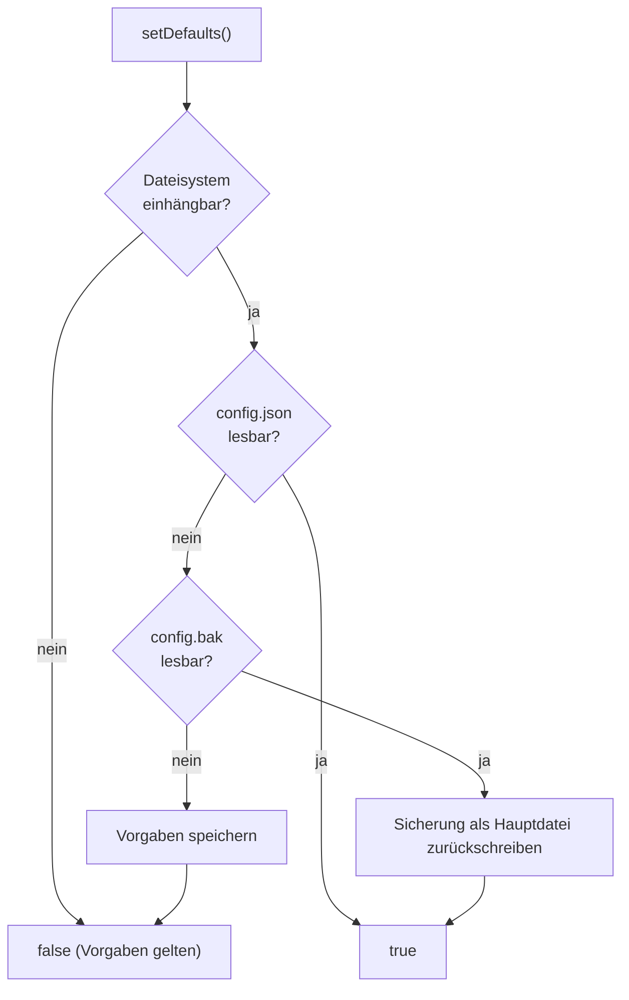
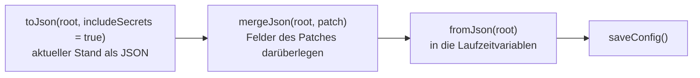

# Config – Konfiguration

**Dateien:** `src/config.cpp`, `src/config.h` · **Namespace:** `Config`

## Zweck

`Config` hält alle Einstellungen des Geräts zur Laufzeit und speichert sie als JSON im Dateisystem. Die Datei ist
reine Ablage: Beim Start wird sie **einmal** gelesen und in die Strukturen kopiert, beim Speichern einmal
zurückgeschrieben. Dazwischen arbeitet jedes Modul direkt mit den Variablen (`Config::sensors.sht41.smoothing`),
nie mit dem JSON.

## Aufbau der Konfiguration



### Felder und Vorgabewerte

| Bereich | Feld | Typ | Vorgabe | Bedeutung |
|---|---|---|---|---|
| `system` | `hostname` | String | leer | Leer heißt „automatisch“ (`HyphaHome-Sens-<MAC>`, setzt `main.cpp`) |
| | `password` | String | leer | Passwort der Web-UI. Leer = kein Schutz |
| | `fireDetection` | bool | `false` | Brandfrüherkennung ([FireDetect](fire-detect.md)) |
| `wlan` | `ssid`, `password` | String | leer | Zugangsdaten |
| `mqtt` | `url`, `port` | String, uint16 | leer, `1883` | Broker |
| | `username`, `password` | String | leer | |
| `sensors.<name>` | `enabled` | bool | `true` | Sensor eingeschaltet |
| `sensors.bh1750` | `luxCalibration` | Tabelle | leer | Kalibrierpunkte (max. 8), Faktor-Modus |
| `sensors.sht41` | `temperatureCalibration` | Tabelle | leer | Kalibrierpunkte (max. 8), Offset-Modus |
| | `smoothing` | uint8 | `1` | Mittelwert über N Messungen (1 bis 60) |
| `sensors.ld2410` | `gates[0..8]` | `{moving, stationary}` | siehe unten | Empfindlichkeit je Zone |
| | `movingHold`, `stationaryHold`, `presenceHold` | Sekunden | `5` | Haltezeiten (0 bis 600) |
| `shellys` | `items[]` | Liste (max. 16) | leer | Name, Adresse, MAC, Generation, Art, Passwort |
| `controls.heating` | `enabled`, `outputs[]` | | `false`, leer | |
| | `targetTemp` | °C | `21.0` | 5,0 bis 30,0, auf 0,1 gerundet |
| | `hysteresisOnMin`, `hysteresisOffMin` | Minuten | `10`, `10` | 0 bis 1440 |
| `controls.light` | `enabled`, `outputs[]`, `luxThreshold`, `brightnessPct`, `fadeSeconds` | | `false`, leer, `10`, `100`, `2` | **Noch ohne Funktion** |
| `controls.ventilation` | `enabled`, `outputs[]`, `aqiThreshold`, `humidityThreshold` | | `false`, leer, `3`, `65` | **Noch ohne Funktion** |

Vorgabe der LD2410-Gates: Zone 0 und 1 `{moving 50, stationary 0}`, Zone 2 bis 5 `{40, 40}`, Zone 6 bis 8 `{30, 15}`.
Der Wert `255` (`LD2410_SENSITIVITY_UNSET`) bedeutet „nicht gesetzt, Wert im Sensor lassen“ und wird in der JSON-Datei
einfach weggelassen.

### Grenzwerte (Makros in `config.h`)

| Makro | Wert | Grund |
|---|---|---|
| `SHELLY_MAX_COUNT` | 16 | Felder fester Größe: kein dynamischer Speicher, und eine fehlerhafte Anfrage kann den Speicher nicht vollschreiben |
| `CONTROL_MAX_OUTPUTS` | 8 | Ausgänge je Regelkreis |
| `SHELLY_MAX_CHANNELS` | 2 | Kanäle je Shelly (0 und 1) |
| `CALIBRATION_MAX_POINTS` | 8 | Kalibrierpunkte je Messgröße (aus `Calibration.h`) |
| `LD2410_GATE_COUNT` | 9 | Zonen des Radars |
| `SHT41_SMOOTHING_MAX` | 60 | Größe des Ringpuffers |
| `LD2410_MOVING_HOLD_MAX_S` | 600 | Obergrenze der Haltezeiten |
| `HEATING_TARGET_MIN_C` / `_MAX_C` / `_DEFAULT_C` | 5 / 30 / 21 | Bereich der Zieltemperatur |
| `VERSION` | `"1.0.0"` | Firmwareversion; wird beim Bauen auch in die Kennung geschrieben |

Diese Grenzen liefert `GET /api/config` im Block `limits` mit, damit die Web-UI sie nicht doppelt kennt.

## Öffentliche Schnittstelle

| Funktion | Aufgabe |
|---|---|
| `bool loadConfig()` | Lädt die Konfiguration. Reihenfolge: `config.json` → `config.bak` → Vorgaben (und neue Datei anlegen). Rückgabe `true`, wenn eine Datei gelesen wurde. |
| `bool saveConfig()` | Schreibt die Konfiguration sicher gegen Stromausfall (siehe unten). |
| `bool applyJson(JsonObjectConst patch)` | Übernimmt einzelne Felder (Teilobjekt) und speichert. Für die API. |
| `bool clearConfig()` | Löscht alle drei Dateien, setzt Vorgaben und schreibt eine neue Datei. |
| `void toJson(JsonObject root, bool includeSecrets = true)` | Schreibt die Laufzeitwerte als JSON. Ohne Geheimnisse (`false`) stehen statt der Passwörter nur `hasPassword`-Flags darin. |
| `String normalizeMac(const String&)` | Großbuchstaben, nur Hexziffern (`a4:cf:12:…` und `A4CF12…` werden gleich). |
| `const ShellyCfg* findShelly(const String& key)` | Sucht einen Shelly erst über die MAC, dann über die Adresse. |
| `size_t storageTotalBytes()` / `storageUsedBytes()` | Größe und Belegung des Konfigurations-Dateisystems. |

## Funktionsweise

### Sicheres Speichern

Ein Stromausfall mitten im Schreiben darf die Konfiguration nicht zerstören. Deshalb gibt es drei Dateien:



- Bricht Schritt 1 ab, ist `config.json` unberührt.
- Bricht Schritt 3 ab, liegt noch `config.bak`; `loadConfig()` verwendet sie beim nächsten Start und schreibt sie als
  Hauptdatei zurück.
- Vor jedem `rename()` wird das Ziel gelöscht, weil `rename()` ein vorhandenes Ziel nicht zuverlässig überschreibt.
- Eine leere Ausgabe (0 Bytes geschrieben) gilt als Fehler und die Datei wird wieder entfernt.

### Laden



`fromJson()` liest jedes Feld mit `| Vorgabe`. Fehlt ein Schlüssel oder hat er den falschen Typ, gilt der Vorgabewert.
**Eine ältere Datei ohne ein später hinzugekommenes Feld braucht darum keine Migration.** Nur wenn die Version in der
Datei von der Firmware abweicht, gibt es einen Logeintrag.

Zahlen außerhalb des zulässigen Bereichs werden **auf die Grenze gesetzt**, nicht verworfen („wer 5000 Minuten einträgt,
meint viel, nicht Vorgabe“).

### Teiländerungen (`applyJson`)



Die Web-UI schickt nur, was sie geändert hat. Objekte werden rekursiv zusammengeführt; **Arrays und Einzelwerte
ersetzen den bisherigen Wert** (ein gesendetes `gates`-Array ersetzt alle Gates).

### Shelly-Passwörter

`GET /api/config` liefert keine Passwörter (nur `hasPassword`). Die Oberfläche kann sie daher auch nicht
zurückschicken. Kommt zu einem Shelly kein `password`-Feld mit, bleibt das bisherige erhalten – erkannt an der **MAC**
(überlebt eine neue IP), ersatzweise an der Adresse. Ein mitgeschicktes leeres Passwort löscht es.

### Ausgänge der Regelkreise

Ein Ausgang ist `{shelly, channel}`. `shelly` wird auf die **normalisierte MAC** umgeschrieben, sobald der Shelly in der
Liste bekannt ist – so bleibt der Ausgang gültig, wenn sich die IP-Adresse ändert. Doppelte Einträge und solche ohne
Shelly werden übersprungen, `channel` wird auf 0 bis 1 begrenzt.

### Dateisystem

Die Konfiguration liegt in der eigenen Partition **`config`** (200 KB, siehe [Flash-Aufteilung](../architektur.md#7-flash-aufteilung-und-updates)),
eingehängt als `fs::LittleFSFS configFs` unter `/config`. Die Web-UI liegt in einer anderen Partition. Dadurch
überschreibt `pio run -t uploadfs` die Konfiguration nicht, und beide App-Partitionen (`app0`, `app1`) lesen dieselbe Datei.

## Beispiel (`firmware/config/config.json`)

```json
{
  "version": "1.0.0",
  "system": { "hostname": "HyphaHome-Sens", "password": "" },
  "wlan":   { "ssid": "", "password": "" },
  "mqtt":   { "url": "", "port": 1883, "username": "", "password": "" }
}
```

Die Datei enthält Passwörter und steht deshalb in der `.gitignore`. Alle weiteren Felder fehlen hier und bekommen
ihre Vorgabewerte. `pio run -t uploadconfig` schreibt sie per USB auf das Gerät ([Build-System](build-system.md)).

## Besonderheiten

- Die Konfiguration wird **nicht gesperrt** (kein Mutex). Die API schreibt im Webserver-Task, `loop()` liest sie
  gleichzeitig. Das ist bei Einzelwerten unkritisch; bei `String`-Feldern ist es theoretisch ein Wettlauf
  (siehe [Auffälligkeiten](../auffaelligkeiten.md)).
- Passwörter liegen im Klartext in `config.json`.
- Der in der Datei stehende `version`-Wert wird nur verglichen und protokolliert; maßgeblich ist immer `VERSION`.
- Die Regelkreise `light` und `ventilation` sind in der Konfiguration schon vorbereitet, im Code gibt es dazu aber
  noch keine Regelung.

## Siehe auch

[Calibration](calibration.md) · [Webinterface](webinterface.md) · [Shelly](shelly.md) · [HeatingControl](heating-control.md)
