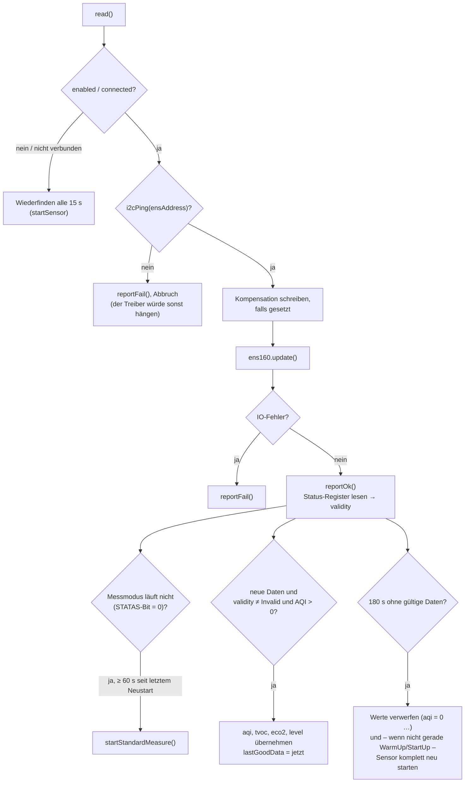

# MyENS160 – Luftqualitätssensor

**Dateien:** `src/MyENS160.cpp`, `src/MyENS160.h` · **Namespace:** `MyENS160`
**Sensor:** ENS160 (ScioSense) · **Anschluss:** I²C, Adresse `0x53` (ADDR-Pin auf VCC, Standard) oder `0x52` (GND)
**Bibliothek:** `sciosense/ScioSense_ENS16x`

## Zweck

Misst flüchtige organische Verbindungen (TVOC), schätzt daraus ein CO₂-Äquivalent (eCO₂) und liefert den
Luftqualitätsindex **AQI 1 bis 5** nach UBA. Das Modul ist das anspruchsvollste der I²C-Sensoren, weil der ENS160
Besonderheiten hat:

- Er braucht Zeit zum Aufwärmen (Messwerte belastbar nach etwa 3 min, beim allerersten Betrieb bis etwa 1 h).
- Er kann sich im Betrieb unbemerkt **zurücksetzen** und antwortet am Bus dann weiter, misst aber nicht mehr.
- Der Treiber **hängt endlos**, wenn der Sensor beim Lesen nicht antwortet.

## Öffentliche Schnittstelle

| Element | Typ | Beschreibung |
|---|---|---|
| `ENS160_ADDRESS_HIGH` / `ENS160_ADDRESS_LOW` | Makros | `0x53` / `0x52` |
| `isConnected` | `bool` | Sensor antwortet |
| `aqi` | `uint8_t` | 1 (sehr gut) bis 5 (schlecht); **0 = noch kein gültiger Wert** |
| `tvoc` | `uint16_t` | ppb |
| `eco2` | `uint16_t` | ppm |
| `validity` | `Validity` | Betriebszustand des Sensors |
| `level` | `Level` | Ampelstufe |
| `enum class Level { Unbekannt, Super, Gut, Mittel, Schlecht, Hoch }` | | AQI 1 → Super … AQI 5 → Hoch |
| `enum class Validity { Normal=0, WarmUp=1, StartUp=2, Invalid=3 }` | | **Nur bei `Normal` sind die Werte belastbar** |
| `setCompensation(float celsius, float rh)` | Funktion | Kompensationswerte für den nächsten `read()` (vom AHT21) |
| `aqiToLevel`, `levelToString`, `validityToString` | Funktionen | Umwandlungen für MQTT/API |
| `init()` / `read(bool print = true)` / `probe()` | Funktionen | wie bei allen Sensormodulen |

Der ScioSense-Treiber wird **bewusst nur in `MyENS160.cpp`** eingebunden: Er definiert Memberfunktionen ohne `inline`
im Header und würde bei mehrfacher Einbindung den Linker mit Mehrfachdefinitionen abbrechen lassen. Die Instanz `ens160`
ist deshalb `static` in der `.cpp`.

## Funktionsweise

### Start mit Adresssuche

`startSensor()` probiert **beide** Adressen. Je Adresse wird erst angepingt (spart den vollen Init-Durchlauf an einer
Adresse, unter der niemand antwortet), dann `ens160.init()` und `startStandardMeasure()`. Die gefundene Adresse wird in
`ensAddress` gemerkt, und die Fristen für „keine Daten“ beginnen von vorn.

### Lesen mit Überwachung (`read()`)

Die drei Schutzmechanismen im Einzelnen:

| Problem | Erkennung | Reaktion |
|---|---|---|
| Sensor abgezogen | `i2cPing(ensAddress)` schlägt fehl (vor jedem Lesen, weil der Treiber bei fehlendem ACK sonst endlos wartet) | `reportFail()` → nach 10 s „nicht verbunden“ |
| Sensor hat sich zurückgesetzt | Statusregister: Bit `STATAS` (`0x80`) = 0, Sensor steht nicht mehr im Messmodus | `startStandardMeasure()`, höchstens alle 60 s |
| Sensor liefert keine Daten mehr | Seit `NO_DATA_TIMEOUT_MS = 180000` kein gültiger AQI | Messwerte auf 0 setzen (damit nichts Altes als Messung durchgeht) und `startSensor()`, höchstens alle 60 s |

Der Neustart wegen fehlender Daten **entfällt**, solange der Sensor selbst `WarmUp` oder `StartUp` meldet. Bei einem
neuen Sensor dauert das bis zu einer Stunde, ein Neustart finge diese Phase von vorn an.

Die Gültigkeit steht in Bits 2 und 3 des Statusregisters: `validity = (status >> 2) & 0x03`.

### Kompensation

`setCompensation()` merkt sich die Werte nur; `read()` schreibt sie **einmal** (`writeCompensation`) und löscht das Flag.
Dadurch gehen die Werte in denselben Messzyklus ein, in dem sie gesetzt wurden. `loop()` ruft sie vor jedem `read()`
mit den AHT21-Werten auf ([MyAHT21](aht21.md)).

### AQI → Stufe

| AQI | Konstante | Stufe |
|---|---|---|
| 1 | `AQI_UBA_EXCELLENT` | Super |
| 2 | `AQI_UBA_GOOD` | Gut |
| 3 | `AQI_UBA_MODERATE` | Mittel |
| 4 | `AQI_UBA_POOR` | Schlecht |
| 5 | `AQI_UBA_UNHEALTHY` | Hoch |
| 0 | – | Unbekannt |

## Konfiguration

| Einstellung | Bedeutung |
|---|---|
| `sensors.ens160.enabled` | Sensor ein/aus |

## Verwendung der Werte

| Verbraucher | Wert |
|---|---|
| [MyMQTT](mqtt.md) | `…/ens160/status` (Betriebszustand), `…/ens160/level`, `…/ens160/tvoc`, `…/ens160/eco2` (nur wenn `aqi > 0`); Verfügbarkeit `…/ens160/available`; Stufe fließt in `…/air_quality` ein |
| [FireDetect](fire-detect.md) | `tvoc` – nur wenn `validity == Normal` und `aqi > 0` |
| [Webinterface](webinterface.md) | `GET /api/sensors` → `ens160` (`aqi`, `tvoc`, `eco2` sind `null`, solange `aqi == 0`) |

## Besonderheiten

- **`aqi == 0` heißt „kein Messwert“**, nicht „sehr gut“. Gültig sind nur 1 bis 5.
- Der Sensor wird im 5-s-Takt gelesen; er liefert etwa jede Sekunde einen Wert.
- Beim ersten Betrieb braucht der ENS160 bis zu eine Stunde, bis die Werte stabil sind. In dieser Zeit meldet
  `validity` `Erststart` bzw. `Aufwärmen`.

## Siehe auch

[MyAHT21](aht21.md) · [SensorHealth](sensor-health.md) · [FireDetect](fire-detect.md)
