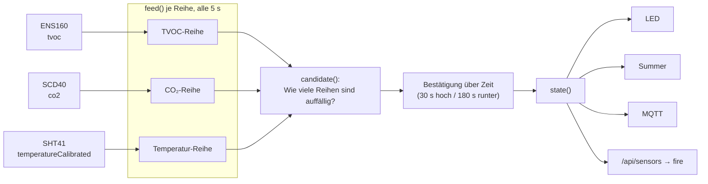
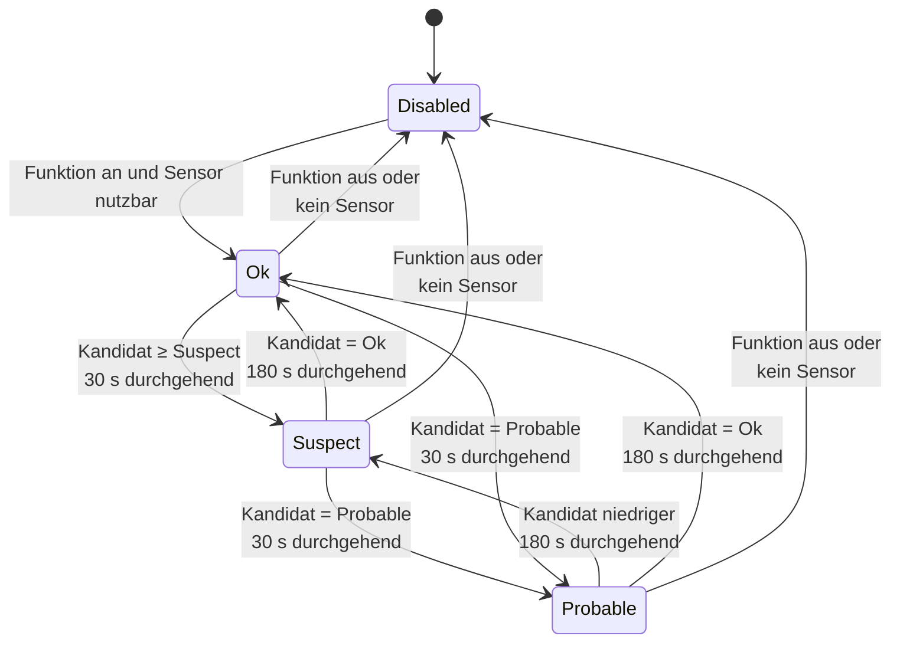

# FireDetect – Brandfrüherkennung

**Dateien:** `src/FireDetect.cpp`, `src/FireDetect.h` · **Namespace:** `FireDetect`
**Eingänge:** TVOC (ENS160), CO₂ (SCD40), Temperatur (SHT41, kalibriert)
**Ausgänge:** LED ([main](main.md)), Summer ([Beeper](beeper.md)), MQTT, API

> **Wichtig:** Das Modul ersetzt **keinen** zertifizierten Rauchmelder. Es wertet vorhandene Raumsensoren aus und kann Brände weder
> zuverlässig erkennen noch ausschließen. Kochdämpfe, Lösungsmittel oder Räuchern können es ebenso auslösen.

## Zweck

Erkennt Muster, die auf ein Feuer hindeuten könnten: schnell steigende Schadstoffe (TVOC), schnell steigendes CO₂ und
schnell steigende Temperatur, und das **gleichzeitig**. Ein einzelner Messwert genügt nie. Grundidee: Ein Wert wird auffällig, wenn er
**beides** erfüllt:

1. Er liegt deutlich über seinem **Normalwert** („Abstand“), und
2. er **steigt** gerade schnell („Anstieg je Minute“).

## Öffentliche Schnittstelle

| Funktion | Beschreibung |
|---|---|
| `update()` | Wertet im 5-s-Takt aus, bestätigt Zustandswechsel, steuert den Summer. Aus jedem `loop()`-Durchlauf aufrufen |
| `State state()` | Gesamtzustand **einschließlich** eines laufenden Testalarms |
| `const char* key(State)` | API-Schlüssel: `disabled`, `ok`, `suspect`, `probable` |
| `const char* mqttText(State)` | MQTT-Text: `Deaktiviert`, `OK`, `Verdacht`, `Wahrscheinlich` |
| `bool sensorsAvailable()` | Mindestens einer der drei Sensoren ist aktiviert **und** verbunden |
| `bool startTest()` | Löst für `FIRE_TEST_S` s einen Verdacht aus. `false`, wenn die Funktion aus ist oder kein Sensor nutzbar ist |
| `tvoc()`, `co2()`, `temperature()` | `Channel` je Messgröße (für Anzeige und Abstimmung der Schwellen) |

```cpp
enum class State { Disabled, Ok, Suspect, Probable };
struct Channel { bool available, ready; float value, baseline, rate; uint8_t level; };
```

`Channel.level`: 0 = unauffällig, 1 = Verdacht, 2 = wahrscheinlich.

## Funktionsweise

### Datenfluss



### Eine Messreihe (`Series`, `feed()`)

Je Messgröße gibt es eine Reihe mit

- einem **Ringpuffer** der letzten `FIRE_WINDOW_SAMPLES` = 24 Werte (24 × 5 s = **2 min**),
- einem **Normalwert** (Baseline), der dem Messwert langsam nachläuft (Zeitkonstante `FIRE_BASELINE_TAU_S` = 30 min),
- dem **Anstieg** (Steigung der Ausgleichsgeraden durch das Fenster, in Einheiten je Minute; erst ab `FIRE_MIN_SAMPLES` = 12 Werten, vorher 0),
- dem **aktuellen Wert** (Mittel der letzten **drei** Messungen, dämpft Rauschen).

Pro 5-s-Schritt:

1. Ist der Sensor nicht verfügbar → Reihe komplett verwerfen (Fenster, Normalwert), `available = false`.
2. Wert in den Puffer, aktuellen Wert (3er-Mittel) bilden.
3. **Erster Wert:** Normalwert = aktueller Wert, Lernphase beginnt (`FIRE_LEARN_S` = 300 s). Solange sie läuft, ist `ready = false`; die Reihe
   zählt noch nicht.
4. Sonst Normalwert nachziehen: `baseline += (value − baseline) × (5 s / 1800 s)`. **Läuft gerade ein Alarm, wird der Normalwert
   eingefroren**, sonst wanderte er dem Brand hinterher und der Abstand schmölze weg.
5. Anstieg berechnen.
6. Stufe bestimmen:

   | Stufe | Bedingung |
   |---|---|
   | 2 (wahrscheinlich) | Abstand ≥ `probableDelta` **und** Anstieg ≥ `probableRate` |
   | 1 (Verdacht) | Abstand ≥ `suspectDelta` **und** Anstieg ≥ `suspectRate` |
   | 0 | sonst |

### Schwellen (Standardwerte, alle per Build-Flag überschreibbar)

| Größe | Verdacht: Abstand | Verdacht: Anstieg | Wahrscheinlich: Abstand | Wahrscheinlich: Anstieg |
|---|---|---|---|---|
| TVOC (ppb) | 300 | 100 ppb/min | 1000 | 300 ppb/min |
| CO₂ (ppm) | 50 | 30 ppm/min | 150 | 100 ppm/min |
| Temperatur (K) | 1,0 | 0,5 K/min | 3,0 | 2,0 K/min |

Makros: `FIRE_TVOC_SUSPECT_DELTA` usw. in `FireDetect.h`.

### Verfügbarkeit der Eingänge

| Reihe | Verfügbar, wenn |
|---|---|
| TVOC | ENS160 aktiviert, verbunden, `validity == Normal` **und** `aqi > 0` |
| CO₂ | SCD40 aktiviert, verbunden, `co2 > 0` |
| Temperatur | SHT41 aktiviert und verbunden (benutzt `temperatureCalibrated`) |

Sensoren, die fehlen oder noch aufwärmen, zählen **nicht mit**.

### Entscheidung (`candidate()`)

Gezählt werden nur Reihen, die **verfügbar und bereit** (`ready`) sind. Von diesen werden benötigt:

```
need = min(Anzahl bereiter Reihen, FIRE_MIN_INDICATORS = 2)
```

| Bedingung | Kandidat |
|---|---|
| keine Reihe bereit | `Ok` |
| mindestens `need` Reihen auf Stufe 2 | `Probable` |
| mindestens `need` Reihen auf Stufe ≥ 1 | `Suspect` |
| sonst | `Ok` |

Sind alle drei Sensoren da, müssen also **zwei gleichzeitig** auffällig sein. Ist nur einer da, genügt dieser.

### Bestätigung über die Zeit

Der Kandidat wird erst übernommen, wenn er **durchgehend** ansteht:



- **Hochstufen** nach `FIRE_CONFIRM_S` = 30 s ununterbrochen höherer Anforderung,
- **Herunterstufen** nach `FIRE_CLEAR_S` = 180 s ununterbrochen niedrigerer Anforderung.

Die lange Rückfallzeit verhindert, dass ein flackerndes Signal den Alarm ständig ein- und ausschaltet. Die Zeiten laufen nur im
5-s-Takt der Auswertung, ihre Genauigkeit ist also ±5 s.

### Summer

In jedem `update()`-Aufruf (nicht nur alle 5 s): Ist der Zustand `Suspect` oder `Probable`, ertönt `Beeper::beepAsync(500)`
**sofort** beim Einsetzen des Alarms, danach im festen Takt:

| Zustand | Abstand der Töne |
|---|---|
| Verdacht | 5000 ms |
| Wahrscheinlich | 2000 ms |

### Testalarm

`startTest()` setzt `testUntil = jetzt + FIRE_TEST_S` (Standard **15 s**). `state()` liefert in dieser Zeit mindestens `Suspect`, solange
die echte Auswertung niedriger liegt. LED, Summer und MQTT verhalten sich wie bei einem echten Verdacht. Ausgelöst wird er über
`POST /api/fire/test` ([Webinterface](webinterface.md)).

## Konfiguration

| Einstellung | Bedeutung |
|---|---|
| `system.fireDetection` | Funktion ein/aus (nur einschaltbar, wenn `sensorsAvailable()`) |

Alle anderen Größen sind **Build-Zeit-Makros** in `FireDetect.h` und lassen sich mit `-D`-Flags in `platformio.ini` anpassen.

## Verwendung der Werte

| Verbraucher | Nutzung |
|---|---|
| [main](main.md) | LED: Rot blinkend (500 ms) bei `Probable`, Orange blinkend bei `Suspect` (höchste Priorität) |
| [MyMQTT](mqtt.md) | `…/fire/indicator` (`mqttText`), Hilfswerte `…/fire/tvoc_rate`, `co2_rate`, `temperature_rate` |
| [Webinterface](webinterface.md) | `GET /api/sensors` → `fire` (`enabled`, `connected`, `state`, je Kanal `available`, `ready`, `value`, `baseline`, `rate`, `level`) |

## Besonderheiten

- **Lernphase:** Nach dem Start und nach jedem Wiedereinschalten eines Sensors vergehen 300 s, bis die Reihe mitzählt. In dieser Zeit
  ist der Zustand `Ok`, auch wenn ein Brand tobt.
- **Langsamer Brand:** Ein sehr langsam steigender Wert (unter den Anstiegsschwellen) wird nie erkannt, und der Normalwert zieht ihm nach.
- **Temperatur:** Verwendet den kalibrierten, nicht den geglätteten Wert des SHT41. Die Auswertung bildet selbst ein 3er-Mittel.
- Zustände werden nur im Speicher gehalten. Nach einem Neustart beginnt alles bei `Disabled` bzw. `Ok` mit neuer Lernphase.

## Siehe auch

[MyENS160](ens160.md) · [MySCD40](scd40.md) · [MySHT41](sht41.md) · [Beeper](beeper.md) · [LED](led.md)
