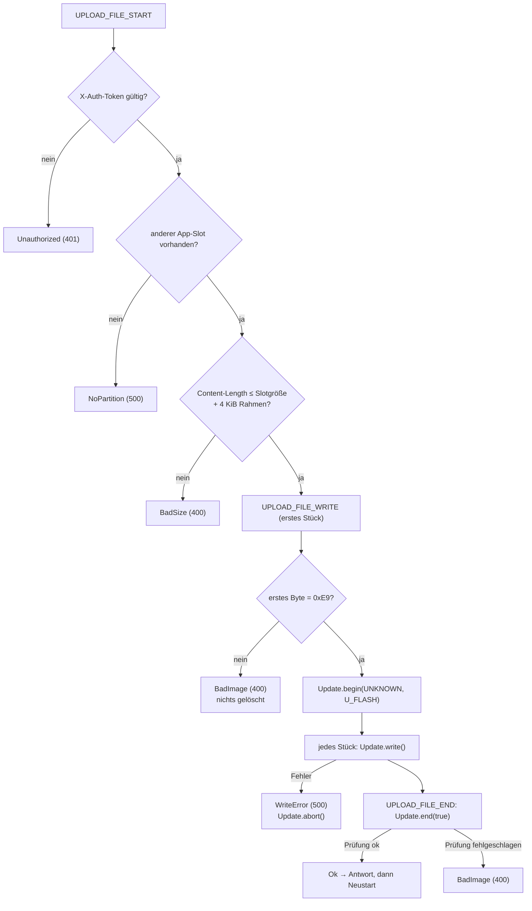

# FirmwareUpdate – Firmware per Upload einspielen (OTA)

**Dateien:** `src/FirmwareUpdate.cpp`, `src/FirmwareUpdate.h` · **Namespace:** `FirmwareUpdate`
**Bibliothek:** `Update` (Arduino-ESP32), `esp_ota_ops`

## Zweck

Nimmt eine neue Firmware (`firmware.bin`) über HTTP entgegen und schreibt sie in den **jeweils anderen** App-Slot (`app0` ↔ `app1`).
Läuft die Firmware auf `app0`, wandert das Update nach `app1`, und umgekehrt. Nach erfolgreicher Prüfung wird der
Start auf den neuen Slot umgestellt und das Gerät startet neu. Die bisherige Firmware bleibt im anderen Slot erhalten (Rückfall
möglich, siehe `POST /api/firmware/switch` in [Webinterface](webinterface.md)).

Die Flash-Aufteilung steht in [Architektur: Flash-Layout](../architektur.md). Damit ein Update ohne Kabel möglich ist, enthält die
`partitions.csv` zwei App-Partitionen (`app0` mit Untertyp `ota_0`, `app1` mit `ota_1`, je 0x140000 = 1,25 MiB) und die Partition `otadata`.

## Öffentliche Schnittstelle

| Funktion | Beschreibung |
|---|---|
| `void setupRoutes()` | Meldet `POST /api/update/firmware` an (aufgerufen von `Webfiles::setupRoutes()`) |

## Ablauf



Wichtige Punkte:

- **Anmeldung:** Nur mit gültigem Sitzungstoken (`X-Auth-Token`). Ist kein Passwort gesetzt, ist die Route offen (siehe
  [Session](session.md)). Anders als [UiUpdate](ui-update.md) gibt es keine Notfallseite mit Passwortfeld – das Update läuft über die Einstellungen
  der Oberfläche.
- **Magic Byte:** Jede ESP32-Firmware beginnt mit `0xE9`. Fehlt es im ersten Datenstück, wird abgelehnt, **bevor** die Bibliothek etwas
  löscht. So zerstört eine falsche Datei nicht den freien Slot.
- **Unbekannte Länge:** `Update.begin(UPDATE_SIZE_UNKNOWN, U_FLASH)`, weil die Länge der Firmware im mehrteiligen Formular nicht
  vorab bekannt ist. Die Bibliothek wählt den freien Slot selbst (`esp_ota_get_next_update_partition`).
- **Abschluss:** `Update.end(true)` prüft Kopf und Prüfsumme des Abbilds und stellt erst bei Erfolg den Start auf den neuen Slot um.
  Das `true` erlaubt eine Datei, die kleiner ist als der Slot.
- **Neustart:** Nach der Antwort ruft die Firmware `Runtime::flush()` (Betriebszeit sichern), wartet 500 ms (damit die Antwort ankommt) und
  führt `ESP.restart()` aus.

## Antwort

```json
{ "ok": true, "restart": true }
```

Fehler: `{"ok":false,"error":"CODE","detail":"…"}`. `detail` ist die Fehlermeldung der Update-Bibliothek, wenn es eine gibt.

| Code | HTTP | Bedeutung |
|---|---|---|
| `NOT_AUTHENTICATED` | 401 | Anmeldung fehlt |
| `NO_PARTITION` | 500 | Kein anderer App-Slot |
| `FW_BAD_SIZE` | 400 | Datei zu groß oder leer |
| `FW_BAD_IMAGE` | 400 | Kein ESP-Abbild oder Prüfung am Ende fehlgeschlagen |
| `WRITE_FAILED` | 500 | Schreiben fehlgeschlagen (`Update.begin`/`write`) |
| `ABORTED` | 500 | Upload abgebrochen |
| `NO_FILE` | 400 | Nichts empfangen |

## Besonderheiten

- Ein Update **überschreibt den anderen Slot**. Was dort lag (ein älterer Stand), ist danach weg. Welcher Stand im anderen Slot liegt,
  ermittelt [BuildInfo](build-info.md) beim Start und zeigt `/api/dashboard` unter `system.otherApp`.
- Läuft die neue Firmware nicht an, startet der Bootloader weiterhin den neuen Slot (kein automatischer Rückfall, kein
  `esp_ota_mark_app_valid_cancel_rollback` im Code). Man muss dann über die serielle Schnittstelle oder durch erneutes Einspielen helfen.
- Das Abbild wird **ohne eigenen Puffer** stückweise vom Webserver an `Update.write()` weitergereicht.
- Auch hier gilt: Der Server bedient nur **eine** Verbindung. Während des Uploads antwortet das Gerät niemand anderem.
- Die Konfiguration (Partition `config`) und die Oberfläche (Partition `spiffs`) bleiben unberührt.

## Siehe auch

[UiUpdate](ui-update.md) · [BuildInfo](build-info.md) · [Runtime](runtime.md) · [Webinterface](webinterface.md) · [Build-System](build-system.md)
