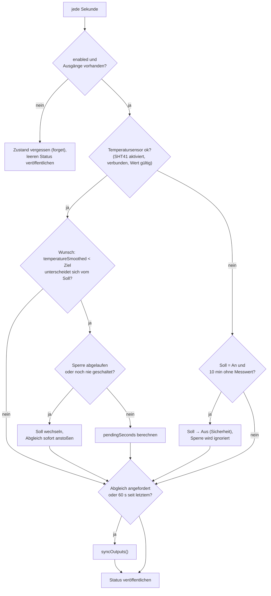

# HeatingControl – Heizungsregelung über Shelly

**Dateien:** `src/HeatingControl.cpp`, `src/HeatingControl.h` · **Namespace:** `HeatingControl`
**Task:** `heating`, Priorität 1, Stack 8192 Byte, Takt 1 s (`HEATINGCONTROL_TICK_MS`)
**Eingang:** `MySHT41::temperatureSmoothed` · **Ausgang:** Shelly-Schaltkanäle über [ShellySwitch](shelly.md)

> Im Quelltext steht „Sehr rudimentär bisher“: Es ist ein einfacher **Zweipunktregler mit Zeitsperre**, kein PID-Regler.

## Zweck

Schaltet eine oder mehrere Heizungen (Shelly-Relais) ein, wenn die Raumtemperatur unter einen Zielwert fällt, und aus, wenn sie
darüber liegt. Damit die Relais nicht im Minutentakt klacken, gilt nach jedem Schalten eine **Sperrzeit** (Hysterese in Minuten, nicht in
Grad).

## Öffentliche Schnittstelle

| Funktion | Beschreibung |
|---|---|
| `begin()` | Startet den Task (einmal in `setup()`) |
| `requestSync()` | Verlangt eine sofortige Abfrage und Angleichung der Shellys. Aus jedem Task aufrufbar |
| `Status status()` | Kopie des aktuellen Stands (unter Spinlock) |
| `key(Desired)`, `key(Actual)` | Schlüssel für API/Oberfläche: `on`, `off`, `mixed`, `unreachable`, `unknown` |

```cpp
enum class Desired { Unknown, Off, On };                      // Soll-Zustand
enum class Actual  { Unknown, Off, On, Mixed, Unreachable };  // Ist-Zustand aller Ausgänge
struct Status {
    bool enabled, sensorOk;
    Desired desired;  Actual actual;
    int32_t pendingSeconds;       // Restsperre, wenn ein Wechsel ansteht, sonst -1
    int32_t lastSyncAgoSeconds;   // Sekunden seit der letzten Abfrage, -1 wenn noch keine
};
```

## Konfiguration (`controls.heating`)

| Feld | Bedeutung |
|---|---|
| `enabled` | Regelung ein/aus |
| `targetTemp` | Zieltemperatur in °C (5,0 … 30,0) |
| `hysteresisOnMin` | Mindest-Wartezeit nach dem **Ausschalten**, bevor wieder eingeschaltet werden darf (0 … 1440 min) |
| `hysteresisOffMin` | Mindest-Wartezeit nach dem **Einschalten**, bevor wieder ausgeschaltet werden darf (0 … 1440 min) |
| `outputs[]` | Liste von `{shelly, channel}`: der Schlüssel eines in `shellys[]` eingetragenen Geräts und dessen Kanal (höchstens `CONTROL_MAX_OUTPUTS`) |

Die Regelung ist nur aktiv, wenn `enabled` **und** mindestens ein Ausgang eingetragen ist. Änderungen sind live wirksam (der Task liest
`Config::controls.heating` in jedem Takt). Bearbeitet werden sie über die Oberfläche (`POST /api/config`) oder über MQTT
([MyMQTT](mqtt.md#heizung-nur-wenn-controlsheatingenabled)).

## Funktionsweise

### Zwei Zustände: Soll und Ist

| | Bedeutung | Wer ändert es |
|---|---|---|
| **Soll** (`desired`) | Was die Regelung will: `On`/`Off`, anfangs `Unknown` | Regellogik |
| **Ist** (`actual`) | Was die Shellys melden: alle an/aus, gemischt, nicht erreichbar | Abfrage (`syncOutputs`) |

Der Task schaltet nie direkt. Er ändert nur das **Soll**; der Abgleich (`syncOutputs`) bringt die Relais dorthin.

### Ablauf des Tasks



### Regel

- Es wird **an** gewünscht, solange die geglättete Temperatur **unter** dem Ziel liegt, sonst **aus**. Es gibt keinen Grad-Abstand zwischen
  Ein- und Ausschalttemperatur.
- Weicht der Wunsch vom Soll ab, wird das Soll erst gewechselt, wenn die **Sperre** seit dem letzten Wechsel abgelaufen ist:
  - Wunsch *an* (Soll ist *aus*): Sperre = `hysteresisOnMin` (Wartezeit nach dem Ausschalten).
  - Wunsch *aus* (Soll ist *an*): Sperre = `hysteresisOffMin` (Wartezeit nach dem Einschalten).
- Solange der Wunsch abweicht, aber die Sperre noch hält, meldet der Status `pendingSeconds` (aufgerundet); `/api/sensors` zeigt
  daraus `pendingMinutes`.
- **Erster Wechsel** nach dem Start: `haveChange` ist `false`, es gibt also keine Sperre. Wann zuletzt geschaltet wurde, weiß nach einem Neustart niemand.

### Sicherheitsabschaltung

Fehlt die Temperatur (Sensor ausgefallen, deaktiviert oder ungültig), wird nichts neu entschieden. Ist das Soll *an* und gab es
`HEATING_SENSOR_LOSS_OFF_MIN` = **10 min** keinen gültigen Wert, wechselt das Soll auf *aus*, **ohne Rücksicht auf die Sperre**. Der Zeitpunkt
„letzter gültiger Wert“ beginnt beim Einschalten der Regelung.

### Abgleich (`syncOutputs`)

Läuft bei jedem Wechsel des Soll, auf Anforderung (`requestSync`) und sonst **alle 60 s** (`HEATING_SYNC_INTERVAL_MS`):

1. Ausgänge aus der Konfiguration **festhalten** (Kopie), weil die Abfrage blockiert und sich die Konfiguration währenddessen ändern kann.
2. Jeden Kanal per `ShellySwitch::read()` abfragen → `On`, `Off` oder `Unreachable` (auch, wenn der Shelly nicht in `shellys[]` steht).
3. **Soll aus Ist ableiten**, solange das Soll `Unknown` ist und alle Kanäle erreichbar sind: Sind alle an → *an*, sonst → *aus*. Bei
   uneinigen Kanälen steht im Log „Kanäle uneins“. So übernimmt die Regelung nach einem Neustart den Zustand, den sie vorfindet, statt
   blind umzuschalten.
4. **Angleichen:** Jeder erreichbare Kanal, der vom Soll abweicht, wird mit `ShellySwitch::write()` umgeschaltet. Das Ergebnis wird erst
   im nächsten Durchlauf gegengeprüft.
5. **Ist bestimmen:** keine Ausgänge → `Unknown`; ein Kanal nicht erreichbar → `Unreachable`; gemischt → `Mixed`; sonst `On`/`Off`.

Das Abgleichen läuft jede Minute, auch ohne Wechsel. Dadurch wird ein von Hand umgeschalteter Shelly nach höchstens einer Minute
zurückgestellt.

## Verwendung der Werte

| Verbraucher | Nutzung |
|---|---|
| [MyMQTT](mqtt.md) | `…/heating/desired`, `…/heating/actual` (deutsche Texte), Soll-Werte und Setzbefehle |
| [Webinterface](webinterface.md) | `GET /api/sensors` → `heating` (`enabled`, `connected`, `desired`, `actual`, `pendingMinutes`); `requestSync()` nach Konfigurationsänderung |

## Besonderheiten

- **Rechenzeit:** `ShellySwitch::read()`/`write()` sind blockierende HTTP-Aufrufe. Sie laufen im eigenen Task, nie in `loopTask`.
- **Stack 8 KB:** `WiFiClient`, Antworttext und JSON-Dokument der Shelly-Abfragen liegen auf dem Stack.
- Das Soll geht beim Neustart verloren (nur RAM) und wird aus dem Ist neu übernommen.
- Gemessen wird mit `temperatureSmoothed` des [SHT41](sht41.md). Beträgt das Glättungsfenster 1, ist das der kalibrierte Momentanwert.
- Werte (`targetTemp` usw.) werden gelesen, ohne die Konfiguration zu sperren. Ein gleichzeitiges Schreiben aus MQTT oder der API kann
  theoretisch einen halb aktualisierten Wert zeigen ([Auffälligkeiten](../auffaelligkeiten.md)).

## Siehe auch

[Shelly (Probe und Switch)](shelly.md) · [MyMQTT](mqtt.md) · [MySHT41](sht41.md) · [Config](config.md)
