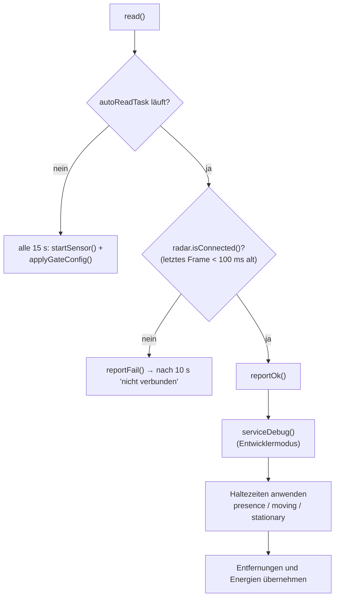
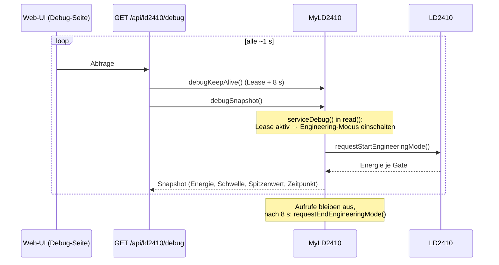

# MyLD2410 – Radarsensor (Präsenz und Bewegung)

**Dateien:** `src/MyLD2410.cpp`, `src/MyLD2410.h` · **Namespace:** `MyLD2410`
**Sensor:** HLK-LD2410 (24-GHz-Radar) · **Anschluss:** UART2, **256000 Baud**, 8N1, `RX = GPIO 16`, `TX = GPIO 17`
**Bibliothek:** `ncmreynolds/ld2410`

## Zweck

Der LD2410 erkennt Menschen auch dann, wenn sie sich nicht bewegen (Atmung, Mikrobewegungen). Das Modul liefert:

- **Präsenz** (`presence`): irgendein Ziel erkannt,
- **Bewegung** (`movingTarget`) mit Entfernung und Signalenergie,
- **Stillstand** (`stationaryTarget`) mit Entfernung und Signalenergie,

und bietet zwei Zusatzfunktionen: die **Empfindlichkeit je Zone** („Gate“) aus der Konfiguration in den Sensor zu
schreiben und einen **Entwicklermodus** zum Einstellen der Schwellen.

Der Sensor teilt den Erfassungsbereich in neun Zonen („Gates“, Index 0 = nächstgelegen; laut Datenblatt je etwa 75 cm).

## Öffentliche Schnittstelle

| Element | Beschreibung |
|---|---|
| `radar` | Treiberinstanz `ld2410` |
| `isConnected` | Der Sensor liefert gültige Frames |
| `presence`, `movingTarget`, `stationaryTarget` | Erkennung **nach** Haltezeit (siehe unten) |
| `movingDistance` (cm), `movingEnergy` (0–100) | Bewegtes Ziel |
| `stationaryDistance` (cm), `stationaryEnergy` (0–100) | Stehendes Ziel |
| `init()` | Startet UART und Radar; schreibt die Gate-Konfiguration |
| `read(bool print = true)` | Übernimmt die Werte aus dem Treiber und wendet die Haltezeiten an |
| `probe()` | Startet UART und Radar (**blockiert bis zu 1 s**) |
| `applyGateConfig()` | Schreibt die Gate-Empfindlichkeiten aus `Config` in den Sensor |
| `printConfiguration()` | Liest die Sensorkonfiguration zurück und gibt sie auf `Serial` aus |
| `debugKeepAlive()`, `debugStop()`, `debugResetPeaks()`, `debugSnapshot(DebugSnapshot&)` | Entwicklermodus |

Anders als die I²C-Sensoren gibt es keinen `i2cPing`; `probe()` ist hier genauso teuer wie ein Start.

## Funktionsweise

### Start

`startSensor()`: `Serial2.begin(256000, SERIAL_8N1, 16, 17)`, `radar.begin(Serial2)` und `radar.autoReadTask()`. Letzteres
startet einen Hintergrundtask der Bibliothek, der den UART-Puffer **laufend** leert. Ohne ihn würde der Puffer bei den
Lesepausen der Hauptschleife überlaufen.

### „Ist der Sensor noch da?“

Ein UART hat kein ACK wie I²C. Erkennungsmerkmal ist, ob noch **gültige Frames ankommen**. Das ist wichtig, weil die
Getter der Bibliothek (`presenceDetected()` usw.) nur den zuletzt gefüllten Puffer lesen: Ein abgezogener Sensor würde
dauerhaft „Bewegung erkannt“ melden, ohne dass es jemand merkt.



Ist der Sensor weg, bleiben die Variablen auf den letzten Werten stehen – [MyMQTT](mqtt.md) und die API senden sie aber
nur, solange `isConnected` gilt.

### Haltezeiten

Der LD2410 meldet Bewegung, Stillstand und Präsenz über die UART **nur im Augenblick der Erkennung**; seine eigene
Nachlaufzeit wirkt dort nicht. Das Signal flackert deshalb. Die Firmware bildet die Nachlaufzeit nach:

```cpp
struct Hold {
    bool seen; uint32_t lastSeen;
    bool apply(bool detected, uint32_t now, uint16_t seconds) {
        if (detected) { seen = true; lastSeen = now; return true; }
        return seen && (now - lastSeen < seconds * 1000);
    }
};
```

Es gibt je einen `Hold` für Präsenz, Bewegung und Stillstand mit eigener Dauer (Vorgabe je 5 s, 0 = aus, höchstens
600 s). Beispiel: Bei `presenceHold = 30` bleibt `presence` 30 s nach der letzten Erkennung `true`.

### Gate-Empfindlichkeit schreiben (`applyGateConfig`)

Der LD2410 speichert seine Einstellungen im **eigenen Flash** und behält sie über das Abschalten hinweg. Ohne Vergleich
würde bei jedem Start je Gate ein Flash-Zyklus verbraucht. Deshalb:

1. `radar.requestCurrentConfiguration()` – was steht im Sensor?
2. Für jedes Gate (höchstens `radar.max_gate`): Soll-Wert aus `Config::sensors.ld2410.gates[g]`. Ist ein Wert `255`
   (nicht gesetzt), wird der aktuelle Wert des Sensors eingesetzt, denn die Bibliothek kann Bewegung und Stillstand nur
   **gemeinsam** schreiben.
3. Nur wenn sich ein Wert unterscheidet, wird `setGateSensitivityThreshold(gate, moving, stationary)` aufgerufen.

Aufgerufen wird die Funktion beim Start, nach jedem Neustart des Sensors und von der API, sobald
`POST /api/config` den Zweig `sensors.ld2410` enthält.

### Entwicklermodus („Engineering mode“)

Im Engineering-Modus liefert der Sensor zusätzlich die **Signalenergie jedes Gates**. Er belastet die serielle Leitung
stärker und ist nach dem Abschalten des Sensors wieder aus. Er läuft deshalb nur **auf Anforderung** (Lease):



- `LD2410_DEBUG_LEASE_MS = 8000`: Bleibt der Aufruf von `debugKeepAlive()` länger aus, schaltet `read()` den Modus ab.
- Beim Einschalten werden **zuerst** die Schwellen aus dem Sensor gelesen, dann der Modus aktiviert. Die Reihenfolge ist
  Absicht: Der Konfigurationsmodus, in dem das Lesen läuft, würde den Engineering-Modus sonst wieder abbrechen.
- Je Gate werden `moving`/`stationary` (Energie), die Schwellen, der **Spitzenwert** seit Beginn oder seit
  `debugResetPeaks()` und der **Zeitpunkt der letzten Überschreitung** der Schwelle gespeichert.
- Fehlgeschlagene Starts werden frühestens nach 2 s wiederholt.
- `thresholdsDirty` ist für den Fall vorgesehen, dass sich die Schwellen im Sensor ändern, während der Modus läuft.
  Im aktuellen Code wird das Flag nirgends auf `true` gesetzt.

`debugSnapshot()` meldet `active = true`, wenn der Modus läuft, Daten ankommen und der Sensor verbunden ist.

## Konfiguration

| Einstellung | Bedeutung |
|---|---|
| `sensors.ld2410.enabled` | Sensor ein/aus |
| `sensors.ld2410.gates[0..8]` | `{moving, stationary}`: Empfindlichkeit 0–100; 255 = nicht ändern |
| `sensors.ld2410.movingHold` / `stationaryHold` / `presenceHold` | Haltezeit in Sekunden (0–600) |

## Verwendung der Werte

| Verbraucher | Wert |
|---|---|
| [MyMQTT](mqtt.md) | `…/ld2410/presence`, `motion`, `stationary` (`ON`/`OFF`, sofort bei Änderung); Entfernungen/Energien nur im vollen 5-s-Durchlauf |
| [Webinterface](webinterface.md) | `GET /api/sensors` → `ld2410`; `GET/POST /api/ld2410/debug` |

Gelesen wird im **200-ms-Takt**.

## Besonderheiten

- Die Debug-Route der API gibt zusätzlich die **rohen** Werte des Treibers ohne Haltezeit aus: Sie zeigen, was der
  Sensor wirklich sieht.
- Frühere Firmwarestände boten Gates, Nachlaufzeit und „Max-Gates“ per MQTT an. [MyMQTT](mqtt.md) räumt die alten
  retained Discovery-Nachrichten dafür beim ersten Verbinden nach dem Start auf.
- Im Treiber haben die Felder `motion_sensitivity[]`/`stationary_sensitivity[]` feste Größe 9; `applyGateConfig()` bricht
  deshalb bei `radar.max_gate` ab.

## Siehe auch

[SensorHealth](sensor-health.md) · [Config](config.md) · [MyMQTT](mqtt.md)
