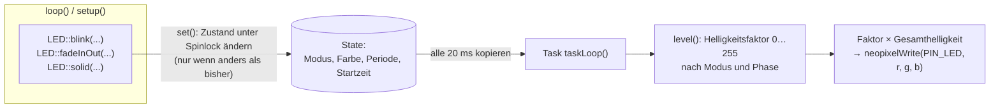

# LED – Statusanzeige (WS2812)

**Dateien:** `src/LED.cpp`, `src/LED.h` · **Namespace:** `LED`
**Hardware:** eine adressierbare WS2812-LED an `GPIO 26` (`PIN_LED` in `pinmapping.h`)
**Task:** `LED`, Kern 1, Priorität 1, Stack 3072 Byte, Takt 20 ms

## Zweck

Zeigt den Gerätezustand auf einen Blick: Farbe und Effekt (aus, dauerhaft, blinkend, atmend). Das Modul **entscheidet nicht**, was
angezeigt wird. Es setzt nur um, was der Aufrufer wünscht. Die Rangfolge der Zustände steht in `loop()`
([main](main.md#loop-im-detail), [Architektur: Statusanzeige](../architektur.md#6-statusanzeige-led)).

## Öffentliche Schnittstelle

| Funktion | Beschreibung |
|---|---|
| `begin()` | Startet den Task, LED ist danach aus. Mehrfacher Aufruf ist wirkungslos |
| `setBrightness(uint8_t)` | Gesamthelligkeit 0…255. Standard im Modul **64**, weil eine WS2812 bei voller Helligkeit sehr hell ist; `setup()` setzt sie aber gleich auf **255** und lässt sie dort |
| `off()` | Aus |
| `solid(Color)` | Dauerhaft in einer Farbe |
| `blink(Color, periodMs = 1000)` | Hart blinken: je eine halbe Periode an und aus |
| `fadeInOut(Color, periodMs = 2000)` | Weich ein- und ausblenden („Atmen“) |

Farbkonstanten (`LED::Color {r,g,b}`): `Off`, `White`, `Red`, `Green`, `Blue`, `Yellow` (255,200,0), `Orange` (255,80,0), `Cyan`,
`Magenta`.

Die Effektfunktionen können **aus jedem Task und in jedem `loop()`-Durchlauf** aufgerufen werden, auch wenn sich nichts ändert.

## Funktionsweise

- **Zustandsübergabe:** `state` wird von den Effektfunktionen gesetzt und vom Task gelesen. Dazwischen schützt ein Spinlock
  (`portMUX_TYPE`). Der Task kopiert den Zustand unter dem Lock und rechnet danach ohne.
- **Gleicher Effekt noch einmal:** Ruft `loop()` bei jedem Durchlauf `fadeInOut(Cyan)` auf, startet die Phase **nicht** neu. Sonst bliebe
  ein Fade am Anfang stehen.
- **Helligkeitsfaktor je Modus (`level`):**

| Modus | Faktor |
|---|---|
| `Solid` | immer 255 |
| `Blink` | 255 in der ersten Hälfte der Periode, danach 0 |
| `Fade` | Dreieckswelle 0 → 255 → 0 über die Periode, dann **quadriert** (`tri² / 255`) |
| `Off` | 0 |

Das Quadrieren beim Atmen gleicht aus, dass das Auge Helligkeit nicht linear wahrnimmt; ohne wirkt das Ausblenden zu abrupt.

- **Schreiben nur bei Änderung:** Der Task merkt sich den letzten RGB-Wert und ruft `neopixelWrite()` nur auf, wenn er sich ändert.
  Bei ruhigem Licht spart das die RMT-Ausgabe.
- Die Mindestperiode ist 2 ms (Schutz vor Division durch 0 bei zu kleinen Werten).

## Verwendete Farben

| Anzeige | Wo gesetzt | Bedeutung |
|---|---|---|
| Weiß, dauerhaft | `setup()` | Start |
| Grün, dauerhaft | Ende von `setup()` | Start abgeschlossen |
| Rot blinkend, 500 ms | `loop()` | Brand wahrscheinlich |
| Orange blinkend | `loop()` | Brandverdacht |
| Cyan atmend | `loop()` | WLAN nicht verbunden |
| Gelb atmend | `loop()` | MQTT nicht verbunden |
| Blau, dauerhaft | `loop()` | Hotspot aktiv (siehe Hinweis) |
| Rot, dauerhaft | `loop()` | Aktivierter Sensor fehlt oder Web-UI unbrauchbar |
| aus | `loop()` | alles in Ordnung |

> Hinweis: Der Blau-Zweig wird nur erreicht, wenn `WiFi.status() == WL_CONNECTED` **und** der Manager `Hotspot` meldet. Im Hotspot ist das
> normalerweise nicht der Fall, dann greift vorher Cyan ([Auffälligkeiten](../auffaelligkeiten.md)).

## Besonderheiten

- Der Treiber nutzt `neopixelWrite()` des Arduino-ESP32-Cores (RMT), keine zusätzliche Bibliothek.
- In `LED.h` steht `#ifndef PIN_LED / #define PIN_LED 1` als Rückfall. Wirksam ist der Wert aus `pinmapping.h` (**26**), der
  vorher eingebunden wird.
- `LED_COUNT` ist definiert, wird aber nicht benutzt: Es gibt nur **eine** LED.

## Siehe auch

[Beeper](beeper.md) · [FireDetect](fire-detect.md) · [main](main.md)
