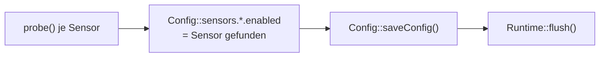

# main – Start, Hauptschleife, Pinbelegung

**Dateien:** `src/main.cpp`, `src/main.h`, `src/pinmapping.h`

## Zweck

`main.cpp` ist der Rahmen der Firmware: `setup()` bringt alle Module in der richtigen Reihenfolge hoch, `loop()` ruft
sie zyklisch auf und wählt die Statusfarbe der LED. `main.h` bindet nur die Header aller Module ein. Eigene Logik
steckt kaum in `main.cpp`; die Arbeit machen die Module.

Der Ablauf von `setup()` und `loop()` ist als Diagramm in der [Architektur](../architektur.md#3-start-des-geräts-setup)
beschrieben. Hier stehen die Details.

## Pinbelegung (`pinmapping.h`)

| Makro | GPIO | Funktion | Verwendet in |
|---|---|---|---|
| `PIN_SDA` | 21 | I²C-Daten | `main.cpp`, [SensorHealth](sensor-health.md) |
| `PIN_SCL` | 22 | I²C-Takt | `main.cpp`, [SensorHealth](sensor-health.md) |
| `PIN_LD2410_RX` | 16 | UART2: Empfang vom Radar | [MyLD2410](ld2410.md) |
| `PIN_LD2410_TX` | 17 | UART2: Senden zum Radar | [MyLD2410](ld2410.md) |
| `PIN_LED` | 26 | WS2812 (eine LED) | [LED](led.md) |
| `PIN_BEEP` | 27 | Aktiver Buzzer | [Beeper](beeper.md) |

Die Zuordnung zur Platine steht im KiCad-Projekt unter `hardware/`.

## Konstanten in `main.cpp`

| Name | Wert | Bedeutung |
|---|---|---|
| `WATCHDOG_TIMEOUT_S` | 30 | Task-Watchdog. 30 s, weil ein MQTT-Connect (Timeout 15 s) `loop()` blockieren kann. |
| `READ_INTERVAL_MS_HIGH` | 200 ms | LD2410 |
| `READ_INTERVAL_MS_MID` | 1000 ms | BH1750, SHT41 |
| `READ_INTERVAL_MS_LOW` | 5000 ms | SCD40, AHT21, ENS160 |

## `setup()` im Detail

1. **`Beeper::begin()`** setzt den Pin sofort auf LOW. Erst danach folgt `Serial.begin(115200)` und eine Sekunde
   Wartezeit für den seriellen Monitor.
2. **LED und Startton.** `LED::begin()`, ein 300-ms-Ton, Helligkeit 255, Farbe Weiß („Start läuft“).
3. **Konfiguration.** `Config::loadConfig()`, dann `PasswordReset::applyIfArmed()`. Ist der Hostname leer, wird
   `HyphaHome-Sens-<letzte 6 Zeichen der MAC>` eingesetzt (nur im Speicher; er wird erst beim nächsten Speichern der
   Konfiguration mit abgelegt).
4. **I²C.** `Wire.begin(PIN_SDA, PIN_SCL)` mit 100 kHz. Die niedrige Taktrate ist robuster bei längeren Leitungen und
   mehreren Teilnehmern.
5. **Erstinbetriebnahme.** `Runtime::begin()` liest den Betriebsstundenzähler. Steht dort 0, lief das Gerät noch nie:
   - 30 Sekunden Wartezeit (Zeit zum Abbrechen durch Ausschalten),
   - `detectSensors()` ruft `probe()` jedes Sensors auf, setzt damit `enabled` in der Konfiguration, speichert sie
     und schreibt den Zähler sofort fest (`Runtime::flush()`), damit die Suche nicht erneut läuft.
6. **Sensoren starten.** Alle sechs `init()`-Aufrufe, danach `MyLD2410::printConfiguration()`.
7. **Netzwerk.** SSID, Passwort und Hotspot-Präfix `HyphaHome-Sens` an den `wlanManager`, dann die Routen
   (`Webfiles::setupRoutes()`, `Webinterface::setupWebserverRoutes()`), dann `wlanManager.begin(32768)` und
   `doConnect()`.
8. **Dienste.** `MyMQTT::init()`, `HeatingControl::begin()`, `BuildInfo::scanOtherApp()`.
9. **Watchdog** einrichten, Build-Information auf `Serial` ausgeben, LED grün.

### Erstinbetriebnahme: `detectSensors()`



Ab Werk sind alle Sensoren eingeschaltet (`Config` setzt `DEFAULT_SENSOR_ENABLED = true`). Nach der
Erstinbetriebnahme sind nur noch die tatsächlich bestückten eingeschaltet. Fehlt ein Sensor später, lässt er sich in
der Web-UI wieder aktivieren.

`MyLD2410::probe()` startet die UART und wartet dabei bis zu eine Sekunde – deshalb der Hinweis im Quelltext.

## `loop()` im Detail

Die Reihenfolge innerhalb eines Durchlaufs:

1. Watchdog zurücksetzen.
2. Sensorgruppen nach Intervall lesen (siehe Tabelle oben). Vor `MyENS160::read()` wird
   `MyENS160::setCompensation(MyAHT21::temperature, MyAHT21::humidity)` aufgerufen – aber nur, wenn AHT21 **und**
   ENS160 verbunden sind.
3. Alle 5 s eine Statuszeile auf `Serial` (Kopfzeile nur jede zehnte Zeile):

   ```
       Zeit   | BH1750 | SHT41  | SCD40  | AHT21  | ENS160 | LD2410 |  WLAN  |  MQTT  |        IP       |  RSSI
        1234 |     OK |     OK |     OK |     OK |     OK |     OK |     OK |     OK |   192.168.1.50  |    -52
   ```
4. `FireDetect::update()`.
5. LED-Farbe wählen (Rangfolge: [Architektur, Abschnitt 6](../architektur.md#6-statusanzeige-led)).
6. **I²C-Bus befreien:** Melden sich *alle fünf* I²C-Sensoren gleichzeitig ab, ist vermutlich der Bus blockiert.
   Dann wird `SensorHealth::i2cRecoverBus()` aufgerufen, höchstens alle 30 s (`i2cBusHealth` merkt sich den
   Zeitpunkt über `SensorHealth::retryDue`).
7. `MyMQTT::loop()`, `PasswordReset::handleTimeout()`, `Session::handleTimeout()`, `Runtime::handle()`.

Der Webserver und das WLAN werden **nicht** in `loop()` bedient, sondern im eigenen Task des
[WLANManager](wlan-manager.md).

## Besonderheiten

- `loop()` enthält kein `delay()`. Ein einzelner Durchlauf ist kurz; blockierend sind nur der SCD40-Neustart
  (500 ms), ein MQTT-Connect (bis 15 s) und – einmalig – die Erstinbetriebnahme.
- `main.h` bindet `webfiles.h` doppelt ein (harmlos wegen `#pragma once`).
- Die Variable `lastprint` zählt die Zeilen der Statusausgabe; sie hat nichts mit MQTT zu tun.

## Siehe auch

[Architektur](../architektur.md) · [Runtime](runtime.md) · [SensorHealth](sensor-health.md) · [LED](led.md)
