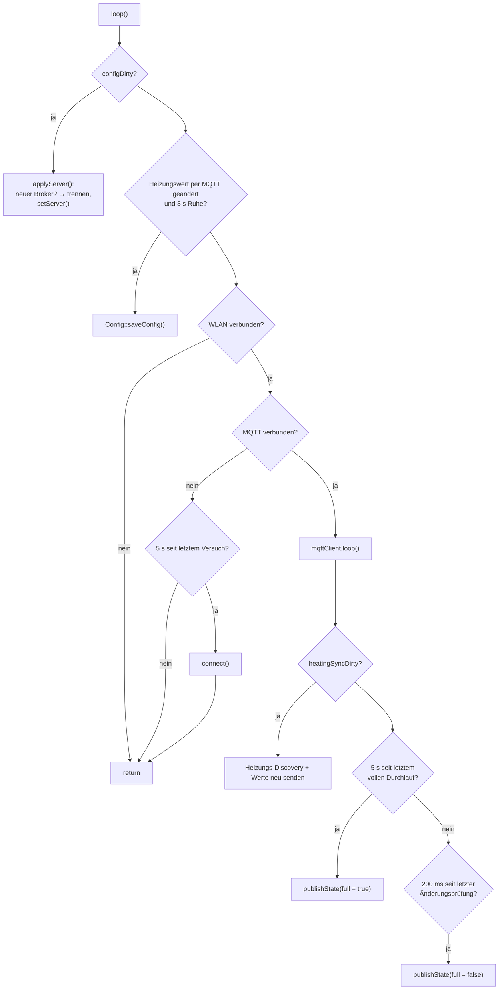
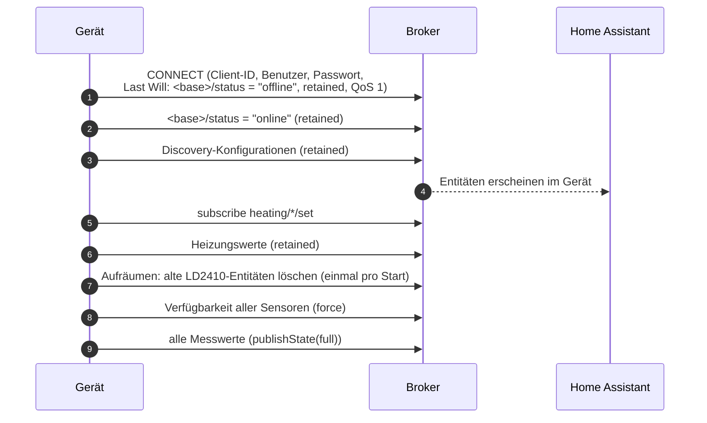

# MyMQTT – MQTT und Home-Assistant-Anbindung

**Dateien:** `src/MyMQTT.cpp`, `src/MyMQTT.h` · **Namespace:** `MyMQTT`
**Bibliotheken:** `knolleary/PubSubClient`, `bblanchon/ArduinoJson` · Build-Flag `-D MQTT_MAX_PACKET_SIZE=1024`

## Zweck

`MyMQTT` hält die Verbindung zum Broker und erledigt drei Dinge:

1. **Home-Assistant-Discovery:** Beim Verbinden meldet das Gerät alle seine Entitäten selbst an. Es ist keine
   `configuration.yaml` nötig.
2. **Messwerte veröffentlichen:** alle 5 s vollständig, dazwischen im 200-ms-Takt nur das, was sich geändert hat.
3. **Befehle annehmen:** Zieltemperatur und Hysteresen der Heizung lassen sich aus Home Assistant einstellen.

MQTT läuft im **`loopTask`** (`MyMQTT::loop()` wird aus `loop()` aufgerufen). Der Client gehört diesem Task; andere Tasks
dürfen ihn nicht anfassen – sie setzen nur Flags.

## Öffentliche Schnittstelle

| Funktion | Beschreibung |
|---|---|
| `void init()` | Server aus der Konfiguration übernehmen, Puffer auf 1024 Byte, Callback für eingehende Nachrichten setzen |
| `void loop()` | Pro `loop()`-Durchlauf: Verbindung halten, Nachrichten verarbeiten, Werte veröffentlichen |
| `bool isConnected()` | Besteht eine Verbindung zum Broker? |
| `String activeBroker()` | Der Broker, mit dem gerade gearbeitet wird (`adresse:port`); leer vor `init()` |
| `void requestReconnect()` | Merkt vor, dass sich die MQTT-Einstellungen geändert haben. Sicher aus jedem Task aufrufbar |
| `void requestHeatingSync()` | Merkt vor, dass sich die Heizungseinstellungen geändert haben (Discovery und Werte neu senden) |

| Makro | Standard | Bedeutung |
|---|---|---|
| `MQTT_PUBLISH_INTERVAL_MS` | 5000 | Abstand der **vollständigen** Durchläufe |
| `MQTT_CHANGE_CHECK_INTERVAL_MS` | 200 | Abstand der Prüfung auf **Änderungen** |
| `MQTT_RECONNECT_INTERVAL_MS` | 5000 | Abstand der Verbindungsversuche |

## Funktionsweise

### Kennungen

| Größe | Wert |
|---|---|
| `deviceId` (zugleich MQTT-Client-ID) | `HyphaHome-Sens-<letzte 6 Hex-Zeichen der MAC>` |
| `baseTopic` | `HyphaHome-Sens/<letzte 6 Hex-Zeichen der MAC>` |
| Discovery-Topic | `homeassistant/<komponente>/<deviceId>/<objectId>/config` |

Der MAC-Suffix macht mehrere Geräte am selben Broker unterscheidbar. Er entsteht wie der Hotspot-Name in
[WLANManager](wlan-manager.md).

### Ablauf von `loop()`

Die Verbindung wird nur aufgebaut, solange das WLAN im Zustand `Connected` ist (nicht im Hotspot).

### Verbindungsaufbau (`connect()`)

Der **Last Will** auf `<base>/status` sorgt dafür, dass Home Assistant das Gerät als „nicht verfügbar“ anzeigt, wenn die
Verbindung unerwartet abbricht.

### Verfügbarkeit

Jede Entität hängt an **zwei** Topics (`availability_mode: all`): dem geräteweiten `<base>/status` und dem ihres
Sensors (`<base>/<sensor>/available`). Die Entität ist nur verfügbar, wenn das Gerät online **und** der Sensor
erreichbar ist. Fällt der SHT41 aus, zeigt Home Assistant Temperatur und Feuchte als „nicht verfügbar“ statt eines
veralteten Werts.

`publishSensorAvailability()` sendet nur bei Änderung (retained); nach einem Reconnect einmal mit `force`. Eine Besonderheit:
`air_quality/available` ist `online`, wenn **mindestens einer** von SCD40 und ENS160 antwortet.

### Messwerte: voll und geändert

Jeder Messwert hat einen Platz („Slot“) im Zwischenspeicher `sent[]`. Zwei Durchläufe:

| Durchlauf | Wann | Was |
|---|---|---|
| **Voll** (`full = true`) | alle 5 s und direkt nach dem Verbinden | **Alle** Werte, auch unveränderte |
| **Änderung** (`full = false`) | alle 200 ms dazwischen | Nur Werte, die vom **zuletzt gesendeten** Wert um mehr als die Schwelle abweichen |

Verglichen wird mit dem zuletzt **gesendeten** Wert, nicht mit der letzten Messung. Sonst würde ein Wert, der in vielen
kleinen Schritten driftet, nie die Schwelle überschreiten. Die Schwelle ist die größere von `minDelta` (absolut, hält
das Messrauschen zurück) und `minRelative × |letzter Wert|` (relativ, nur bei Lux).

Texte (Stufen, `ON`/`OFF`, Brandindikator) werden gesendet, sobald sie sich ändern. Entfernung und Energie des LD2410
schwanken mit jedem Frame und gehen nur im vollen Durchlauf hinaus; Präsenz, Bewegung und Stillstand dagegen sofort.

**Werte werden nur gesendet, solange der zugehörige Sensor `isConnected` ist.** Der BH1750 liefert zum Beispiel bei einem
Lesefehler `-1`, das darf nicht als Messwert durchgehen.

## Topics und Entitäten

`<base>` = `HyphaHome-Sens/<mac6>`. State-Topics sind **nicht retained**, Verfügbarkeit, Discovery und Heizungswerte schon.
„HA“ gibt an, ob die Entität in Home Assistant **standardmäßig aktiv** ist (`enabled_by_default`).

### Raumklima

| Topic | Inhalt | Einheit | Schwelle | HA |
|---|---|---|---|---|
| `<base>/sht41/temperature` | geglättete Temperatur | °C | 0,1 | aktiv |
| `<base>/sht41/humidity` | geglättete Feuchte | % | 0,5 | aktiv |
| `<base>/sht41/dew_point` | Taupunkt | °C | 0,1 | aktiv |
| `<base>/sht41/temperature_raw` | Rohtemperatur | °C | 0,1 | aus |
| `<base>/sht41/temperature_calibrated` | kalibrierte Temperatur (ohne Mittelwert) | °C | 0,1 | aus |
| `<base>/sht41/humidity_raw` | Rohfeuchte | % | 0,5 | aus |
| `<base>/sht41/humidity_calibrated` | kalibrierte Feuchte (ohne Mittelwert) | % | 0,5 | aus |
| `<base>/bh1750/lux` | kalibrierte Helligkeit | lx | 1 lx oder 5 % | aktiv |
| `<base>/bh1750/lux_raw` | Rohwert | lx | 1 lx oder 5 % | aus |
| `<base>/scd40/co2` | CO₂ | ppm | 10 | aktiv |
| `<base>/scd40/temperature`, `…/humidity` | Werte des SCD40 | °C, % | 0,1 / 0,5 | aus |
| `<base>/aht21/temperature`, `…/humidity` | Werte des AHT21 | °C, % | 0,1 / 0,5 | aus |

### Luftqualität

| Topic | Inhalt | HA |
|---|---|---|
| `<base>/air_quality` | **Schlechtere** der beiden Stufen aus CO₂ und AQI (`Super` … `Hoch`) | aktiv |
| `<base>/scd40/level` | Stufe aus dem CO₂-Wert | aus |
| `<base>/ens160/level` | Stufe aus dem AQI | aus |
| `<base>/ens160/tvoc` | TVOC in ppb (Schwelle 10) | aktiv |
| `<base>/ens160/eco2` | eCO₂ in ppm (Schwelle 10) | aus |
| `<base>/ens160/status` | `Normal`, `Aufwärmen`, `Erststart`, `Ungültig` | aktiv (Diagnose) |

`air_quality` wird aus der Rangzahl (0 = Super … 4 = Hoch) beider Quellen gebildet. Liegt nur eine vor, zählt nur diese;
liegt keine vor, wird nichts gesendet. Der numerische AQI (1–5) wird **nicht** mehr veröffentlicht – die Stufe enthält
dieselbe Information.

### Präsenz (LD2410)

| Topic | Inhalt | HA |
|---|---|---|
| `<base>/ld2410/presence` | `ON`/`OFF` (binary_sensor, `occupancy`) | aus |
| `<base>/ld2410/motion` | `ON`/`OFF` (`motion`) | aus |
| `<base>/ld2410/stationary` | `ON`/`OFF` (`occupancy`) | aus |
| `<base>/ld2410/moving_distance`, `moving_energy`, `stationary_distance`, `stationary_energy` | cm bzw. % (nur im vollen Durchlauf) | aus |

„Präsenz“ ist standardmäßig aus, weil sie nur *Bewegung ODER Stillsitzen* bedeutet und damit redundant ist.

### Brandfrüherkennung

| Topic | Inhalt | HA |
|---|---|---|
| `<base>/fire/indicator` | `Deaktiviert`, `OK`, `Verdacht`, `Wahrscheinlich` (wird **immer** gesendet) | aktiv |
| `<base>/fire/tvoc_rate`, `co2_rate`, `temperature_rate` | Anstieg in ppb/min, ppm/min, K/min (Hilfswerte zum Abstimmen) | aus (Diagnose) |

### Diagnose

| Topic | Inhalt | HA |
|---|---|---|
| `<base>/diagnostic/ui_version`, `ui_vendor` | Version und Hersteller der Web-UI (erst, wenn eine UI gelesen wurde) | aktiv |
| `<base>/diagnostic/cpu_temperature` | Chiptemperatur in °C (Schwelle 1) | aktiv |
| `<base>/diagnostic/wifi_rssi` | Signalstärke in dBm (Schwelle 3) | aktiv |

### Heizung (nur wenn `controls.heating.enabled`)

| Topic | Richtung | Inhalt |
|---|---|---|
| `<base>/heating/desired` | Gerät → HA | Soll-Zustand `Ein`/`Aus`/`Unbekannt` |
| `<base>/heating/actual` | Gerät → HA | Ist-Zustand `Ein`/`Aus`/`Gemischt`/`Nicht erreichbar`/`Unbekannt` |
| `<base>/heating/target` (retained) | Gerät → HA | Zieltemperatur |
| `<base>/heating/target/set` | HA → Gerät | neue Zieltemperatur (5,0 bis 30,0 °C) |
| `<base>/heating/hysteresis_on` (retained) / `…/set` | beide | Einschalthysterese in Minuten (0 bis 1440) |
| `<base>/heating/hysteresis_off` (retained) / `…/set` | beide | Ausschalthysterese in Minuten (0 bis 1440) |

Ist die Heizungssteuerung **ausgeschaltet**, löscht das Gerät die Entitäten wieder: leere retained Nachrichten auf ihre
Discovery- und Wert-Topics (`removeEntity()`).

## Eingehende Befehle (Heizung)

`onMessage()` verarbeitet die drei `…/set`-Topics:

1. Ist die Heizung aus, wird die Nachricht ignoriert.
2. Der Payload (höchstens 15 Zeichen) wird mit `strtof` gelesen.
3. Zieltemperatur: auf 0,1 gerundet und auf 5,0 bis 30,0 geprüft. Hysterese: auf ganze Minuten gerundet, 0 bis 1440.
4. **Ungültige Werte werden verworfen**, aber der gültige Wert wird trotzdem zurückgemeldet (`publishHeatingState()`), damit
   Home Assistant nicht auf einem Wert stehen bleibt, den das Gerät nie übernommen hat.
5. Bei einer Änderung wird das Speichern erst **3 s später** ausgelöst (`HEATING_SAVE_DELAY_MS`). Ein Schieberegler
   schickt viele Werte kurz hintereinander, und jedes Speichern kostet Flash-Zyklen.

Die Änderungen wirken sofort auf [HeatingControl](heating-control.md), weil dieses direkt `Config::controls.heating`
liest.

## Konfigurationsänderungen

| Auslöser | Reaktion |
|---|---|
| `POST /api/config` mit Zweig `mqtt` | `requestReconnect()` → `loop()` ruft `applyServer()`. Hat sich `url:port` geändert, wird die Verbindung getrennt und neu aufgebaut |
| `POST /api/config` mit Zweig `controls.heating` | `requestHeatingSync()` → Discovery der Heizung neu senden bzw. entfernen, Werte neu melden |

Benutzer und Passwort werden bei jedem `connect()` frisch aus `Config::mqtt` gelesen. Ändert man nur sie, wird also beim
nächsten Verbindungsaufbau der neue Wert benutzt (eine bestehende Verbindung bleibt bis dahin offen).

## Besonderheiten

- `MQTT_MAX_PACKET_SIZE=1024` ist als Build-Flag gesetzt und zusätzlich per `setBufferSize(1024)`; die größten Pakete sind
  die Discovery-Dokumente.
- `connect()` blockiert `loop()` für die Dauer des Verbindungsversuchs. PubSubClient gibt dafür standardmäßig bis zu 15 s Zeit
  (`MQTT_SOCKET_TIMEOUT`). Der Watchdog der Hauptschleife steht auf 30 s ([main](main.md)), diese Zeit passt also hinein.
- Die **Discovery wird nach jedem Reconnect neu gesendet** (retained). Dadurch aktualisiert sich auch die
  `configuration_url` (IP-Adresse) in Home Assistant, und ein geänderter Hostname erreicht HA beim nächsten Verbinden.
- Alle Entitäten teilen einen `device`-Block (Identifier, MAC, Name = Hostname, Hersteller `EideardVMR`, Modell
  `Hypha Home - Sens`, Firmwareversion). Nur dadurch ordnet Home Assistant sie einem Gerät zu.
- `removeLegacyLd2410Entities()` löscht einmal pro Start die Reste früherer Firmware (Gate-Empfindlichkeiten, Max-Gates
  als MQTT-Entitäten).

## Siehe auch

[Architektur: Weg eines MQTT-Wertes](../architektur.md#weg-eines-mqtt-wertes) · [HeatingControl](heating-control.md) ·
[FireDetect](fire-detect.md) · [WLANManager](wlan-manager.md)
