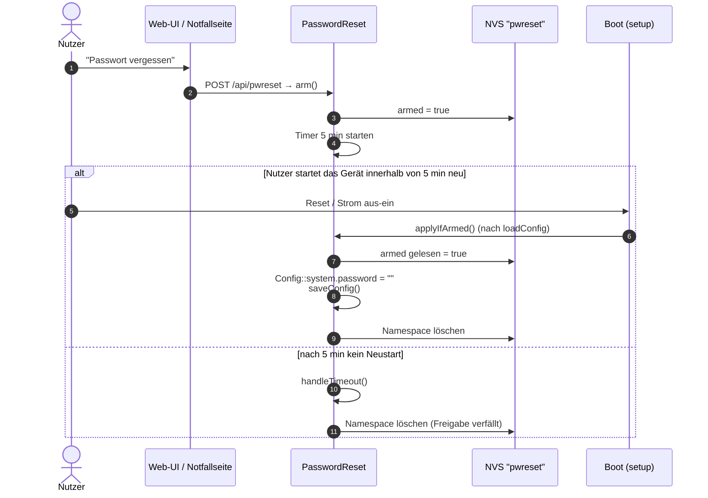

# PasswordReset – Notfall-Zurücksetzen des Passworts

**Dateien:** `src/PasswordReset.cpp`, `src/PasswordReset.h` · **Namespace:** `PasswordReset`
**Speicher:** NVS, Namespace `pwreset`, Schlüssel `armed`

## Zweck

Hat jemand das Geräte-Passwort vergessen, kommt er an die Konfiguration nicht mehr heran. Eine Möglichkeit ohne Kabel und Flash-Werkzeug:
Das Zurücksetzen wird über das Netz **freigegeben** und erst durch einen **Neustart des Geräts** wirksam. Der Neustart beweist physischen
Zugriff (Stecker ziehen oder Reset-Taste), denn ein Angreifer allein über das Netz kann das Gerät nicht neu starten, solange er nicht angemeldet ist.

## Ablauf

## Öffentliche Schnittstelle

| Funktion | Beschreibung |
|---|---|
| `arm()` | Gibt das Zurücksetzen frei: Flag im NVS setzen, Zeitpunkt merken, `armed = true` |
| `uint32_t remainingSeconds()` | Restzeit der Freigabe in Sekunden (aufgerundet), 0 wenn keine aktiv |
| `applyIfArmed()` | Beim Start: Ist das Flag im NVS gesetzt, wird das Passwort gelöscht (und gespeichert), danach wird das Flag verbraucht |
| `handleTimeout()` | In `loop()`: löscht die Freigabe nach Ablauf der Frist |

Konfigurierbare Makros: `PWRESET_VALUD_MS` (Gültigkeit der Freigabe, Standard **5 min**), `PWRESET_NVS_NAMESPACE` (`"pwreset"`),
`PWRESET_NVS_KEY_ARMED` (`"armed"`). (Der Makroname enthält einen Tippfehler: `VALUD` statt `VALID`.)

## Funktionsweise im Detail

- **Das Flag steht im NVS**, nicht im RAM, weil es den Neustart überleben muss. Die Zeitmessung (`armedAt`) liegt nur im RAM; nach einem
  Neustart ist die Frist also nicht mehr relevant. Das Flag zählt, solange es gesetzt ist.
- **Freigabe verfällt** nur, wenn das Gerät **nicht** neu gestartet wurde: `handleTimeout()` löscht dann das Flag. Wird das Gerät innerhalb der
  Frist neu gestartet, ist das Flag noch da und `applyIfArmed()` wirkt. Wird es erst nach der Frist neu gestartet, ist das Flag bereits gelöscht, **sofern das Gerät bis dahin durchgelaufen ist**: Fällt der Strom
  innerhalb der 5 min aus, bleibt das Flag stehen, und `applyIfArmed()` löscht das Passwort beim nächsten Start, egal wie viel später das ist (die Frist
  läuft nur im RAM).
- **Aufrufreihenfolge in `setup()`** ist wichtig (siehe [Architektur](../architektur.md)):
  1. **nach** `Config::loadConfig()`, weil das Laden das Passwort sonst wieder aus der Datei zurückholt,
  2. **vor** dem Setzen des automatischen Hostnamens, weil `applyIfArmed()` `Config::saveConfig()` aufruft und der automatische Name sonst
     mitgespeichert würde.
- `writeFlag(false)` löscht den **ganzen Namespace** (`prefs.clear()`), nicht nur den Schlüssel.

## Wo kommt die Freigabe her?

| Stelle | Route |
|---|---|
| [Webinterface](webinterface.md) | `GET /api/pwreset` → `{"remaining": s}`, `POST /api/pwreset` → `arm()` und Restzeit |
| [UiUpdate](ui-update.md) (Notfallseite) | Knopf „Forgot password“ → `POST /api/pwreset`, Hinweis „Restart the device now, afterwards the password is empty“ |
| Web-UI | Seite `/pwreset` (liefert [Webfiles](webfiles.md) aus) |

> Die beiden Routen verlangen **keine** Anmeldung. Das ist gewollt, denn der Nutzer hat das Passwort ja vergessen. Die Sicherheit liegt im Neustart.

## Besonderheiten

- Jeder im selben Netz kann die Freigabe auslösen. Wirksam wird sie aber nur, wenn jemand das Gerät danach neu startet. Wer physischen
  Zugriff hat, kann das Passwort also immer zurücksetzen. Das ist als Werkseinstellungs-Ersatz beabsichtigt.
- Wer die Freigabe auslöst und **zufällig** innerhalb von 5 min einen Neustart verursacht (Stromausfall, Update), verliert das Passwort ebenfalls.
- Nach dem Zurücksetzen ist das Passwort **leer** und damit das Gerät offen, bis ein neues gesetzt wird ([Session](session.md)).

## Siehe auch

[Session](session.md) · [Webinterface](webinterface.md) · [Config](config.md) · [Architektur: setup()](../architektur.md)
