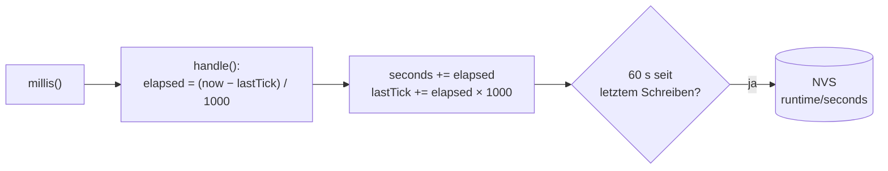

# Runtime – Betriebszeit und Erstinbetriebnahme

**Dateien:** `src/Runtime.cpp`, `src/Runtime.h` · **Namespace:** `Runtime`

## Zweck

`Runtime` zählt die **gesamte Betriebszeit** des Geräts über alle Einschaltvorgänge hinweg. Der Zähler dient außerdem als
Merker für die **Erstinbetriebnahme**: Steht dort 0, lief das Gerät noch nie, und `main.cpp` sucht einmalig nach den
bestückten Sensoren ([main](main.md#erstinbetriebnahme-detectsensors)).

Gespeichert wird im NVS (Namespace `runtime`, Schlüssel `seconds`), nicht im Dateisystem.

## Öffentliche Schnittstelle

| Funktion | Beschreibung |
|---|---|
| `void begin()` | Liest den Zählerstand aus dem NVS und setzt Start- und Sitzungszeit. Setzt `firstBoot`, wenn der Wert 0 ist |
| `void handle()` | Rechnet die vergangene Zeit auf den Zähler und schreibt ihn höchstens alle 60 s in das NVS. Jeden `loop()`-Durchlauf aufrufen |
| `void flush()` | Schreibt sofort, unabhängig vom Intervall (vor einem Neustart, nach der Erstinbetriebnahme) |
| `uint32_t totalSeconds()` | Gesamte Betriebszeit |
| `uint32_t sessionSeconds()` | Betriebszeit seit dem letzten Einschalten |
| `bool isFirstBoot()` | `true` bei der Erstinbetriebnahme. **Erst nach `begin()` aufrufen** |
| `void reset()` | Setzt den Zähler auf 0 → das Gerät gilt beim nächsten Start wieder als fabrikneu |

| Makro | Standard | Bedeutung |
|---|---|---|
| `RUNTIME_WRITE_INTERVAL_MS` | 60000 | Abstand zwischen zwei NVS-Schreibvorgängen |
| `RUNTIME_NVS_NAMESPACE` | `"runtime"` | NVS-Namespace |
| `RUNTIME_NVS_KEY_SECONDS` | `"seconds"` | NVS-Schlüssel |

## Funktionsweise

- `lastTick` wird nur um **volle Sekunden** weitergeschoben. Eine angebrochene Sekunde geht nicht verloren.
- `sessionSeconds()` ist `seconds − sessionStart`, wobei `sessionStart` der Zählerstand beim Hochfahren ist.
- **Flash schonen:** NVS schreibt Zellen wechselnd, trotzdem hat der Flash nur etwa 100 000 Schreibzyklen. Alle 60 s ist
  deshalb die Untergrenze, die der Quelltext empfiehlt. Beim kontrollierten Neustart (`restartSoon()`, OTA-Update)
  wird zusätzlich `flush()` aufgerufen, damit die letzten Sekunden nicht fehlen.
- Bei einem **Stromausfall** gehen daher bis zu 60 s Betriebszeit verloren. Das ist für den Zweck (Erstinbetriebnahme
  erkennen, Betriebsdauer anzeigen) ausreichend.

## Wo wird `Runtime` verwendet?

| Aufrufer | Zweck |
|---|---|
| `main.cpp` | `begin()`, `isFirstBoot()`, `flush()`, `handle()` |
| [Webinterface](webinterface.md) | Anzeige in `/api/config` und `/api/dashboard`; `flush()` vor `restartSoon()` |
| [FirmwareUpdate](firmware-update.md) | `flush()` vor dem Neustart nach einem Update |

## Besonderheiten

- Läuft der Zähler über (`uint32_t`, rund 136 Jahre), ist das für dieses Gerät ohne Bedeutung.
- Wird der Zähler per `reset()` auf 0 gesetzt, startet beim **nächsten Neustart** die Erstinbetriebnahme mit der
  30-Sekunden-Wartezeit und der erneuten Sensorsuche. `reset()` wird im aktuellen Code von keinem Modul aufgerufen; auch
  `POST /api/reset` setzt nur die Konfiguration zurück, nicht den Zähler.

## Siehe auch

[main](main.md) · [Config](config.md)
