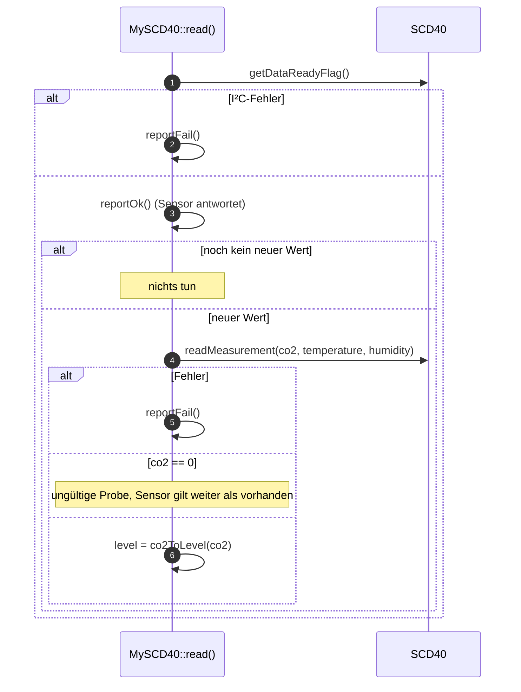

# MySCD40 – CO₂-Sensor

**Dateien:** `src/MySCD40.cpp`, `src/MySCD40.h` · **Namespace:** `MySCD40`
**Sensor:** SCD40 (Sensirion) · **Anschluss:** I²C, Adresse `0x62`
**Bibliothek:** `sensirion/Sensirion I2C SCD4x`

## Zweck

Misst die CO₂-Konzentration in ppm (zusätzlich Temperatur und Feuchte) und leitet daraus eine **Ampelstufe** ab, die
auch in die zusammengefasste Luftqualität eingeht.

## Öffentliche Schnittstelle

| Element | Typ | Beschreibung |
|---|---|---|
| `SCD40_ADDRESS` | Makro | `0x62` |
| `scd4x` | `SensirionI2CScd4x` | Treiberinstanz |
| `isConnected` | `bool` | Sensor antwortet |
| `co2` | `uint16_t` | CO₂ in ppm (0 = noch kein Wert) |
| `temperature` | `float` | Temperatur des SCD40 in °C |
| `humidity` | `float` | Relative Feuchte des SCD40 in % |
| `level` | `Level` | Ampelstufe |
| `enum class Level { Super, Gut, Mittel, Schlecht, Hoch }` | | |
| `co2ToLevel(uint16_t)` | Funktion | Ppm → Stufe |
| `levelToString(Level)` | Funktion | Stufe → `"Super"` … `"Hoch"` (für MQTT) |
| `init()` / `read(bool print = true)` / `probe()` | Funktionen | wie bei allen Sensormodulen |

### Stufen

| CO₂ (ppm) | Stufe |
|---|---|
| < 800 | Super |
| 800 bis < 1000 | Gut |
| 1000 bis < 1200 | Mittel |
| 1200 bis < 1600 | Schlecht |
| ≥ 1600 | Hoch |

## Funktionsweise

Der SCD40 arbeitet im **zyklischen Messmodus** und liefert etwa alle 5 Sekunden einen neuen Wert. Er wird deshalb
im 5-s-Takt gelesen ([main](main.md)).

- **Start (`startSensor`)**: `scd4x.begin(Wire)`, `stopPeriodicMeasurement()` (falls der Sensor noch von einer früheren
  Sitzung misst), **500 ms Pause** (laut Datenblatt nötig), dann `startPeriodicMeasurement()`. Der erste Wert kommt nach
  etwa 5 s.
- Weil der Start blockiert, wird ein fehlender SCD40 nur alle **30 s** gesucht (statt 15 s), damit `loop()` nicht alle
  15 s eine halbe Sekunde steht.
- **Ein „leerer“ Zyklus** (Daten noch nicht bereit) ist kein Fehler: der Sensor hat ja geantwortet.

## Konfiguration

| Einstellung | Bedeutung |
|---|---|
| `sensors.scd40.enabled` | Sensor ein/aus |

Es gibt keine Kalibrierung und keine Höhenkompensation im Code.

## Verwendung der Werte

| Verbraucher | Wert |
|---|---|
| [MyMQTT](mqtt.md) | `…/scd40/co2`, `…/scd40/level`, `…/scd40/temperature`, `…/scd40/humidity`; `…/air_quality` (zusammen mit ENS160) |
| [FireDetect](fire-detect.md) | `co2` für den CO₂-Anstieg |
| [Webinterface](webinterface.md) | `GET /api/sensors` → `scd40` (Stufe als Schlüssel `great/good/medium/bad/high`) |

## Besonderheiten

- Temperatur und Feuchte des SCD40 sind **Nebenprodukte** und in Home Assistant standardmäßig deaktiviert; für das
  Raumklima ist der [SHT41](sht41.md) maßgeblich.
- Die `Level`-Namen sind deutsch (`Super` … `Hoch`), die API nutzt dagegen englische Schlüssel, die die Web-UI übersetzt.

## Siehe auch

[SensorHealth](sensor-health.md) · [FireDetect](fire-detect.md) · [MyENS160](ens160.md)
