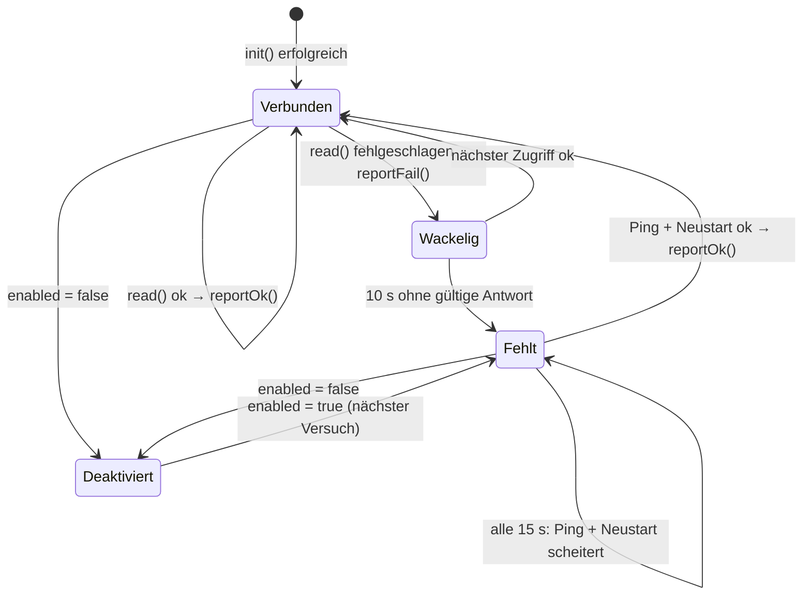
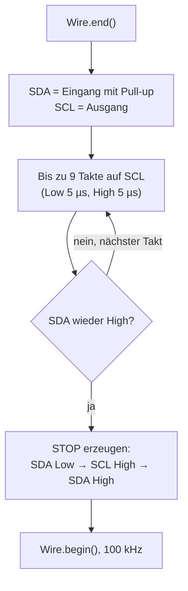

# SensorHealth – Ausfallerkennung und I²C-Rettung

**Dateien:** `src/SensorHealth.cpp`, `src/SensorHealth.h` · **Namespace:** `SensorHealth`

## Zweck

Drei Dinge, die sonst in jedem Sensormodul einzeln stehen müssten:

1. **Entprellen.** Auf einem I²C-Bus mit mehreren Teilnehmern gibt es gelegentlich Aussetzer. Ein einzelner Fehlschlag
   meldet einen Sensor deshalb noch nicht ab. Gerechnet wird in **Zeit**, nicht in Versuchen.
2. **Wiederfinden.** Ein als fehlend markierter Sensor wird in Abständen erneut gesucht.
3. **Bus befreien.** Wird ein I²C-Sensor mitten in einer Übertragung abgezogen, kann er `SDA` dauerhaft auf Low
   halten und damit den ganzen Bus blockieren.

## Öffentliche Schnittstelle

| Element | Beschreibung |
|---|---|
| `FAIL_TIMEOUT_MS = 10000` | So lange darf ein Sensor am Stück ohne gültige Antwort bleiben, bevor er als fehlend gilt |
| `RETRY_INTERVAL_MS = 15000` | Standardabstand zwischen zwei Suchversuchen |
| `struct State { fails; failSince; lastRetry; }` | Zustand eines Sensors. Jedes Sensormodul legt eine `static`-Instanz an |
| `reportOk(bool& present, State&, const char* tag)` | Erfolgreicher Zugriff: Fehlerzähler auf 0, `present = true`. Log nur beim **Wechsel** des Zustands |
| `reportFail(bool& present, State&, const char* tag)` | Fehlgeschlagener Zugriff. Erst nach `FAIL_TIMEOUT_MS` seit dem **ersten** Fehlschlag der Folge wird `present = false` |
| `bool retryDue(State&, uint32_t interval = 15000)` | `true`, wenn seit dem letzten Versuch `interval` ms vergangen sind; merkt sich dann die Zeit |
| `bool i2cPing(uint8_t address)` | Antwortet unter der Adresse ein Gerät mit ACK? Viel billiger als ein vollständiger Start |
| `void i2cRecoverBus()` | Gibt einen blockierten Bus frei |

Das `isConnected`-Flag selbst bleibt öffentlich im jeweiligen Sensormodul, weil MQTT und die API es lesen.

## Funktionsweise

### Zustandsautomat jedes Sensors



„Wackelig“ ist kein eigener Zustand im Code, sondern `fails > 0` bei `present == true`. Dazu in `reportFail()`:

- `failSince` wird beim ersten Fehlschlag der Folge gesetzt, ein Erfolg setzt den Zähler (`fails`) auf 0 zurück.
- Der Zähler `fails` dient **nur** der Log-Ausgabe (`antwortet nicht mehr (seit 10 s, 12 Fehlversuche)`).
- Ist der Sensor schon abgemeldet, passiert nichts mehr – kein erneutes Zählen, kein erneutes Loggen.

### Wiederfinden

Jedes Sensormodul nutzt in `read()` dasselbe Muster:

```cpp
if (!isConnected) {
    if (SensorHealth::retryDue(health) && SensorHealth::i2cPing(ADDR) && startSensor()) {
        SensorHealth::reportOk(isConnected, health, TAG);
    }
    return;
}
```

Erst wenn Zeit abgelaufen **und** der Ping antwortet, wird der teure Start ausgeführt. Der SCD40 nutzt 30 s statt
15 s, weil sein Start ein blockierendes `delay(500)` enthält.

### Bus-Freigabe: `i2cRecoverBus()`

Das Verfahren folgt der Empfehlung der I²C-Spezifikation für einen hängenden Slave:



Neun Takte reichen, damit ein Slave sein angefangenes Byte zu Ende schreiben und `SDA` loslassen kann. Das STOP-Signal am
Ende bringt alle Teilnehmer zurück in den Ruhezustand.

Aufgerufen wird die Funktion aus [`loop()`](main.md), wenn **alle fünf I²C-Sensoren gleichzeitig** als fehlend gelten, und
höchstens alle 30 s. Der LD2410 zählt nicht mit, er hängt an der UART.

## Besonderheiten

- `i2cPing()` benutzt die globale `Wire`-Instanz; der Aufruf im Hauptloop-Task und der Aufruf aus Webserver-Handlern
  dürfen sich nicht überlappen. Die Handler greifen allerdings nie auf den Bus zu, nur auf die Sensorvariablen.
- Der ENS160 braucht zusätzlich zur Ping-Prüfung eine Datenprüfung (siehe [MyENS160](ens160.md)), weil er auch nach einem
  internen Reset noch am Bus antwortet.
- Der LD2410 hat keine Bus-Antwort wie I²C; sein „Ping“ ist, ob noch gültige Frames ankommen
  (siehe [MyLD2410](ld2410.md)).

## Siehe auch

[main](main.md) · [MyBH1750](bh1750.md) · [MySHT41](sht41.md) · [MySCD40](scd40.md) · [MyAHT21](aht21.md) · [MyENS160](ens160.md) · [MyLD2410](ld2410.md)
