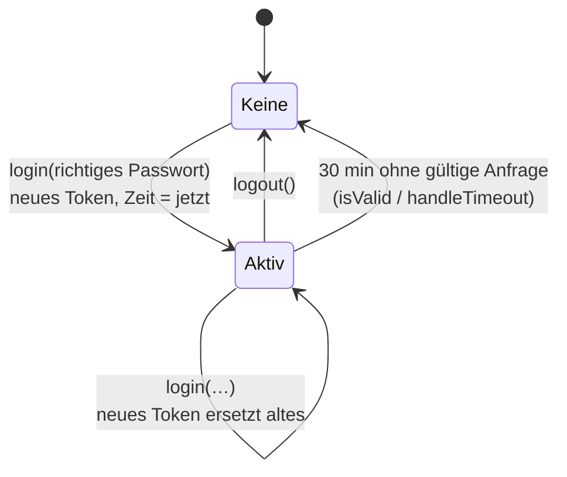

# Session – Anmeldung per Sitzungstoken

**Dateien:** `src/Session.cpp`, `src/Session.h` · **Namespace:** `Session`
**Konfiguration:** `Config::system.password` · Build-Flag `SESSION_TIMEOUT_MINUTES` (Standard 30)

## Zweck

Schützt die REST-API und die Update-Routen mit **einem Passwort** für das ganze Gerät (kein Benutzername). Wer das richtige Passwort schickt,
bekommt ein zufälliges **Token**, das er bei jeder weiteren Anfrage im Kopf `X-Auth-Token` mitschickt.

> Es gibt nur **ein einziges Token**. Meldet sich jemand neu an, wird die vorige Sitzung ungültig. Mehrfachanmeldung ist nicht möglich.

## Öffentliche Schnittstelle

| Funktion | Beschreibung |
|---|---|
| `bool isProtected()` | Ist ein Passwort gesetzt (`password.length() > 0`)? |
| `String login(password)` | Prüft das Passwort, erzeugt ein neues Token und startet die Sitzung. Leerer String bei falschem Passwort |
| `bool checkPassword(password)` | Prüft nur das Passwort, **ohne** Sitzung anzulegen oder zu beenden (für die Notfallseite von [UiUpdate](ui-update.md)) |
| `bool isValid(token)` | Prüft ein Token und **verlängert** bei Erfolg die Frist |
| `void logout()` | Beendet die Sitzung sofort |
| `void handleTimeout()` | Verwirft eine abgelaufene Sitzung (aus `loop()`) |
| `uint32_t remainingSeconds()` | Restlaufzeit in Sekunden, 0 ohne Sitzung (für die Anzeige) |

## Funktionsweise

- **Token:** 32 Hexadezimalziffern aus vier Aufrufen von `esp_random()` (Hardware-Zufallszahlengenerator).
- **Frist:** `SESSION_TIMEOUT_MINUTES` × 60 000 ms, gemessen mit `millis()`. Jede erfolgreich geprüfte Anfrage setzt den Zähler zurück
  (**Gleitfenster**). Die Oberfläche kann also offen bleiben, solange sie regelmäßig anfragt.
- **Kein Passwort gesetzt:** `isValid()` liefert dann immer `true`. Das Gerät ist offen; `login()` mit beliebigem Passwort ergibt trotzdem ein Token.
- **Leeres Token** wird nie akzeptiert (sofern ein Passwort gesetzt ist).
- Ist die Frist abgelaufen, räumt `isValid()` selbst auf (`logout()`) und lehnt ab. `handleTimeout()` in `loop()` tut dasselbe für den Fall, dass gar keine Anfrage mehr kommt.

## Wer benutzt es?

| Aufrufer | Funktion |
|---|---|
| [Webinterface](webinterface.md) | `login()` bei `POST /api/login`, `logout()`, `isValid()` in `requireAuth()`, `isProtected()` und `remainingSeconds()` in `GET /api/session` |
| [FirmwareUpdate](firmware-update.md) | `isValid()` beim Beginn des Uploads |
| [UiUpdate](ui-update.md) | `isValid()` (API-Route) bzw. `checkPassword()` (Notfallseite) |
| [main](main.md) | `handleTimeout()` in jedem `loop()` |

Die Seiten selbst (`/`, `/login`, …) sind **nicht** geschützt: [Webfiles](webfiles.md) liefert sie ohne Anmeldung aus. Geschützt sind die Daten hinter
`/api/...`. Die Oberfläche fragt `GET /api/session` und leitet bei Bedarf auf `/login` um.

## Besonderheiten

- **Das Passwort liegt im Klartext** in `config.json` und wird per Klartext-HTTP übertragen ([Auffälligkeiten](../auffaelligkeiten.md)).
- Der Vergleich `password != Config::system.password` ist ein einfacher String-Vergleich, **ohne** Schutz gegen Ausprobieren: keine Sperre nach
  Fehlversuchen, keine Verzögerung.
- Alle Zustände sind nur im RAM: Nach einem Neustart sind alle Sitzungen ungültig.
- Die statischen Variablen (`sessionToken`, `sessionTime`) werden aus mehreren Tasks gelesen, aber nicht gesperrt; die Handler laufen im selben Task (WLAN),
  `handleTimeout()` in `loopTask`.
- Vergessenes Passwort: [PasswordReset](password-reset.md).

## Siehe auch

[PasswordReset](password-reset.md) · [Webinterface](webinterface.md) · [Config](config.md)
