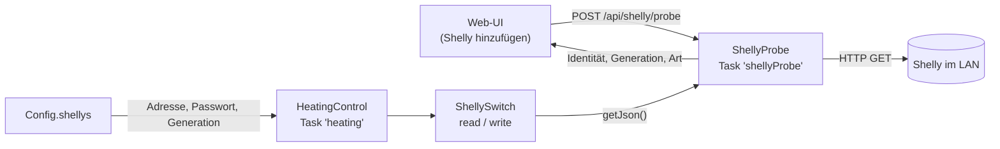
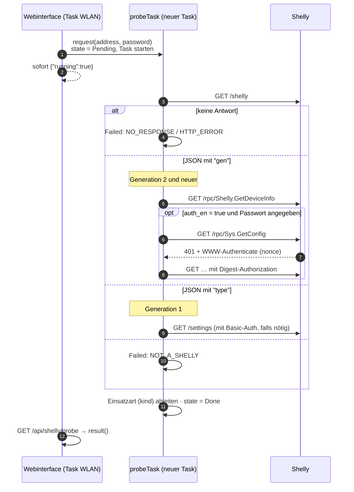

# ShellyProbe und ShellySwitch – Shelly-Geräte erkennen und schalten

**Dateien:** `src/ShellyProbe.cpp|.h`, `src/ShellySwitch.cpp|.h` · **Namespaces:** `ShellyProbe`, `ShellySwitch`
**Unterstützt:** Shelly Generation 1 bis 4 (Klartext-HTTP im eigenen Netz, Port 80)

Zwei Module, die zusammengehören:

- **`ShellyProbe`** findet heraus, *was* hinter einer IP-Adresse steckt (Modell, Generation, Passwortpflicht, Einsatzart). Es enthält außerdem
  den **HTTP-Client** der Shelly-Anbindung.
- **`ShellySwitch`** liest und setzt den Schaltzustand eines Relais. Es nutzt dafür den Client von `ShellyProbe`.

## Zweck im Gesamtsystem



## ShellyProbe

### Öffentliche Schnittstelle

| Funktion | Beschreibung |
|---|---|
| `request(address, password)` | Startet eine Abfrage in einem eigenen Task. Läuft schon eine, wird der Aufruf ignoriert |
| `State state()` | `Idle`, `Pending`, `Running`, `Done`, `Failed` |
| `Result result()` | Kopie des Ergebnisses der letzten Abfrage (mit Mutex, 200 ms Wartezeit) |
| `getJson(host, path, password, gen, doc, httpCode)` | GET mit Anmeldung, liefert ein JSON-Dokument. **Blockiert**, deshalb nie aus `loop()` oder dem Webserver aufrufen |

`Result` enthält: `address`, `error` (`HTTP_ERROR`, `NO_RESPONSE`, `NOT_A_SHELLY`, `OUT_OF_MEMORY`), `httpStatus`, `mac`, `gen` (1…4, 0 unbekannt),
`model`, `app`, `firmware`, `authRequired`, `passwordState`, `profile`, `kind`.

`PasswordState`: `Unchecked`, `NotNeeded`, `Missing`, `Wrong`, `Valid`.

### Ablauf einer Erkennung



Die Abfrage läuft in einem **eigenen Task** (`shellyProbe`, Priorität 1, Stack 8 KB), der genau eine Abfrage macht und sich dann selbst
beendet. Priorität 1 liegt unter dem Webserver (2): Eine Abfrage darf die Oberfläche nicht ausbremsen. Das Ergebnis entsteht in mehreren
Schritten; ein **Mutex** (`resultMutex`) hält den Zustand zusammen, damit der Leser nie einen halbfertigen Stand sieht. Das Passwort
wird nach der Abfrage aus dem Speicher gelöscht (`pendingPassword = ""`).

### Generationen und Anmeldung

| | Gen 1 | Gen 2 und neuer |
|---|---|---|
| Erkennung | `GET /shelly` enthält `type`, `fw`, `auth` | `GET /shelly` enthält `gen`, `model`, `app`, `ver`, `auth_en` |
| Weitere Daten | `GET /settings` (gefiltert auf `mode`, `device.type`) | `GET /rpc/Shelly.GetDeviceInfo` (Modell, App, Firmware, MAC, Profil) |
| Anmeldung | **HTTP Basic** (`admin:<Passwort>`) | **HTTP Digest, SHA-256**, Benutzer `admin` |
| Passwort prüfen | `/settings` mit Basic-Auth: 401 → `Wrong` | `GET /rpc/Sys.GetConfig`: 401 → Digest-Antwort → 200 = `Valid`, 401 = `Wrong` |
| Schalten | `GET /relay/<k>?turn=on` bzw. `…=off` | `GET /rpc/Switch.Set?id=<k>&on=true` bzw. `…=false` |
| Zustand lesen | `GET /relay/<k>` → `ison` | `GET /rpc/Switch.GetStatus?id=<k>` → `output` |

**Digest (Gen 2+)** (`digestAuthorization`): Aus dem `WWW-Authenticate`-Kopf werden `realm` und `nonce` gelesen. Dann gilt:

```
HA1      = SHA256("admin:" + realm + ":" + Passwort)
HA2      = SHA256("GET:" + uri)
response = SHA256(HA1 + ":" + nonce + ":00000001:" + cnonce + ":auth:" + HA2)
```

`cnonce` ist eine Zufallszahl aus `esp_random()`, `nc` bleibt `00000001`. Die SHA-256-Berechnung läuft über mbedTLS, das ohnehin im
Framework steckt, ohne den TLS-Stack hinzuzufügen.

### Einsatzart (`kind`)

`classify()` leitet aus Modell, App-Name und Profil die **Einsatzart** ab, damit die Oberfläche weiß, welche Kanäle es gibt:

| Ergebnis | Bedeutung |
|---|---|
| `switch1` | ein Schaltkanal (z. B. Shelly 1, Plug, Plus 1) |
| `switch2` | zwei Schaltkanäle (z. B. Shelly 2.5/Plus 2PM im Schaltbetrieb) |
| `cover` | Rollladen-/Jalousiebetrieb |
| `dimmer` | Dimmer |
| (leer) | nicht erkannt |

Gen 1: `SHDM-*` → `dimmer`; `SHSW-21`/`SHSW-25` mit Modus `roller` → `cover`, sonst `switch2`; andere `SHSW-*`/`SHPLG*` → `switch1`. Gen 2+:
App enthält „dimmer“ → `dimmer`; Profil `cover` → `cover`; „plug“ → `switch1`; sonst entscheidet die **erste Ziffer** im App-Namen (`1` → `switch1`,
`2` → `switch2`). Gen 1 nennt die Modi „relay“/„roller“; sie werden auf die Gen-2-Begriffe `switch`/`cover` umgesetzt, damit die
Oberfläche nur eine Schreibweise kennt.

### Der HTTP-Client (`httpGet`)

Absichtlich **ohne `HTTPClient`**: Dessen Header zieht den ganzen TLS-Stack in die Firmware (gemessen 162 KB), obwohl nur Klartext-HTTP im eigenen
Netz gebraucht wird. Stattdessen spricht `WiFiClient` HTTP/1.0 von Hand:

- Zeitlimits: Verbindungsaufbau `SHELLY_PROBE_CONNECT_TIMEOUT_MS` = **1500 ms**, Antwort `SHELLY_PROBE_READ_TIMEOUT_MS` = **2500 ms**.
- Gelesen werden nur die Statuszeile und zwei Kopfzeilen (`Transfer-Encoding: chunked`, `WWW-Authenticate`).
- Der Rumpf wird nur bei Status 200 gelesen, auch „chunked“, höchstens `SHELLY_PROBE_MAX_BODY` = 32768 Bytes. (Ein Shelly 2.5 liefert teils
  bis zu 10 kB; ein zu kleiner Puffer ergäbe kaputtes JSON.)
- `getJson()` wiederholt bei Gen 2+ und `401` den Aufruf mit Digest-Anmeldung, bei Gen 1 mit Passwort sendet es von vornherein Basic-Auth.

## ShellySwitch

### Öffentliche Schnittstelle

| Funktion | Beschreibung |
|---|---|
| `bool read(Target, channel, bool& on)` | Fragt ab, ob der Kanal an ist. `false` bei Fehler oder unpassender Antwort |
| `bool write(Target, channel, bool on)` | Schaltet ein oder aus. `true`, wenn das Gerät den Befehl angenommen hat |
| `struct Target { String address, password; uint8_t gen; }` | Kopie der nötigen Felder aus `Config::ShellyCfg` |

`Target` ist eine **Kopie**, damit der Aufrufer die Konfiguration nicht über die Dauer der blockierenden Anfrage festhalten muss. Bei `gen == 0`
(noch nicht erkannt) oder leerer Adresse tut `read()`/`write()` nichts und liefert `false`.

Die Funktionen blockieren für die Dauer der HTTP-Anfrage und werden deshalb nur vom Task [HeatingControl](heating-control.md) aufgerufen.

## Konfiguration (`shellys[]`)

| Feld | Bedeutung |
|---|---|
| `name` | Anzeigename |
| `address` | IP-Adresse oder Hostname |
| `mac` | Kennung des Geräts; bleibt gleich, auch wenn die Adresse wechselt |
| `gen` | Generation 1…4 (Ergebnis der Erkennung) |
| `kind` | Einsatzart (siehe oben) |
| `password` | Passwort, falls gesetzt (wird von `GET /api/config` nicht ausgegeben, nur `hasPassword`) |

Höchstens `SHELLY_MAX_COUNT` Geräte mit je `SHELLY_MAX_CHANNELS` Kanälen. Ausgänge der Heizung verweisen mit `shelly` (Schlüssel) und
`channel` auf einen Eintrag.

## Besonderheiten

- Gen 3 und 4 werden wie Gen 2 behandelt (gleiche RPC-API).
- Passwörter werden im Klartext in der Konfigurationsdatei gespeichert und im Klartext über HTTP übertragen (Basic) bzw. gehasht (Digest);
  siehe [Auffälligkeiten](../auffaelligkeiten.md).
- Bei der Erkennung gilt: leeres Passwort in der Anfrage heißt „gespeichertes Passwort dieser Adresse benutzen“ (Logik in
  [Webinterface](webinterface.md)).

## Siehe auch

[HeatingControl](heating-control.md) · [Webinterface](webinterface.md) · [Config](config.md)
