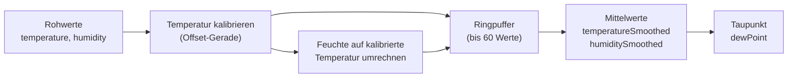

# MySHT41 – Temperatur und Luftfeuchte

**Dateien:** `src/MySHT41.cpp`, `src/MySHT41.h` · **Namespace:** `MySHT41`
**Sensor:** SHT41 · **Anschluss:** I²C, Adresse `0x44` (`SHT4x_DEFAULT_ADDR`)
**Bibliothek:** `adafruit/Adafruit SHT4x Library`

## Zweck

Der SHT41 ist der **Hauptsensor für Raumklima**. Das Modul liefert Temperatur und relative Luftfeuchte und rechnet
daraus mehrere abgeleitete Größen:



## Öffentliche Schnittstelle

| Element | Einheit | Beschreibung |
|---|---|---|
| `isConnected` | – | Sensor antwortet |
| `temperature` | °C | Rohwert |
| `humidity` | % rF | Rohwert |
| `temperatureCalibrated` | °C | Über die Ausgleichsgerade korrigiert |
| `humidityCalibrated` | % rF | Auf die korrigierte Temperatur umgerechnet |
| `temperatureSmoothed` | °C | Mittelwert der letzten *N* kalibrierten Werte. **Dieser Wert geht per MQTT hinaus und regelt die Heizung** |
| `humiditySmoothed` | % rF | Mittelwert der letzten *N* Feuchtewerte |
| `dewPoint` | °C | Taupunkt aus den gemittelten Werten |
| `init()` / `read(bool print = true)` / `probe()` | – | wie bei allen Sensormodulen |

## Funktionsweise

### Start

`startSensor()`: `sht4.begin()`, Präzision `SHT4X_HIGH_PRECISION`, **Heizer aus** (`SHT4X_NO_HEATER`). Der eingebaute
Heizer würde die Messung verfälschen.

### Einlesen (`read()`)

Ablauf wie bei den anderen Sensoren ([SensorHealth](sensor-health.md)); bei Erfolg:

1. `temperature`, `humidity` = Rohwerte.
2. `temperatureCalibrated` = `Calibration::apply(…, Fallback::Offset)`. Mit einem Punkt wird also verschoben
   (typisch: Eigenerwärmung durch die Platine).
3. `humidityCalibrated` = Feuchte, auf die korrigierte Temperatur umgerechnet.
4. Beide Werte gehen in den Ringpuffer; daraus entstehen die Mittelwerte und der Taupunkt.

### Warum die Feuchte mitgezogen wird

Relative Luftfeuchte hängt von der Temperatur ab. Wenn die Temperatur um 1 K korrigiert wird, ist die Feuchte bei
*derselben absoluten Wassermenge* eine andere. Die Funktion `applyHumidityCorrection()` rechnet deshalb über den
Sättigungsdampfdruck um (Magnus-Formel):

```
rF_korr = rF_roh × E(T_roh) / E(T_korr)         E(T) = 6,112 · exp( 17,62·T / (243,12 + T) )   [hPa]
```

Das Ergebnis wird auf 0 bis 100 % begrenzt. Ohne Temperaturkalibrierung sind beide Temperaturen gleich und die Feuchte
bleibt unverändert.

### Glättung

Ein Ringpuffer (`SHT41_SMOOTHING_MAX = 60` Einträge) speichert die letzten **kalibrierten** Messungen. Der Mittelwert
läuft über die letzten `Config::sensors.sht41.smoothing` Einträge (1 = keine Glättung, höchstens 60). Gibt es noch
weniger Messwerte, wird über die vorhandenen gemittelt. Bei einer Messung pro Sekunde entspricht `smoothing = 60`
einer Minute.

Fällt der Sensor aus, wird der Ringpuffer **geleert** (`historyCount = 0`), damit nach dem Wiederfinden keine alten Werte
in den Mittelwert eingehen.

### Taupunkt

Nach der Magnus-Formel (`a = 17,62`, `b = 243,12`), berechnet aus `temperatureSmoothed` und `humiditySmoothed`. Die
Feuchte wird auf 0,1 bis 100 % begrenzt, damit der Logarithmus definiert bleibt.

## Konfiguration

| Einstellung | Bereich | Bedeutung |
|---|---|---|
| `sensors.sht41.enabled` | bool | Sensor ein/aus |
| `sensors.sht41.temperatureCalibration` | bis 8 Punkte | Kalibrierung der Temperatur (Offset-Modus) |
| `sensors.sht41.smoothing` | 1 bis 60 | Anzahl der Messungen für den Mittelwert |

## Verwendung der Werte

| Verbraucher | Wert |
|---|---|
| [MyMQTT](mqtt.md) | `temperature`, `humidity`, `dew_point` (geglättet); `temperature_raw`, `temperature_calibrated`, `humidity_raw`, `humidity_calibrated` (in Home Assistant standardmäßig deaktiviert) |
| [HeatingControl](heating-control.md) | `temperatureSmoothed` ist der Istwert der Regelung |
| [FireDetect](fire-detect.md) | `temperatureCalibrated` (Einzelwert) für den Temperaturanstieg |
| [Webinterface](webinterface.md) | `GET /api/sensors` → `sht41` |

Gelesen wird im **1-s-Takt**.

## Besonderheiten

- Wer eine Glättung einstellt, verzögert damit auch die Heizungsregelung (sie regelt auf dem Mittelwert).
- Rohwerte und kalibrierte Werte gehen getrennt hinaus, damit man eine Kalibrierung in Home Assistant nachvollziehen kann.

## Siehe auch

[Calibration](calibration.md) · [SensorHealth](sensor-health.md) · [HeatingControl](heating-control.md)
