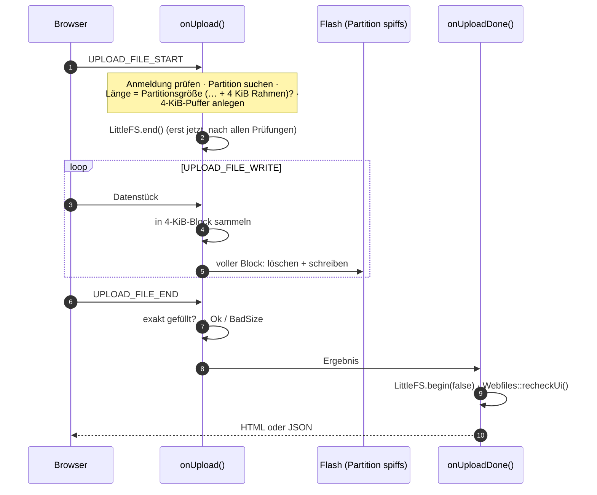

# UiUpdate – Web-Oberfläche einspielen (und Notfallseite)

**Dateien:** `src/UiUpdate.cpp`, `src/UiUpdate.h` · **Namespace:** `UiUpdate`
**Ziel:** Partition `spiffs` (LittleFS-Abbild `littlefs.bin`)

## Zweck

Zwei Aufgaben in einem Modul:

1. **Neue Oberfläche einspielen**, ohne Kabel und PlatformIO: Man lädt die Datei `littlefs.bin` hoch, und die Firmware schreibt sie
   direkt in die UI-Partition.
2. **Notfallseite**: Ist keine Oberfläche installiert oder passt sie nicht zur Firmware, wäre das Gerät sonst bedienungslos. Die
   Notfallseite steckt deshalb **fest im Firmwarecode** (kein Dateisystem nötig) und bietet genau das Hochladen einer UI an.

## Öffentliche Schnittstelle

| Funktion | Beschreibung |
|---|---|
| `void setupRoutes()` | Meldet die drei Routen an (wird von `Webfiles::setupRoutes()` aufgerufen) |
| `void sendPage()` | Schickt die Notfallseite. [Webfiles](webfiles.md) ruft sie anstelle **jeder** Seite auf, solange `uiUsable()` falsch ist |

## Routen

| Methode | Pfad | Antwort | Anmeldung |
|---|---|---|---|
| GET | `/ui-update` | Notfallseite (HTML) | keine |
| POST | `/ui-update` | HTML-Ergebnis | Passwortfeld `pw` im Formular (`Session::checkPassword`) |
| POST | `/api/update/ui` | JSON-Ergebnis | Sitzungstoken `X-Auth-Token` (`Session::isValid`) |

Beide POST-Routen teilen sich dieselben Funktionen (`onUpload` und `onUploadDone`). `isApiRequest()` prüft, ob der Pfad mit
`/api/` beginnt, und wählt Anmeldeart und Antwortformat.

Die Notfallseite hat ein Formular (Passwort, Datei, „Upload“) und einen Knopf **„Forgot password“**, der `POST /api/pwreset`
aufruft ([PasswordReset](password-reset.md)). Alle Texte sind englisch und fest im Code; Werte aus `version.json` werden mit
`escape()` maskiert, bevor sie ins HTML kommen.

## Ablauf des Uploads

Der Webserver ruft `onUpload()` für jeden Abschnitt des mehrteiligen Formulars auf, danach `onUploadDone()`.



Schutzmaßnahmen, die verhindern, dass ein falscher Upload die laufende Oberfläche zerstört:

| Prüfung | Zeitpunkt | Folge bei Misserfolg |
|---|---|---|
| Anmeldung | vor jeder Änderung | `WrongPassword` (403 für HTML, 401 für JSON) |
| Partition `spiffs` vorhanden | vor jeder Änderung | `NoPartition` (500) |
| `Content-Length` zwischen Partitionsgröße und Größe + 4096 | vor jeder Änderung | `BadSize` (400) |
| Erster Block trägt ab Byte 8 den Text `littlefs` | **vor dem ersten Löschen** | `BadImage` (400), die alte UI bleibt |
| Block würde über das Partitionsende hinausragen | beim Schreiben | `BadSize` |
| `fill == 0` und `written == Partitionsgröße` am Ende | am Ende | sonst `BadSize` |

Ein Abbild muss die Partition **genau** füllen. Deshalb nimmt das Modul `littlefs.bin` (das Build-Ergebnis von
PlatformIO), keine `.zip`-Datei und keine einzelnen HTML-Dateien.

### Ende

`onUploadDone()` gibt den Puffer frei, hängt LittleFS wieder ein (**`begin(false)`**: nie neu formatieren, damit ein
gescheiterter Upload nicht noch eine leere Oberfläche erzeugt) und liest `/version.json` neu (`Webfiles::recheckUi()`).
Klappt der Upload, aber lässt sich das Dateisystem nicht einhängen, wird das Ergebnis zu `BadImage`.

JSON-Antwort bei Erfolg:

```json
{ "ok": true, "version": "1.2.0", "compatible": true }
```

Fehler: `{"ok":false,"error":"CODE"}` mit einem der Codes:

| Code | HTTP | Bedeutung |
|---|---|---|
| `NOT_AUTHENTICATED` | 401 / 403 | Anmeldung fehlt oder falsches Passwort |
| `UI_BAD_SIZE` | 400 | Datei hat nicht die Größe der Partition |
| `UI_BAD_IMAGE` | 400 | Kein LittleFS-Abbild |
| `NO_PARTITION` | 500 | Partition nicht gefunden |
| `WRITE_FAILED` | 500 | Löschen/Schreiben fehlgeschlagen |
| `ABORTED` | 500 | Upload abgebrochen |
| `NO_FILE` | 400 | Nichts empfangen |

`compatible` sagt, ob die neu eingespielte Oberfläche zur Firmware passt ([Webfiles](webfiles.md)). Die HTML-Antwort nennt
dasselbe als Satz („The web UI x matches the firmware“ usw.).

## Besonderheiten

- **Unterbrechung ist riskant:** Zwischen dem ersten Löschen und dem letzten Schreiben ist die alte Oberfläche weg. Reißt die
  Verbindung ab, bleibt die Notfallseite – genau dafür gibt es sie.
- Der Upload braucht nur einen **4-KiB-Puffer** (per `malloc`), nicht das ganze Abbild im RAM. Daten gehen blockweise direkt in den Flash.
- Das Passwort der Notfallseite steht im Formular **vor** der Datei und ist daher schon gelesen, wenn die Datei beginnt. Die
  Reihenfolge im Formular ist deshalb wichtig.
- Der Passwortvergleich der Notfallseite nutzt `Session::checkPassword()`. Ist **kein** Passwort gesetzt, ist der Upload frei.
- Die Update-Seite ist ohne Anmeldung erreichbar (`GET /ui-update`), schützt aber das Hochladen selbst.

## Siehe auch

[FirmwareUpdate](firmware-update.md) (gleiches Muster für die Firmware) · [Webfiles](webfiles.md) · [Session](session.md) ·
[Build-System](build-system.md)
