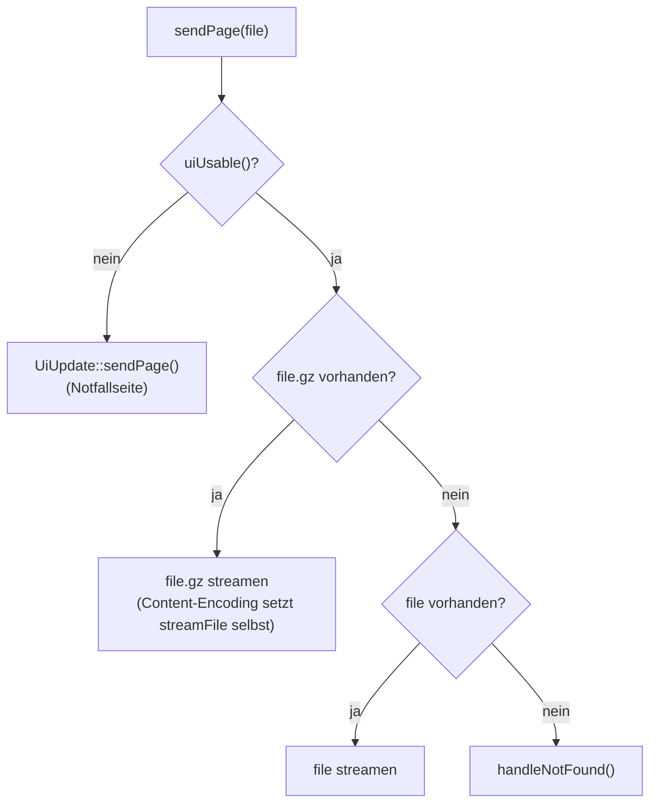

# Webfiles – Auslieferung der Web-Oberfläche

**Dateien:** `src/webfiles.cpp`, `src/webfiles.h` · **Namespace:** `Webfiles`
**Dateisystem:** LittleFS auf der Partition `spiffs` (0x12E000 Byte ≈ 1,18 MiB, siehe [Architektur](../architektur.md))

## Zweck

Die Oberfläche (HTML, CSS, JavaScript, Bilder) liegt **nicht in der Firmware**, sondern im Dateisystem. `Webfiles` liefert diese
Dateien aus und prüft, ob die dort liegende Oberfläche zur Firmware passt. Die JSON-Schnittstelle (`/api/...`) steht dagegen in
[Webinterface](webinterface.md).

Die Trennung hat einen Zweck: Oberfläche und Firmware lassen sich **getrennt aktualisieren** (`uploadfs` per PlatformIO oder
im Betrieb über [UiUpdate](ui-update.md)), und die Konfiguration überlebt beides, weil sie in einer dritten Partition (`config`) liegt.

## Öffentliche Schnittstelle

| Element | Beschreibung |
|---|---|
| `setupRoutes()` | Hängt LittleFS ein, liest `/version.json`, meldet alle Seiten- und Dateirouten an, ruft `UiUpdate::setupRoutes()` und `FirmwareUpdate::setupRoutes()` auf |
| `const UiInfo& ui()` | Angaben zur installierten Oberfläche |
| `bool uiUsable()` | `true` bei Zustand `Ok` oder `Limited`: die Seiten dürfen ausgeliefert werden |
| `recheckUi()` | Liest `/version.json` neu (nach einem UI-Update) |
| `enum class UiState { Ok, Limited, TooOld, Unknown }` | Verträglichkeit von Oberfläche und Firmware |
| `struct UiInfo` | `state`, `version`, `name`, `vendor`, `link`, `minApi`, `recommendedApi` (feste `char`-Puffer) |

## Funktionsweise

### Seitenrouten

`PAGES[]` ordnet jeder URL eine Datei zu. Alle Routen sind `GET`:

| URL | Datei |
|---|---|
| `/` | `/index.html` |
| `/login` | `/login.html` |
| `/pwreset` | `/pwreset.html` |
| `/connections` | `/connections.html` |
| `/sensors` | `/sensors.html` |
| `/sensors/bh1750` … `/sensors/ld2410` | `/sensor-bh1750.html`, `-sht41`, `-scd40`, `-aht21`, `-ens160`, `-ld2410` |
| `/sensors/ld2410/debug` | `/sensor-ld2410-debug.html` |
| `/settings` | `/settings.html` |
| `/control` | `/control.html` |

Zusätzlich liefert `serveStatic` ganze Ordner aus: `/css/`, `/js/`, `/images/`. Ein Cache-Header wird **bewusst nicht** gesetzt,
damit der Browser nach einem `uploadfs` die neue Fassung holt statt der alten.

### Dateien ausliefern (`sendFileFromFs`)



- **Vorab gepackte Seiten:** Existiert neben `index.html` auch `index.html.gz`, wird die `.gz`-Fassung gesendet; der Browser packt
  selbst aus. Der Bauschritt `scripts/build_frontend.py` erzeugt sie ([Build-System](build-system.md)).
- Die Kopfzeile `Content-Encoding: gzip` setzt `streamFile()` **selbst**, sobald der Dateiname auf `.gz` endet. Setzte man sie
  zusätzlich, stünde sie doppelt in der Antwort und der Browser meldet `ERR_CONTENT_DECODING_FAILED`.
- Der MIME-Typ ist immer `text/html` (alle Seiten sind HTML). CSS, JS und Bilder laufen über `serveStatic`, das den Typ anhand der Endung wählt.
- **Diagnose in der seriellen Konsole:** Kommt weniger an, als die Datei groß ist, gibt die Firmware
  `[Web] <pfad> ABGEBROCHEN: x von y Bytes nach … ms, RSSI …, Heap frei …` aus; dauert eine Auslieferung länger als 1 s, erscheint
  `… langsam …`. Beides hilft bei WLAN-Problemen.

### Unbekannte Pfade

`handleNotFound()` (registriert mit `ws.onNotFound`) antwortet mit `404 Not found`. Ist die Oberfläche nicht nutzbar, zeigt es
stattdessen die Notfallseite von [UiUpdate](ui-update.md). So landet man bei **jeder** beliebigen Adresse auf der Seite, über die sich
eine passende Oberfläche hochladen lässt, auch im Hotspot mit seinem Captive-Portal-DNS.

### Verträglichkeit prüfen (`checkUiVersion`)

Beim Start (und nach `recheckUi()`) wird `/version.json` aus dem Dateisystem gelesen:

```json
{
  "ui_version": "1.2.0",
  "ui_name": "default",
  "vendor": "…",
  "link": "https://…",
  "min_api_version": "0.9.0",
  "recommended_api_version": "1.0.0"
}
```

| Fall | `UiState` | Folge |
|---|---|---|
| Datei fehlt, kein gültiges JSON, `ui_version` oder `min_api_version` leer | `Unknown` | Notfallseite |
| Firmwareversion `<` `min_api_version` | `TooOld` | Notfallseite („Firmware zu alt“) |
| `min_api_version` ≤ Firmware `<` `recommended_api_version` | `Limited` | Oberfläche läuft, mit Lücken |
| Firmware ≥ `recommended_api_version` | `Ok` | alles in Ordnung |

Fehlt `recommended_api_version`, wird `min_api_version` benutzt. Der Vergleich nutzt `Version::parse(VERSION)` (Klasse `Version`
aus `Version.h`, Format `major.minor.patch`).

Der Zustand wird in `/api/dashboard` (`system.webui`) und in der MQTT-Diagnose (`ui_version`, `ui_vendor`) gemeldet.

> Das Format der Versionsprüfung macht die Oberfläche selbst zum Träger der Kompatibilitätsaussage: Sie weiß, welche
> API-Version sie mindestens braucht. Die Firmware muss nur vergleichen.

## Konfiguration

Keine. Die Seitenliste ist im Code fest eingetragen (`PAGES[]`). Eine neue Seite braucht also **zwei** Änderungen: die Datei in
`data/` und einen Eintrag in `PAGES[]`.

## Besonderheiten

- `LittleFS.begin(true)` formatiert eine nicht einhängbare Partition. Das ist unkritisch, weil dort nichts liegt, was `uploadfs`
  nicht wiederherstellt. Die Konfiguration liegt in der Partition `config` (separat, siehe [Config](config.md)).
- Der Dateisystemzugriff der Konfiguration verwendet eine **eigene** Partition; `LittleFS` in diesem Modul meint nur die UI-Partition.
- Die Reihenfolge in `setup()`: `Webfiles::setupRoutes()` muss **vor** `wlanManager.begin()` stehen, damit alle Routen beim Start des Servers bekannt sind.

## Siehe auch

[UiUpdate](ui-update.md) · [Webinterface](webinterface.md) · [WLANManager](wlan-manager.md) · [Build-System](build-system.md)
