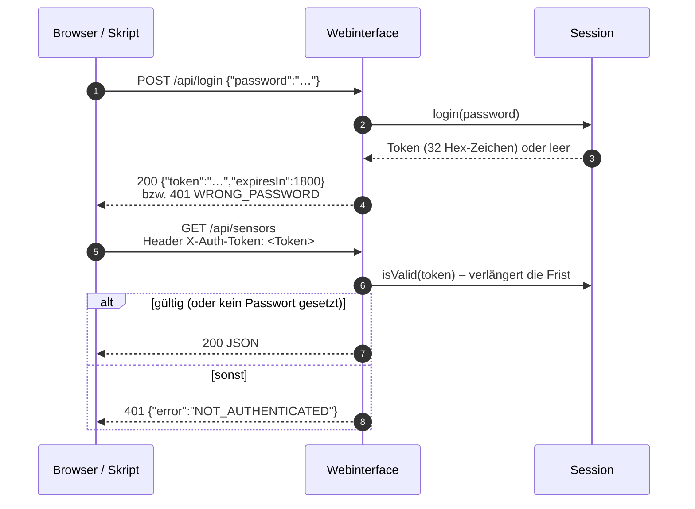
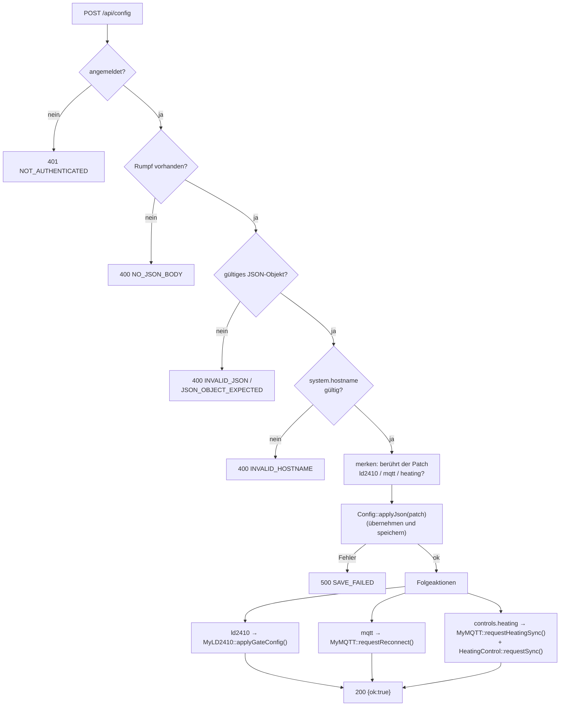

# Webinterface – REST-API

**Dateien:** `src/webinterface.cpp`, `src/webinterface.h` · **Namespace:** `Webinterface`
**Abhängig von:** [WLANManager](wlan-manager.md) (Server), [Session](session.md) (Anmeldung), fast allen Fachmodulen

## Zweck

Das Modul stellt die **JSON-Schnittstelle** bereit, über die die Web-Oberfläche (und jedes andere Werkzeug, z. B. `curl`)
das Gerät liest und einstellt. Es enthält **keine HTML-Seiten**: Die Oberfläche selbst liefert [Webfiles](webfiles.md)
aus dem Dateisystem aus. Die Handler sind dünn; die eigentliche Arbeit steckt in den Fachmodulen.

## Öffentliche Schnittstelle

Nur eine Funktion:

| Funktion | Beschreibung |
|---|---|
| `void setupWebserverRoutes()` | Meldet alle `/api/...`-Routen bei `wlanManager.addRoute()` an. Wird in `setup()` **vor** `wlanManager.begin()` aufgerufen |

Alle Handler sind `static` in anonymen Namensräumen von `webinterface.cpp`.

## Anmeldung

Die API ist durch ein **Sitzungstoken** geschützt (ausführlich in [Session](session.md)).

- Das Token wird im Kopf **`X-Auth-Token`** mitgeschickt. Der Server liest diese Kopfzeile nur, weil
  `startWebserver()` sie ausdrücklich einträgt ([WLANManager](wlan-manager.md)).
- Ist **kein Passwort gesetzt**, ist jede Anfrage gültig (`Session::isValid()` liefert dann immer `true`).
- Es gibt **ein einziges** Token. Eine neue Anmeldung ersetzt die alte Sitzung.
- Jede erfolgreiche Prüfung verlängert die Frist (Gleitfenster, Vorgabe 30 min).

`requireAuth()` ist die Torwache jedes geschützten Handlers: Fehlt die Berechtigung, sendet sie 401 und der Handler bricht ab.

## Routen

„Auth“ = erfordert gültige Sitzung. Fehler kommen als `{"error":"CODE"}`.

### Sitzung und Gerät

| Methode | Pfad | Auth | Zweck |
|---|---|---|---|
| POST | `/api/login` | nein | Passwort → Token (`401 WRONG_PASSWORD`) |
| POST | `/api/logout` | nein | Beendet die Sitzung |
| GET | `/api/session` | nein | `{authenticated, protected, expiresIn, hostname}`: ob das Gerät passwortgeschützt ist, ob diese Anfrage angemeldet ist, Restzeit in s |
| GET | `/api/info` | nein | `{systemType:"Hypha Home - Sens", hostname, firmwareVersion, webinterfaceVersion}`: damit Apps/Skripte das Gerät im Netz identifizieren können |

### Passwort-Notfallreset

| Methode | Pfad | Auth | Zweck |
|---|---|---|---|
| GET | `/api/pwreset` | nein | `{"remaining": Sekunden}` der Freigabe (0 = keine) |
| POST | `/api/pwreset` | nein | Gibt das Zurücksetzen für 5 min frei ([PasswordReset](password-reset.md)) |

Diese beiden Routen verlangen **absichtlich keine Anmeldung**, denn sie sind für jemanden gedacht, der das Passwort vergessen
hat. Der Schutz liegt darin, dass die Freigabe erst durch einen **Neustart des Geräts** wirksam wird.

### Konfiguration

| Methode | Pfad | Auth | Zweck |
|---|---|---|---|
| GET | `/api/config` | ja | Gesamte Konfiguration (`Config::toJson(root, false)`; Passwörter erscheinen **nicht** im Klartext, stattdessen `hasPassword: true/false`) plus `runtime` und `limits` |
| POST | `/api/config` | ja | Teilkonfiguration einspielen und speichern |

`GET /api/config` ergänzt die gespeicherte Konfiguration um zwei Blöcke:

- `runtime`: `totalSeconds`, `sessionSeconds`, `firstBoot` ([Runtime](runtime.md))
- `limits`: Grenzen, an denen sich die Oberfläche orientiert: `calibrationPoints`, `ld2410Gates`, `sht41SmoothingMax`,
  `ld2410MovingHoldMax`, `shellys`, `shellyChannels`, `controlOutputs`, `heatingTargetMin`, `heatingTargetMax`

**`POST /api/config`** nimmt ein JSON-Objekt im Aufbau der `config.json`, das **nur die geänderten Felder** enthalten muss
(„Patch“). Ablauf:

Das „Berührt?“ wird **vor** `applyJson()` festgestellt, weil danach nur noch die Laufzeitvariablen übrig sind.

Der Hostname wird geprüft (`hostnameValid`): ein DNS-Label aus Buchstaben, Ziffern und Bindestrichen, höchstens 63 Zeichen, nicht
mit `-` am Rand. Leer ist erlaubt und heißt „automatisch“ (`HyphaHome-Sens-<MAC>`, von `main` gesetzt).

> Änderungen am Zweig `wlan` werden gespeichert, aber **nicht** an den [WLANManager](wlan-manager.md) weitergereicht.
> Neue WLAN-Daten wirken nach einem Neustart.

### Messwerte und Zustand

| Methode | Pfad | Auth | Antwort |
|---|---|---|---|
| GET | `/api/sensors` | ja | Alle Messwerte, je Sensor `enabled`/`connected` plus Werte; außerdem `heating` und `fire` |
| GET | `/api/status` | ja | `wlan` (Zustand, SSID, RSSI, Balken, IP, MAC, Hostname) und `mqtt` (verbunden, Broker, URL, Port) |
| GET | `/api/dashboard` | ja | Alles für die Startseite in **einer** Antwort (siehe unten) |
| GET | `/api/ld2410/debug` | ja | Entwicklermodus des Radars ([MyLD2410](ld2410.md)) |
| POST | `/api/ld2410/debug` | ja | `{"action":"stop"}` oder `{"action":"reset"}` |
| POST | `/api/fire/test` | ja | Testalarm für `FIRE_TEST_S` s ([FireDetect](fire-detect.md)); `400 FIRE_NOT_AVAILABLE`, wenn nicht möglich |

**`/api/sensors`** im Überblick:

| Block | Felder |
|---|---|
| `bh1750` | `enabled`, `connected`, `lux`, `luxCalibrated` |
| `sht41` | `enabled`, `connected`, `temperature`, `temperatureCalibrated`, `humidity`, `humidityCalibrated`, `smoothing`, `temperatureSmoothed`, `humiditySmoothed`, `dewPoint` |
| `scd40` | `enabled`, `connected`, `co2`, `temperature`, `humidity`, `level` |
| `aht21` | `enabled`, `connected`, `temperature`, `humidity` |
| `ens160` | `enabled`, `connected`, `aqi`/`tvoc`/`eco2` (**`null`**, solange `aqi == 0`), `level`, `validity` |
| `ld2410` | `enabled`, `connected`, `presence`, `movingTarget/Distance/Energy`, `stationaryTarget/Distance/Energy` |
| `heating` | `enabled`, `connected`, `desired`, `actual`, `pendingMinutes` (aufgerundet, `null` ohne Wartezeit) |
| `fire` | `enabled`, `connected`, `state`, je Kanal `tvoc`/`co2`/`temperature`: `available`, `ready`, `value`, `baseline`, `rate`, `level` |

Stufen werden als **englische Schlüssel** geliefert (`great`, `good`, `medium`, `bad`, `high`, `unknown`), Betriebszustände des
ENS160 als `normal`, `warmUp`, `startUp`, `invalid`. Die Oberfläche übersetzt sie anhand ihrer Sprachdatei.

**`/api/dashboard`** bündelt, damit die Startseite mit einer Anfrage auskommt (der Server bedient nur eine Verbindung zugleich):

| Block | Inhalt |
|---|---|
| `hostname` | Gerätename |
| `sensors` | je Sensor `{enabled, connected}` |
| `wlan` | Zustand, SSID, RSSI |
| `mqtt` | `configured`, `connected`, `broker` |
| `shelly` | `used`, `max` |
| `system.heap` | `total`, `free`, `minFree`, `maxBlock` |
| `system.fs`, `system.configFs` | Belegung des UI-Dateisystems und der Konfigurationspartition |
| `system.app` | laufender Slot (`app0`/`app1`), Größe, Größe der Firmware |
| `system.otherApp` | Zustand des anderen Slots (`found`, `empty`, `unmarked`, `none`, `pending`), Größen, bei `found` zusätzlich `version`, `build`, `built`, `git` ([BuildInfo](build-info.md)) |
| `system.webui` | Zustand (`ok`, `limited`, `tooOld`, `unknown`), Version, Name, Hersteller, Link, `minApi`, `recommendedApi` ([Webfiles](webfiles.md)) |
| `system.runtime` | `totalSeconds`, `sessionSeconds`, `resetReason` |
| `system.firmware` | `version`, `build`, `built`, `git`, `sdk`, `core`, `chip`, `revision`, `cores`, `cpuMHz` |
| `system.tasks`, `system.cpuTemperature` | Anzahl FreeRTOS-Tasks; Chiptemperatur oder `null`, wenn unplausibel (außerhalb −40 … 150 °C) |

### Suchläufe (mehrstufig)

Zwei Funktionen laufen zu lang für eine einzelne Anfrage. Sie arbeiten deshalb in **Start → Abfrage**:

| Methode | Pfad | Zweck |
|---|---|---|
| POST | `/api/wifi/scan` | Startet eine WLAN-Suche (`WiFi.scanNetworks(true)`, nicht blockierend). Antwort `{"running":true}` |
| GET | `/api/wifi/scan` | Ergebnis. `{"running":true}` solange sie läuft, sonst `{"running":false,"networks":[{ssid, rssi, secure}]}` |
| POST | `/api/shelly/probe` | Startet die Erkennung eines Shelly: `{"address":"…","password":"optional"}` ([ShellyProbe](shelly.md)) |
| GET | `/api/shelly/probe` | Ergebnis (siehe [Shelly](shelly.md)); `{"running":true}`, solange er arbeitet |

Beim WLAN-Ergebnis wird je SSID nur der stärkste Zugangspunkt ausgegeben, absteigend nach Signalstärke sortiert (einfache
Auswahlsortierung; kommt ohne zusätzlichen Speicher aus). Versteckte Netze (leere SSID) fallen weg. `secure` bedeutet:
Verschlüsselung ≠ offen.

Beim Shelly-Probe gilt: Ist das Passwortfeld leer, wird das **gespeicherte Passwort derselben Adresse** benutzt („leer = unverändert“,
wie beim Speichern). Diese beiden Anfragen sind der Grund, warum der Probe in einem eigenen Task läuft: Der HTTP-Handler soll sofort
antworten.

### Wartung

| Methode | Pfad | Auth | Zweck |
|---|---|---|---|
| POST | `/api/restart` | ja | Antwort `{ok:true}`, dann Neustart |
| POST | `/api/reset` | ja | Löscht die Konfiguration (`Config::clearConfig()`, Auslieferungszustand), dann Neustart |
| POST | `/api/firmware/switch` | ja | Stellt den Start auf den **anderen** App-Slot um und startet neu. `400 NO_FIRMWARE_IN_OTHER_SLOT`, wenn dort nichts Bootfähiges liegt (Zustand muss `found` oder `unmarked` sein); `500 SWITCH_FAILED` |

`restartSoon()` ruft zuerst `Runtime::flush()` (Betriebsstunden sichern), wartet 500 ms (damit die Antwort noch hinausgeht) und startet dann.

**Nicht hier, sondern in eigenen Modulen:** `POST /api/update/firmware` ([FirmwareUpdate](firmware-update.md)),
`GET /ui-update` sowie `POST /ui-update` und `POST /api/update/ui` ([UiUpdate](ui-update.md)) und die Seiten der
Oberfläche samt „Nicht gefunden“-Behandlung ([Webfiles](webfiles.md)). Diese Module melden ihre Routen selbst an.

## Fehlerformat

Die API antwortet bei Fehlern mit `{"error":"CODE"}` und passendem Statuscode:

| Code | Status | Bedeutung |
|---|---|---|
| `WRONG_PASSWORD` | 401 | Anmeldung abgelehnt |
| `NOT_AUTHENTICATED` | 401 | Token fehlt, falsch oder abgelaufen |
| `NO_JSON_BODY`, `INVALID_JSON`, `JSON_OBJECT_EXPECTED` | 400 | Rumpf fehlt oder ist unbrauchbar |
| `INVALID_HOSTNAME` | 400 | Hostname verletzt die Regeln |
| `NO_ADDRESS` | 400 | Shelly-Probe ohne Adresse |
| `FIRE_NOT_AVAILABLE` | 400 | Testalarm nicht möglich |
| `NO_FIRMWARE_IN_OTHER_SLOT` | 400 | Umschalten nicht möglich |
| `SAVE_FAILED`, `RESET_FAILED`, `SWITCH_FAILED` | 500 | Speichern bzw. Umschalten fehlgeschlagen |

Antworten mit Messwerten tragen `Cache-Control: no-store` (`sendJson()`), damit der Browser nie veraltete Werte zeigt.

## Besonderheiten

- Der `ArduinoJson`-Speicher (`JsonDocument`) liegt jeweils auf dem Heap und wird pro Anfrage neu angelegt (ArduinoJson 7).
- Die API ist **nicht** gegen gleichzeitige Zugriffe aus mehreren Tasks gesichert: Handler laufen im WLAN-Task, lesen aber
  Variablen, die die Sensoren in `loopTask` schreiben ([Auffälligkeiten](../auffaelligkeiten.md)).
- Die Handler lesen Werte direkt aus den Namespaces (Pull-Modell); es gibt keinen Zwischenspeicher.

## Siehe auch

[Session](session.md) · [WLANManager](wlan-manager.md) · [Config](config.md) · [Architektur: Datenfluss](../architektur.md)
