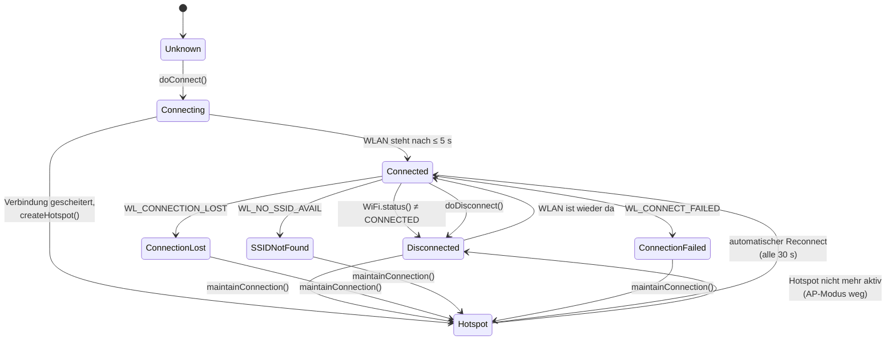
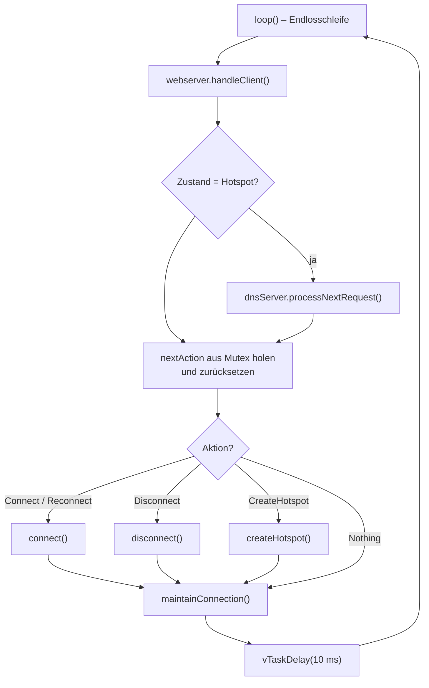
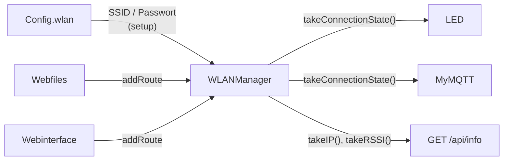

# WLANManager und FastWebServer – WLAN, Hotspot und HTTP-Server

**Dateien:** `src/libs/WLANManager/WLANManager.cpp|.h`, `src/FastWebServer.cpp|.h`
**Typen:** Klasse `WLANManager` (globale Instanz `wlanManager`), Klasse `FastWebServer : WebServer`
**Task:** `WLANMGT_loop`, Kern 1, Priorität 2, Stack 32768 Byte (Aufruf `wlanManager.begin(32768)` in `setup()`)

Diese beiden sind die einzigen Klassen der Firmware (alle anderen Module sind Namespaces). Sie gehören zusammen, weil der
`WLANManager` den Webserver **besitzt**: Der Server läuft im selben Task wie die Verbindungsverwaltung.

## Zweck

- WLAN-Verbindung herstellen, überwachen und bei Verlust selbstständig wiederherstellen.
- Wenn kein WLAN erreichbar ist, einen **Hotspot** aufspannen, damit das Gerät nie unerreichbar wird.
- Den HTTP-Server (Port 80) betreiben, auf dem [Webfiles](webfiles.md) und [Webinterface](webinterface.md) ihre Routen
  anmelden.
- Per NTP die Uhrzeit holen (Zeitzone Europe/Berlin).

## Öffentliche Schnittstelle (`WLANManager`)

### Einstellungen

| Funktion | Beschreibung |
|---|---|
| `setSSID(String)`, `setPassword(String)` | Zugangsdaten für das Heimnetz (mit Mutex geschützt) |
| `setHotspotPrefix(String)` | Namensanfang des Hotspots (`main` setzt `"HyphaHome-Sens"`) |
| `setReconnectTrys(byte)` / `getReconnectTrys()` / `getCurrentReconnects()` | Zähler für Verbindungsversuche (im Code nicht ausgewertet, siehe [Auffälligkeiten](../auffaelligkeiten.md)) |
| `setHostName(String)` / `getHostName()` | Reicht den Namen an `WiFi.setHostname()` weiter. **Wird von der Firmware nirgends aufgerufen** |
| `getSSID()`, `getHotspotPrefix()` | Lesen der gesetzten Werte |

### Aktionen (asynchron)

Die `do…()`-Funktionen führen nichts selbst aus. Sie tragen den Wunsch in `nextAction` ein; der Task arbeitet ihn im
nächsten Durchlauf ab. So kann jeder Task (z. B. die Web-Routen) sie gefahrlos aufrufen.

| Funktion | Wirkung |
|---|---|
| `doConnect()` / `doReconnect()` | Beide lösen `connect()` aus (mit den aktuell gesetzten Zugangsdaten). Aufgerufen wird nur `doConnect()` aus `setup()` |
| `doDisconnect()` | Trennt und stoppt den Server |
| `doCreateHotspot()` | Fährt den Hotspot hoch |

Jede liefert `true`, wenn der Wunsch angenommen wurde. Ist bereits eine Aktion vorgemerkt (`nextAction != Nothing`) oder ist der
Mutex nicht innerhalb von 100 ms zu bekommen, liefert sie `false` – ein zweiter Wunsch überschreibt den ersten also nicht.

### Status

| Funktion | Ergebnis |
|---|---|
| `takeConnectionState()` | `ConnectionState`, **gleicht dabei mit `WiFi.status()` ab** (siehe unten) |
| `takeIP()` | `WiFi.localIP()` bei `Connected`, `softAPIP()` bei `Hotspot`, sonst `"0.0.0.0"` |
| `takeSSID()` | Heimnetz-SSID, im Hotspot die Hotspot-SSID, sonst die konfigurierte |
| `takeRSSI()` | dBm bei `Connected`, sonst `-200` |
| `takeRSSIBars()` | 0 bis 5 Balken: > −50 → 5, > −60 → 4, > −70 → 3, > −80 → 2, sonst 1 (0 bei −200) |

### Webserver

| Funktion | Beschreibung |
|---|---|
| `addRoute(uri, handler)` | Route für alle Methoden (so die Überladung der Bibliothek, Standard `HTTP_ANY`) |
| `addRoute(uri, method, handler)` | Route für eine bestimmte Methode |
| `getWebserver()` | Referenz auf den `WebServer&` (für `ws.arg()`, `ws.send()`, `ws.header()` in den Handlern) |

## Zustände

`ConnectionState` ist ein Enum mit acht Werten: `Unknown`, `Connecting`, `Connected`, `Disconnected`,
`ConnectionLost`, `ConnectionFailed`, `SSIDNotFound`, `Hotspot`.

`takeConnectionState()` meldet nicht blind `currentState`, sondern prüft nach:

- War `Connected`, aber `WiFi.status()` ist nicht mehr `WL_CONNECTED` → je nach Statuscode `SSIDNotFound`,
  `ConnectionFailed`, `ConnectionLost` oder `Disconnected`.
- War `Disconnected`, ist aber wieder verbunden → `Connected`.
- War `Hotspot`, aber der AP-Modus ist weg → `Disconnected`.

Dieser Abgleich passiert bei **jedem Aufruf**, auch aus anderen Tasks. Dadurch zeigen LED, MQTT und API sofort den echten
Zustand, ohne dass der WLAN-Task dazwischen gelaufen sein muss.

## Funktionsweise des Tasks

Der ganze Ablauf – HTTP-Anfragen, DNS, Verbindungsaufbau – läuft **in einem Task nacheinander**. Während `connect()` bis zu 5 s
wartet, bedient das Gerät keine Web-Anfragen. Das ist hier harmlos, weil der Server dabei ohnehin gestoppt ist.

### `connect()`

1. Zustand `Connecting`, Webserver und DNS stoppen, 100 ms Pause.
2. `WiFi.disconnect(true)`, `setAutoReconnect(false)` (den Wiederaufbau übernimmt `maintainConnection()`), `mode(WIFI_STA)`.
3. **`WiFi.setSleep(false)`**: Modem-Schlaf aus. Im Schlafmodus liefert der Router Pakete nur zum Beacon aus; Browser-ACKs
   bleiben dann hängen, `WiFiClient::write()` gibt nach 10 × 1 s auf, und der Browser sieht eine abgebrochene Seite. Der
   Aufruf muss nach **jedem** `WiFi.mode()` stehen, weil der Treiber beim Neustart des Funkteils auf den Standard
   zurückfällt.
4. `WiFi.begin(ssid, password)`, danach bis zu 10 × 500 ms auf `WL_CONNECTED` warten.
5. Erfolg → Zustand `Connected`, einmalig NTP einrichten, Webserver starten.
   Misserfolg → Statuscode in den passenden Zustand übersetzen und `createHotspot()` aufrufen.

### `createHotspot()`

- SSID = `<Prefix>-<letzte 6 Hex-Zeichen der MAC>`, also z. B. `HyphaHome-Sens-A1B2C3`. Das Netz ist **offen** (kein Passwort).
- Modus **`WIFI_AP_STA`**: Der Hotspot läuft, die Station-Seite bleibt für Verbindungsversuche zum Heimnetz nutzbar.
- Feste Adresse `192.168.4.1/24`.
- Ein **DNS-Server auf Port 53** beantwortet **jede** Anfrage mit `192.168.4.1` (`dnsServer.start(53, "*", apIP)`). Damit landet jeder
  Browseraufruf im Hotspot beim Gerät („Captive Portal“-Verhalten).
- Danach Webserver starten, Zustand `Hotspot`. Schlägt `softAP()` fehl, ist der Zustand `Disconnected`.

### `maintainConnection()` – selbstheilender Betrieb

Wird in jedem Durchlauf aufgerufen und tut zwei Dinge:

1. **Verbindung verloren?** Ist der Zustand weder `Connected` noch `Hotspot`, wird sofort der Hotspot hochgefahren. Der
   Nutzer ist damit nie ausgesperrt.
2. **Hotspot aktiv und SSID bekannt?** Alle `autoReconnectIntervalMs` = **30 s** ein stiller Verbindungsversuch
   (`WiFi.begin` + bis zu 5 s warten), **ohne** den Hotspot abzubauen. Klappt er, werden DNS und Hotspot beendet
   (`softAPdisconnect`, Modus `WIFI_STA`), der Zustand wird `Connected` und NTP eingerichtet. Scheitert er, bleibt der Hotspot.

Der stille Versuch nutzt die **im Manager gespeicherten** Zugangsdaten (`ssid`, `password`). Diese werden nur in `setup()`
aus der Konfiguration übernommen. `POST /api/config` ruft `setSSID()`/`setPassword()` oder `doReconnect()` **nicht** auf. Neue
WLAN-Zugangsdaten wirken deshalb erst nach einem Neustart des Geräts (`POST /api/restart`).

> Beim stillen Versuch bleibt der Webserver ungestoppt, aber der Task blockiert bis zu 5 s. In dieser Zeit antwortet das
> Gerät im Hotspot nicht. Das ist eine bewusste Abwägung zugunsten eines einfachen Ablaufs.

### Zeit (NTP)

Beim ersten erfolgreichen Verbinden ruft das Modul `configTzTime("CET-1CEST,M3.5.0,M10.5.0/3", "de.pool.ntp.org", "pool.ntp.org")`
auf. Das ist die Zeitzone Europe/Berlin mit Sommerzeit-Umschaltung (zuletzt-Sonntag im März 02:00, im Oktober 03:00).
Im Quelltext wertet derzeit nichts die Uhrzeit aus (kein `getLocalTime`/`time()`); [Session](session.md) und
[PasswordReset](password-reset.md) rechnen mit `millis()`. Die Einrichtung dient also nur der Systemzeit des ESP.

## Webserver

`startWebserver()` trägt vor `begin()` zwei Kopfzeilen ein, die der Server mitliest: `User-Agent` und **`X-Auth-Token`**. Der
Arduino-`WebServer` wirft alle anderen Kopfzeilen beim Einlesen weg; ohne diese Eintragung gäbe es keine
Token-Anmeldung der API ([Session](session.md)).

Die Routen werden **vor** `begin()` über `addRoute()` angemeldet (`Webfiles::setupRoutes()` und
`Webinterface::setupWebserverRoutes()` in `setup()`). Der Server wird bei jedem `connect()`/`createHotspot()` gestoppt und
neu gestartet; die Routen bleiben dabei erhalten.

### FastWebServer

Der Arduino-`WebServer` bedient immer nur **eine** TCP-Verbindung zugleich. `lwip_accept()` liefert eine Verbindung schon, sobald der
TCP-Handshake steht – bevor ein Byte der Anfrage da ist. Kommt dann nichts, hält `handleClient()` diese stumme Verbindung bis
`HTTP_MAX_DATA_WAIT` = **5000 ms** fest und nimmt niemand sonst an. Browser öffnen Verbindungen auf Vorrat (jede Antwort der
Bibliothek trägt `Connection: close`), also trifft das regelmäßig zu. Gemessen am 10.10.2026: Seitenaufbau 15,9 s,
einzelne Anfragen 4,5 bis 5,4 s, manche gescheitert.

`FastWebServer` erbt von `WebServer` und überschreibt **nur `handleClient()`**. Die Logik ist die der Bibliothek (Arduino-Core
2.0.17), mit einer einzigen Abweichung:

| | Bibliothek | `FastWebServer` |
|---|---|---|
| Wartezeit auf die Anfragedaten im Zustand `HC_WAIT_READ` | `HTTP_MAX_DATA_WAIT` = 5000 ms | `FAST_WEBSERVER_DATA_WAIT_MS` = **250 ms** |

Ist der Wert zu knapp, wird die Verbindung geschlossen, der Browser baut sie neu auf – ein Versuch mehr, nichts geht verloren.

Was damit **nicht** behoben ist: Verbindungen werden weiterhin nacheinander bedient. Echte Nebenläufigkeit (z. B.
Server-Sent Events statt Polling) würde einen Wechsel auf `ESPAsyncWebServer` erfordern; dann entfiele die Klasse.

`getWebserver()` liefert weiter eine `WebServer&`, für alle Aufrufer ändert sich nichts.

## Zusammenspiel

| Verbraucher | Nutzung |
|---|---|
| [main](main.md) | Zugangsdaten setzen, Task starten, `doConnect()`, Statuszeile in `loop()` |
| [Webinterface](webinterface.md) | Routen; WLAN-Block in `/api/status` und `/api/dashboard` (Zustand, SSID, RSSI, IP) |
| [Webfiles](webfiles.md) | Routen für die statischen Dateien |
| [MyMQTT](mqtt.md) | verbindet nur im Zustand `Connected`; RSSI als Diagnosewert |
| [LED](led.md) | Zustand `Hotspot` / `Connected` / sonst |

## Besonderheiten

- **Mutex** (`Mutex`, 100-ms-Timeout) schützt `nextAction`, `currentState` und die Setter. Die Getter `getSSID()` usw. lesen ohne Mutex.
- **Hostname und mDNS**: Ein Kommentar in `Webinterface` spricht von „mDNS“, im Quelltext wird aber weder `MDNS.begin()` aufgerufen noch der Hostname angewendet. Die Firmware belegt `Config::system.hostname` (Standard `HyphaHome-Sens-<MAC>`), ruft aber `setHostName()` nie auf.
  Der Name erscheint in Web-UI und MQTT, nicht als DHCP-/mDNS-Name. Details in [Auffälligkeiten](../auffaelligkeiten.md).
- Die Variable `timeInit` aus dem Header wird in `connect()` und `maintainConnection()` jeweils durch eine **lokale
  `static`-Variable gleichen Namens** verdeckt. Funktional egal, aber die NTP-Einrichtung läuft dadurch höchstens je einmal
  pro Funktion statt insgesamt einmal.
- Der Konstruktor legt den Webserver auf Port 80 fest (`webserver(80)`); der Port ist nicht konfigurierbar.

## Siehe auch

[Architektur: Systemkontext](../architektur.md) · [Webinterface](webinterface.md) · [Session](session.md) · [LED](led.md)
