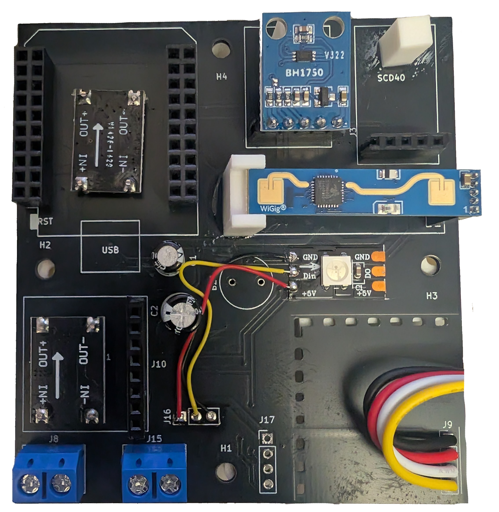
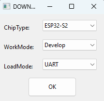
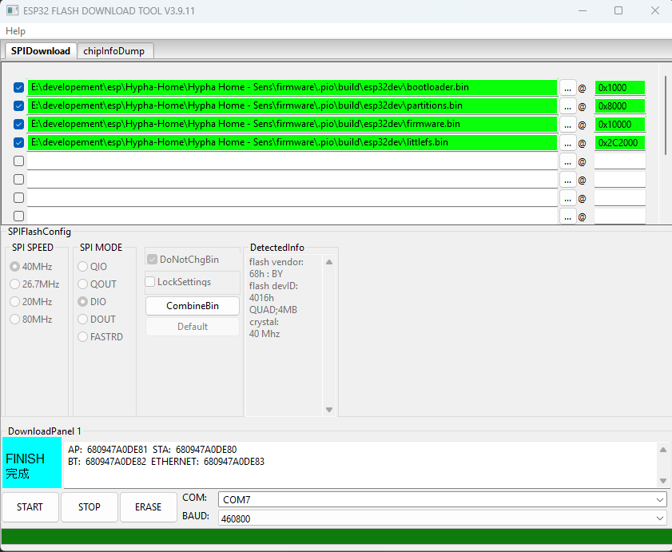

# Der Aufbau in kürze
## Die Platine

> **WARNUNG**
> Diese Platine Rev.1 wird nicht zum Nachbau empfohlen! 
> Sie hat einige Mängel. Also wer das Projekt gerne mal testen will, der kann mit der Platine durchaus anfangen. Aber für den Produktiven einsatz empfehle ich selber eine neue zu erstellen oder auf Version 2 zu warten. Ich würde mich freuen, wenn jemand ein neues Design der allgemeinheit zur verfügung stellt. 

Die Platine kann z.B. auf [JLPCB](https://jlcpcb.com/) bestellt werden. Die Kosten für 5 Platinen inkl. Versand (Euro-Paket) liegen bei etwa 14€.

## Stückliste / Beschaffung
Die meisten Teile die ihr braucht (zzgl. der Platine) könnt ihr bei Ali Express beschaffen. Ich habe damit gute Erfahrung gemacht. Ihr könnt diese Bauteile natürlich auch wo anders erwerben Dies sind nur Beispiel

| Bauteil | Anzahl | Preis | Link | Ali Version |
| - | - | - | - | - |
| ESP32 D1-Mini | 1 | 6,19€ | [Link](https://de.aliexpress.com/item/1005006629784548.html?spm=a2g0o.productlist.main.9.23f51e80AEt3Fe&algo_pvid=a7189715-89be-4161-a23f-393aca16be9e&algo_exp_id=a7189715-89be-4161-a23f-393aca16be9e-8&pdp_ext_f=%7B%22order%22%3A%221590%22%2C%22spu_best_type%22%3A%22price%22%2C%22eval%22%3A%221%22%2C%22fromPage%22%3A%22search%22%7D&pdp_npi=6%40dis%21EUR%216.19%216.19%21%21%2145.25%2145.25%21%402161390617930455184213256e0e40%2112000058133419125%21sea%21DE%212614412079%21X%211%210%21n_tag%3A-29919%3Bd%3A1d3e7e8b%3Bm03_new_user%3A-29895&curPageLogUid=DZMwuCNTEEAo&utparam-url=scene%3Asearch%7Cquery_from%3A%7Cx_object_id%3A1005006629784548%7C_p_origin_prod%3A) | CP2102 Type-C |
| LD2410 | 1 | 7,19€ | [Link](https://de.aliexpress.com/item/1005009280307944.html?spm=a2g0o.order_list.order_list_main.5.470d18028ZDlZ2&gatewayAdapt=glo2deu) | HLK-LD2410B module |
| SCD41 | 1 | 16,79€ | [Link](https://de.aliexpress.com/item/1005009316835305.html?spm=a2g0o.order_list.order_list_main.11.470d18028ZDlZ2&gatewayAdapt=glo2deu) | SCD41 Blue plate |
| Step-Down 3.3V | 1 | 1,89€ | [Link](https://de.aliexpress.com/item/1005010311256340.html?spm=a2g0o.order_list.order_list_main.17.470d18028ZDlZ2&gatewayAdapt=glo2deu) | DC 5-30V, DC 5V |
| Step-Down 5V | 1 | 1,89€ | [Link](https://de.aliexpress.com/item/1005010311256340.html?spm=a2g0o.order_list.order_list_main.23.470d18028ZDlZ2&gatewayAdapt=glo2deu) | DC 5-30V, DC 3.3V |
| ENS160+AHT21 | 1 | 6,19€ | [Link](https://de.aliexpress.com/item/1005004761725413.html?spm=a2g0o.order_list.order_list_main.29.470d18028ZDlZ2&gatewayAdapt=glo2deu) | - |
| BH1750 | 1 | 0,78€ | [Link](https://de.aliexpress.com/item/1005006600344653.html?spm=a2g0o.order_list.order_list_main.35.470d18028ZDlZ2&gatewayAdapt=glo2deu) | GY-302 |
| SHT41 | 1 | 3,55€ | [Link](https://de.aliexpress.com/item/1005011657455854.html?spm=a2g0o.order_list.order_list_main.41.470d18028ZDlZ2&gatewayAdapt=glo2deu) | SHT41 |

Ich muss aber ehrlich sein, ihr braucht noch mehr Teile. Da wären z.B. pinheader(Stiftleisten/Buchsenleisten) wenn ihr keine vorrätig habt. Ich verlinke euch hier einmal einige Bauteile die ihr euch bestellen könnt/solltet weil ihr sie brauchen werdet.

| Bauteil | Preis | Link | Grund | Reicht für X Platinen | Kosten pro Platine |
| - | - | - | - | - | - |
| 2x10 Buchsenleiste | 12,69€ | [Link](https://www.amazon.de/dp/B07H9QPHKV?ref=ppx_yo2ov_dt_b_fed_asin_title) | Speziell für den ESP32 | 25 | 0,51 |
| Set mit Buchsenleisten | 9,99€ | [Link](https://www.amazon.de/dp/B07Q1XBGFB?ref=ppx_yo2ov_dt_b_fed_asin_title) | Für die Sensoren. Deckt (abgesehen vom 5-Pin) alle Größen ab die benötigt werden. | 20 | 0,50 |
| Set Stift- und Buchsenleisten 40-Pin | 6,99€ | [Link](https://www.amazon.de/dp/B0DRCL1MZ3?ref=ppx_yo2ov_dt_b_fed_asin_title) | Wenn irgendwo mal was fehlt | 25 | 0,28 |
| 1,27mm 5-Pol Stift- Buchsenleiste | 12,99€ | [Link](https://www.amazon.de/dp/B0D5XXGDYK?ref=ppx_yo2ov_dt_b_fed_asin_title) | Für den LD2410 | 16* | 0,82 |
| Set Kondensatoren | 10,99€ | [Link](https://www.amazon.de/dp/B0C1VBXCQM?ref=ppx_yo2ov_dt_b_fed_asin_title) | Ich habe einen Sensor ohne Kondensatoren gebaut, funktioniert auch wunderbar! Ist also eher Optional.  | 20 | 0,55 |
| Aktiver Buzzer | 6,99 | [Link](https://www.amazon.de/dp/B0DGD4YJ1P?ref=ppx_yo2ov_dt_b_fed_asin_title) | Leider nicht für Platine Rev.1 geeignet, ist aber in Zukunft vorgesehen | 20 | 0,35 |
| Magneten | 8,99€ | [Link](https://www.amazon.de/dp/B0DRNQRWRV?ref=ppx_yo2ov_dt_b_fed_asin_title) | Für das Gehäuse | 45 | 0,05 |
| Schraubklemmen 5mm | 8,99 | [Link](https://www.amazon.de/dp/B0FN6M628B?ref=ppx_yo2ov_dt_b_fed_asin_title) | Zur Stromversorgung an die Platine | 60 | 0,15 |
| JST 2.54 | 7,99€ | [Link](https://www.amazon.de/dp/B0CBWZNP6Z?ref=ppx_yo2ov_dt_b_fed_asin_title) | Ich fand die sehr hilfreich den SHT41 welcher sich außerhalb des Gehäuses befindet, anzubinden. Meine Methode war sehr Plump, das geht aber besser. | 25 | 0,32 |
| M3x4mm Zylindewrschraube | 4,79 | [Link](https://www.amazon.de/dp/B0GF1TD157?ref=ppx_yo2ov_dt_b_fed_asin_title) | Zum befestigen der Platine am Gehäuse | 25 | 0,19 |
| Geräteschrauben | 6,29€ | [Link](https://www.amazon.de/dp/B0D1CJZYS6?ref=ppx_yo2ov_dt_b_fed_asin_title) | Zum befestigen des Gehäuses an einer Unterputzdose | 50 | 0,13 |
| JST SM 2,5 | 10,99 | [Link](https://www.amazon.de/dp/B07QM13SRX?ref=ppx_yo2ov_dt_b_fed_asin_title) | Für die Stromversorgung | 25-50 | 0,22-0,44 |

\* Für den LD2410 habe ich 3 Buchsenleisten übereinander verwendet. Die passen gut zusammen und wackeln nicht. Das bewirkt, dass der Sensor über den anderen bauteilen liegt und der Abstrahlwinkel wird verbessert! Dann reicht so ein Set aber nur für 16 Sensoren.

Insgesamt kann man für eine voll bestückte Platine etwa **50€** rechnen.

## Der Zusammenbau
Die Platine lässt sich mit den Sensoren ganz individuell gestallten. Wer z.B. keinen CO2 Sensor möchte, lässt ihn einfach weg. Was wirklich notwendig ist, sind die Spannugswandler, der ESP32 und wenigstens ein Sensor.

Ich verlöte zunächst die Buchsenleisten auf der Platine und auf den Sensoren. Einige Sensoren haben bereits eine Stiftleiste. Danach nehme ich mir die Spannugswandler vor. Dazu schneide ich mit von dem Set mit Stiftleisten einzelne ab stecke diese in die Löcher für die Spannungswandler und lege die Spannungswandler falschrum auf das Board. Da die Spannungswandler eig. auf der Unterseite geplant waren, müssen sie entweder dort, oder falschrum auf der Oberseite montiert werden. Man kann nun die Stifte auf dem Spannungswandler verlöten und dann an der Platine.

Auf dem Bild sieht man die Spannungswandler links bei denen die Unterseite nach oben zeigt.

>Wer die Platine mit USB statt mit 12V/14V betreiben will, kann dies auch machen indem man den Spannungswandler unten links weglässt und dafür dann J4 mit J5 verbindet. Dann kann man einfach 5V oder ein USB Gerät verwenden um das Board zu betreiben

## ESP32 beschreiben
### Unter Windows
Zum erstmaligen beschrieben des ESP32 verwendet ihr unter Windows einfach [Flash Download Tool](https://www.espressif.com/en/support/download/other-tools). Wenn das runtergeladen ist, einfach die exe starten. Es erscheint folgendes Fenster:

Wichtig ist, dass ihr "ESP32" auswählt. Nicht "ESP32-S2" oder so. Dann Develop und UART. Das passt.

Ihr ladet euch ebenfalls aus diesem Projekt ein Release (egal welches) runter und entpackt dieses. Dort findet ihr 4 *.bin Dateien. Diese müssen wie auf dem Screenshot zu sehen eingebunden werden. Auch die Adressen rechts neben dem @ müssen exakt stimmen!
Dann wählt ihr unten noch den passen COM und die Baudrate aus und ihr könnt den Chip mit Start beschreiben. 

Nach dem beschreiben befindet sich der ESP32 30sek. lang in einem Schwebezustand. In diesen 30sek. könnt ihr den ESP32 abziehen und auf das Board stecken. Wenn alle gewünschten Sensoren angesteckt sind, kann das Board mit Strom versorgt werden. Der ESP wird nach 30sek. beginnen die Sensoren zu suchen und einzurichten. Danach ist die Anlernphase abgeschlossen.

## Ersteinrichtung
Wenn der ESP ganz frisch ist, spannt er ein WLAN auf "HyphaHome-Sens-[MAC]". Ihr könnt euch mit diesem WLAN verbinden und dort euche korrekten WLAN Einstellungen vornehmen. Danach startet der ESP einmal neu und versucht sich mit dem WLAN zu verbinden. Wenn das nicht gelingt, wird er erneut den Hotspot eröffnen. 